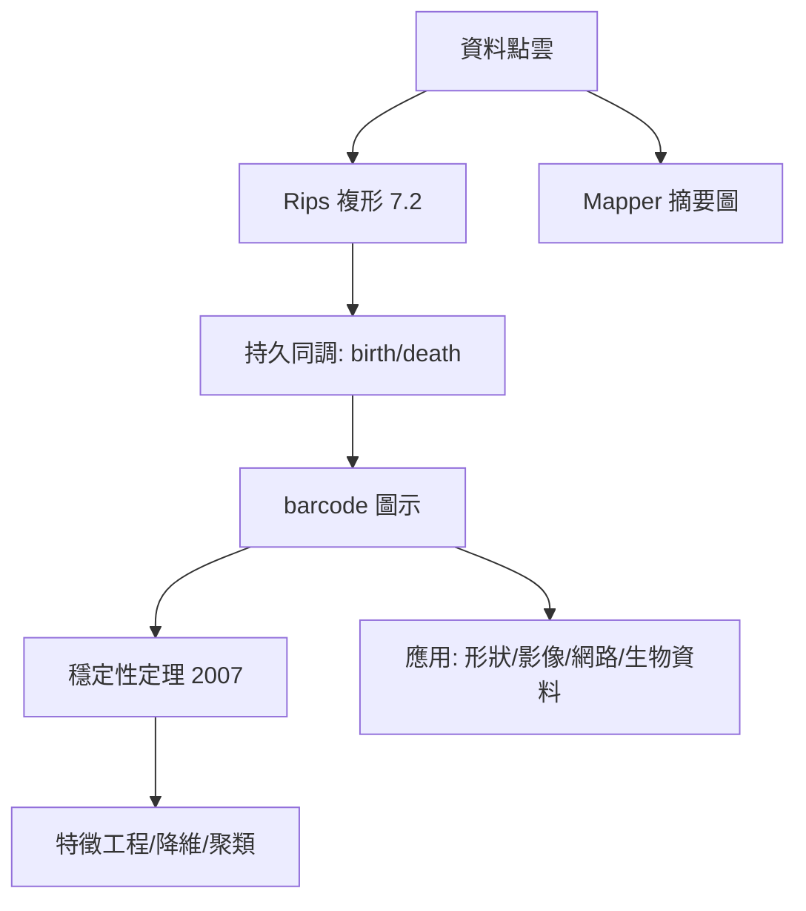

# 13.2 幾何數據分析（TDA）：數據的拓撲幾何結構

## 前因：資料有「形狀」嗎？

傳統統計問「資料的平均值與變異數」；TDA（Carlsson、Edelsbrunner 等，2000s）問「**資料的形狀**」：有幾個連通分量？幾個環？幾個空腔？這些特徵在雜訊與座標變換下穩定——正是 2.2/7.2 拓撲不變量的資料版。

## 構造

**核心方法**：

1. **點雲 → 單純複形**：給每點半徑 $\epsilon$ 的球，重疊則連邊、成面——Vietoris–Rips 或 Čech 複形（7.2 的單純同調登場）。
2. **持久同調（persistent homology）**：讓 $\epsilon$ 從 0 增大到 $\infty$，記錄每個同調類的「出生」與「死亡」：

$$\epsilon_{birth} \to \epsilon_{death} \quad \Rightarrow \quad \text{barcode / persistence diagram}$$

**活得久的特徵是訊號，短命的是雜訊**——把「拓撲不變量」變成「隨尺度穩定的特徵」。

3. **穩定性定理**（Cohen-Steiner–Edelsbrunner–Harer, 2007）：資料微小擾動 → 圖示的 bottleneck 距離微小——**TDA 有自己的誤差理論**，這是它成為科學的關鍵。
4. **Mapper**：用濾波函數 + 聚類構建資料的「拓撲摘要圖」。

## 後果

1. **應用實績**：乳腺腫瘤亞型分類（Nicolau et al., 2011，Mapper 發現存活曲線不同的亞群）、材料孔隙結構、腦網路、音樂形態。
2. **理論回流**：持久同調反哺純數學（持久景觀的統計、隨機複形、與 4.4 高維集中的結合）。
3. **與 AI 的結合**：拓撲正則化、拓撲損失、解釋神經網路的表徵幾何。
4. **本書觀點**：TDA 是 7.2「同調 = 線性代數」的直接工程化——**一百年的純理論在資料時代變成演算法**，完美演示本書「抽象的滯後紅利」。

## 練習與思考

1. 對圓上均勻取 50 點畫出 $H_1$ barcode：一個長條（出生在中等 $\epsilon$）。
2. 為什麼需要「穩定性定理」而「算出同調」不夠？
