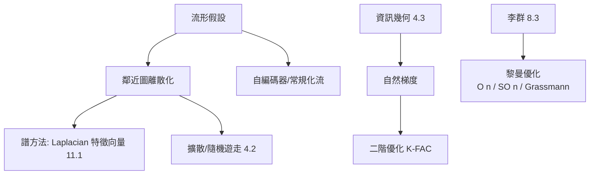

# 13.3 機器學習中的微分幾何與優化：流形學習與流形上的梯度下降

## 前因：資料住在彎曲的世界裡

高維資料（影像、語音、基因）的有效維度遠低於表面維度——**流形假設**：資料集中在一個（未知的）低維流形附近（2.3 的直接應用）。同時，訓練模型本身是優化問題，而優化地形也常是彎曲的。微分幾何因此同時從「資料側」與「演算法側」進入機器學習。

## 構造

### A. 資料側：流形學習

假設高維點 $\{x_i\} \subset \mathbb{R}^D$ 由低維座標 $z_i \in \mathbb{R}^d$ 經嵌入 $F$ 生成。目標：反演 $F$。

| 方法 | 幾何思想 |
|---|---|
| Isomap（2000） | 測地線距離（沿流形的最短路）+ MDS |
| LLE / Laplacian Eigenmaps（2001–03） | 鄰域圖的譜（11.1 的圖 Laplacian！） |
| t-SNE / UMAP | 機率化鄰域 + KL 散度（4.3）優化 |
| 擴散映射 | 圖上的隨機遊走（4.2）的特徵函數 |

**共同核心**：把「流形」離散化為**鄰近圖**，然後用譜理論（11.1）與熱方程（12.1）求嵌入。

### B. 演算法側：流形上的優化

1. **黎曼梯度下降**：若參數天然住在流形上（正交矩陣 $\in \mathrm{O}(n)$、秩固定矩陣、機率單體 4.3），用流形梯度：

$$\tilde\nabla f = \nabla f - \langle \nabla f, n\rangle n \quad (\text{切空間投影})$$

2. **自然梯度**（Amari, 1998；4.3 資訊幾何）：參數空間配上 Fisher 度量，$\tilde\nabla f = g^{-1}\nabla f$——在分佈空間中走「幾何上真正最陡」的方向；K-FAC 等二階方法是其大規模近似。
3. **深度學習的損失地形**：過參數化使極小點連成（近）流形；隱式偏差（gradient flow 偏好最小範數解）= 動態系統（3.3）觀點。

## 後果

1. **理論統一**：降維、聚類、嵌入共用「圖 + Laplacian 譜」——11.1 譜理論的資料版。
2. **工程實效**：黎曼優化在 PCA、協方差分類、Transformer 注意力的正交參數化中落地。
3. **生成模型**：normalizing flows、擴散模型把「資料流形 ↔ 噪音空間」的幾何變換變成顯式模型。
4. **本書觀點**：這是四大柱石在應用端的大合流——機率（4）、幾何（2、8、11、12）、代數（矩陣流形）、分析（優化動力學）同時在場。

## 練習與思考

1. 解釋 Laplacian Eigenmaps 為何偏好把相連點嵌入到相近位置（提示：Rayleigh 商最小化，11.1）。
2. 為什麼自然梯度「座標不變」？聯想 4.3 的 Fisher 度量與 2.1 的不變量原則。
