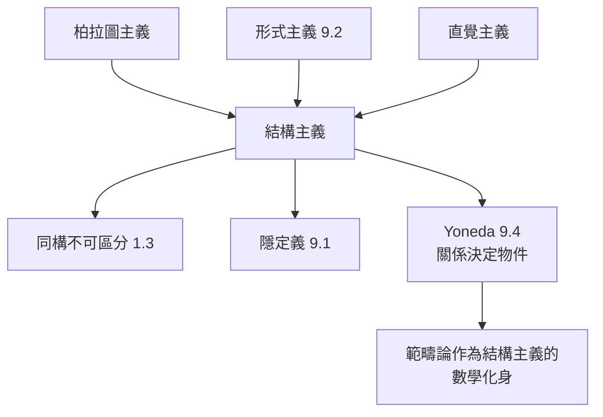

# 14.1 結構主義哲學：數學物件是由其相互關係決定的嗎？

## 前因：三種立場的百年對峙

數學物件「是」什麼？三大傳統立場：

| 立場 | 主張 | 困難 |
|---|---|---|
| 柏拉圖主義 | 物件獨立存在於抽象世界 | 那個世界在哪？我們如何「看見」？ |
| 形式主義 | 物件 = 符號與規則（9.2） | 為何符號遊戲能描寫世界？ |
| 直覺主義/建構主義 | 物件由可構造性定義 | 排除大量有用數學（非構造證明） |

20 世紀數學實踐（1.3 隱定義、9.1 公理化、9.3 Yoneda）指向第四條路：**結構主義**。

## 構造：結構主義的論證

**核心主張**：數學物件沒有「內在本質」，只有**結構位置**。 $3$ 不是某個神秘實體，而是「自然數結構中的第三個位置」； $S_3$ 是「任意三元素集的置換結構」。

**數學內部的三個支持證據**（本書前文的回響）：

1. **同構的不可區分性**（1.3）： $G \cong H$ 時任何群論性質皆同——「本質」無處安放。
2. **Hilbert 隱定義**（9.1）：點線面可換成桌子椅子啤酒杯——物件 = 滿足公理的角色。
3. **Yoneda 引理**（9.4）：物件由它與所有物件的關係完全決定——**「關係決定物件」被證明為範疇論定理**。

**Benacerraf 論證（1965）**： $3$ 可以是 $\{\{\emptyset\}\}$ ，也可以是 $\{0,1,2\}$ ，也可以是任何「三」的表示——**沒有一個是「真正的」3**；結論：數不是集合，而是結構中的位置。

**哲學版的 Gelfand 對偶（6.2）**：空間由函數環決定 $\leftrightarrow$ 物件由關係網決定——結構主義不只是哲學品味，而是數學方法論的普遍化。

## 後果

1. **範疇論作為結構主義的形式語言**（9.3–9.4）：物件不重要、態射才重要。
2. **不變量思想的哲學化**：數學追求的「真理」= 結構的必然關係（Erlangen 的「不變量」哲學推廣到全部數學）。
3. **教育含義**：學數學 = 學結構關係，而非背誦物件清單——本書的教學立場。
4. **殘留難題**：「多個同構複本哪個都行」導致基底問題（Benacerraf 的第二難題：結構主義如何談知識的因果接觸？）——開放於 14.2。

## 練習與思考

1. 用 Yoneda 引理重述「數字 3 由其在加法結構中的角色定義」。
2. 結構主義如何回應「那麼『自然數結構』本身存在嗎？」（比較：範疇論中的骨架與普遍物件。）
