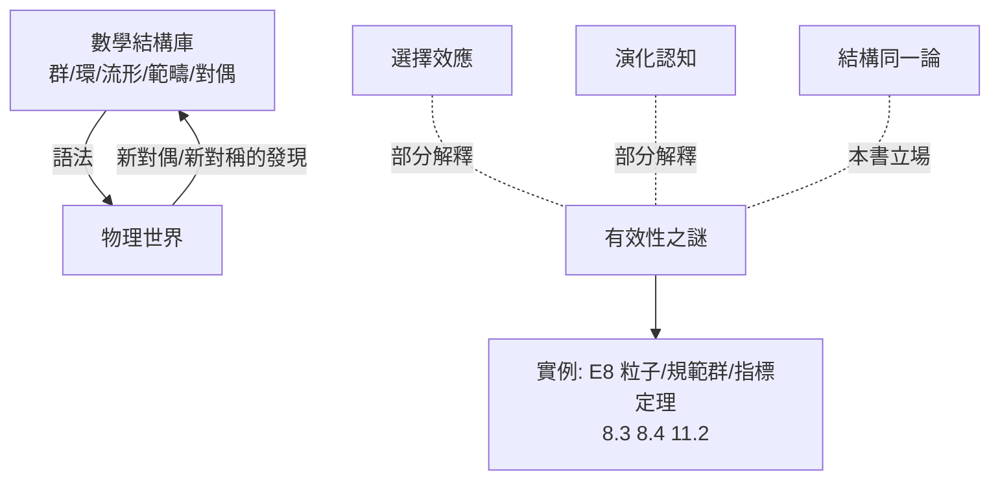

# 14.2 數學不可思議的有效性：為何抽象結構能預測物理世界？（1960）

## 前因：Wigner 的謎題

物理學家 Wigner（1960）提出著名論文《數學在自然科學中不可思議的有效性》：

- 複數（為解三次方程發明）成為量子力學的必需語言；
- 李群（8.3，純粹的連續對稱分類）精確預言基本粒子（Gell-Mann 用 $\mathrm{SU}(3)$ 十重態預言 $\Omega^-$ 粒子，1962 預言、1964 被發現）；
- 黎曼幾何（2.1，純思辨）正是廣義相對論的語言；
- 纖維叢與示性類（8.4）精確描述規範場的磁單極量子化；
- 甚至 Langlands 綱領的幾何端（10.4）出現在規範理論中。

**謎題**：為什麼為內部審美而生的抽象結構，屢屢精確命中物理現實？

## 構造：四種解釋路線

1. **選擇效應（Hamming）**：我們只注意到成功的數學；失敗的物理數學被遺忘。解釋力：部分。
2. **演化認知**：數學直觀來自對物理世界的適應（空間、數量、因果）——數學「貼近」物理理所當然。但難解釋極度抽象的 $E_8$、非交換幾何為何也有效。
3. **結構同一論（結構主義的回答）**：物理世界本身是**結構的**（對稱、守恆、對偶）；數學是「一切可能結構」的探索。**不是數學預言物理，而是物理必然是某種結構，而數學已備妥所有結構的目錄**——本書的立場傾向。證據：物理定律的骨幹（對稱群、上同調、度量、譜）恰是數學的不變量層（8.1、8.4、11.1）。
4. **對偶作為橋樑**：物理對偶（10.4）= 數學對偶（6、9 章）。當兩門學科共享「對偶文法」，一邊的直覺可以合法地遷移到另一邊——這解釋了「有效性」的**方向性**：數學提供的是語法，物理提供語義。

## 後果

1. **數學物理成為正式學科**：指標定理、鏡像對稱、Seiberg–Witten——第 8–12 章的諸多突破是雙向輸送的果實。
2. **綱領的物理回饋**：Erlangen（8.4 規範場論）、Langlands（10.4）皆有物理化身——「綱領有效」的極端證據。
3. **AI 時代的新問法**（14.3）：如果抽象結構天然「貼近」世界，機器學習結構應能加速科學發現。
4. **謙遜的結論**：有效性之謎仍未完全解開；但本書的路線圖——**結構、對偶、綱領**——至少把它從神秘主義轉化為可研究的數學史與數學社會學問題。

## 練習與思考

1. 用 8.4 的規範原理說明「物理定律由對稱決定」的具體機制。
2. 比較「選擇效應」與「結構同一論」對 E8 預言 Ω⁻ 粒子案例的解釋力。
