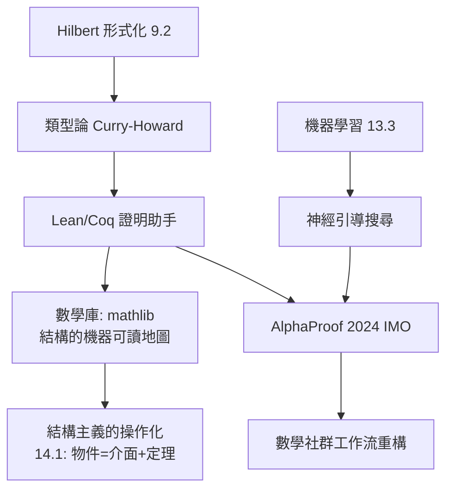

# 14.3 AI 與數學結構的未來：自動定理證明與範疇論架構

## 前因：形式化的第二次生命

9.2 的 Hilbert Program 在 1931 年受挫，但「形式化」的技術存活下來。21 世紀，兩股力量讓它復活：

1. **證明助手**：Coq（1989–）、Lean（2013–）、Isabelle——用類型論（Curry–Howard 對應：**命題 = 類型、證明 = 程式**）讓電腦檢驗證明。里程碑：四色定理（2005, Coq）、Feit–Thompson 定理（2012）、液體張量實驗（Liquid Tensor Experiment, 2020–22, Lean——正是驗證 Clausen–Scholze 的**導出幾何/凝聚態數學**證明，直接連到本書 6.3、9.4 的範疇傳統）。
2. **AI**：機器學習在數學中的進場——猜測結構、引導搜尋、發現反例。

## 構造

### A. 形式化的數學地基（本書語言的總復習）

| 形式化元件 | 本書出處 |
|---|---|
| 依賴類型論（Martin-Löf） | 9.1 公理化 → 9.3 範疇論 |
| Curry–Howard 對應 | 9.4 態射 = 函數；證明 = 構造 |
| Topos 與高階範疇 | 9.3、6.3 概形 |
| 同倫類型論（HoTT, 2013） | 7.1 同倫成為邏輯基礎：「恆等 = 路徑」 |

### B. AI 參與數學的三種模式

1. **猜測引擎**：機器學習在 Knot 數據集上發現新不變量相關性（2021，DeepMind–Mathematicians 合作）；表示論中的超參數猜測。
2. **搜尋加速**：AlphaProof / AlphaGeometry（2024）達到 IMO 銀牌水準——神經網路引導 Lean 中的形式搜尋；GPT 型模型輔助構造反例。
3. **結構發現**：在 Langlands 式的大對應中，AI 幫忙「對表」——尋找兩端資料的匹配規律（10.1 的方法論縮影）。

### C. 範疇論架構的未來角色

- **結構即介面**：範疇論把數學寫成「API」——mathlib 的組織哲學正是「普遍性質先行」（9.4）。
- **對偶的可計算化**：Langlands、鏡像對稱這類大對應，其機器驗證需要高階範疇與 $\infty$ -群胚（HoTT 正在做）。
- **本書的展望**：三大綱領（8、9、10 章）描述了數學如何自我統一；AI + 形式化可能使統一**可執行**——結構、對偶、綱領從論文中的隱喻變成機器可驗證的工作流。

## 後果與開放問題

1. 數學知識的載體變化：論文 → 庫（mathlib）+ 可執行證明。
2. 認識論問題：AI「發現」的關聯需要結構化解釋——本書的結構主義（14.1）與對偶觀（6、9 章）正是解釋語言。
3. 開放問題：機器能否理解**綱領**（而不只是定理）？這是數學統一故事在 21 世紀的續章。

## 練習與思考

1. 解釋 Curry–Howard 對應如何使「證明」成為可執行的構造（聯想 9.4 的構造性視角）。
2. 為什麼 HoTT 中「恆等 = 同倫路徑」是範疇論（9.3）與代數拓撲（7.1）的合流？
