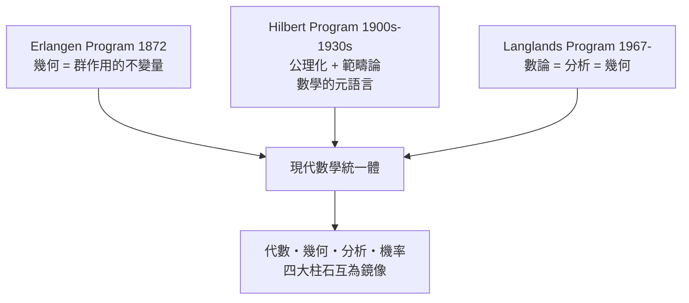

# 數學的骨骼與靈魂：現代數學的整體結構與大統一綱領

* The Structure and Unity of Mathematics

本書不以「知識點羅列」的方式介紹數學分支，而是以**結構（Structures）、對偶（Dualities）與綱領（Programs）**三條主軸，展示代數、幾何、分析、機率統計如何透過幾個宏觀框架（Erlangen Program、Hilbert Program、Langlands Program、範疇論與泛函分析）交織成一座統一體。

## 目錄

* 前言
    * [0.1-數學的分與合](00.1-數學的分與合.md)
    * [0.2-本書的視角-結構對偶與綱領](00.2-本書的視角-結構對偶與綱領.md)
    * [0.3-閱讀地圖-數學地貌全景導覽](00.3-閱讀地圖-數學地貌全景導覽.md)

* 第1章-代數的精髓——對稱、結構與運算
    * [1.1-1832-從方程求根到群論-對稱性的數學語言](01.1-1832-從方程求根到群論-對稱性的數學語言.md)
    * [1.2-環體與模-代數結構階梯](01.2-環體與模-代數結構階梯.md)
    * [1.3-抽象代數的本質-透過運算律定義物件](01.3-抽象代數的本質-透過運算律定義物件.md)

* 第2章-幾何的變革——空間概念的演變
    * [2.1-歐幾里得空間與古典幾何的極限](02.1-歐幾里得空間與古典幾何的極限.md)
    * [2.2-拓撲空間-流去形狀保留連續](02.2-拓撲空間-流去形狀保留連續.md)
    * [2.3-微分流形與光滑空間-局部歐氏空間的拼貼](02.3-微分流形與光滑空間-局部歐氏空間的拼貼.md)
    * [2.4-代數多樣體-方程組解集的幾何形狀](02.4-代數多樣體-方程組解集的幾何形狀.md)

* 第3章-微積分與分析——極限、度量與無窮
    * [3.1-實分析與測度論-微積分的嚴格化](03.1-實分析與測度論-微積分的嚴格化.md)
    * [3.2-複分析-剛性與幾何構造的完美結合](03.2-複分析-剛性與幾何構造的完美結合.md)
    * [3.3-算子與微分方程-動態系統的語言](03.3-算子與微分方程-動態系統的語言.md)

* 第4章-機率與統計——測度、幾何與數據結構
    * [4.1-1933-柯爾莫哥洛夫公理體系-機率即測度](04.1-1933-柯爾莫哥洛夫公理體系-機率即測度.md)
    * [4.2-隨機過程與幾何-布朗運動與流形上的隨機漫步](04.2-隨機過程與幾何-布朗運動與流形上的隨機漫步.md)
    * [4.3-資訊幾何-機率分佈所構成的黎曼流形](04.3-資訊幾何-機率分佈所構成的黎曼流形.md)
    * [4.4-大數法則與中心極限定理-高維空間的幾何集中現象](04.4-大數法則與中心極限定理-高維空間的幾何集中現象.md)

* 第5章-空間的類型學——從歐氏到無窮維
    * [5.1-空間分級圖譜-向量空間拓撲空間度量空間與流形](05.1-空間分級圖譜-向量空間拓撲空間度量空間與流形.md)
    * [5.2-無窮維空間的誕生-函數作為空間中的點](05.2-無窮維空間的誕生-函數作為空間中的點.md)
    * [5.3-希爾伯特空間-內積角度與正交幾何](05.3-希爾伯特空間-內積角度與正交幾何.md)
    * [5.4-巴拿赫空間-以完備賦範定義的分析舞台](05.4-巴拿赫空間-以完備賦範定義的分析舞台.md)

* 第6章-代數與幾何的對偶性
    * [6.1-笛卡兒的遺產-坐標化作為代數與幾何的第一次交會](06.1-笛卡兒的遺產-坐標化作為代數與幾何的第一次交會.md)
    * [6.2-1943-Gelfand對偶-幾何空間與交換代數環的完美對應](06.2-1943-Gelfand對偶-幾何空間與交換代數環的完美對應.md)
    * [6.3-1960-Grothendieck概形-將數論與幾何統一](06.3-1960-Grothendieck概形-將數論與幾何統一.md)
    * [6.4-1980-非交換幾何-當代數不交換時的空間概念](06.4-1980-非交換幾何-當代數不交換時的空間概念.md)

* 第7章-代數拓撲——用代數捕獲幾何洞察
    * [7.1-1895-同倫群與基本群-用圈繞流形來量測洞](07.1-1895-同倫群與基本群-用圈繞流形來量測洞.md)
    * [7.2-同調論與不變量-將空間轉譯為線性代數](07.2-同調論與不變量-將空間轉譯為線性代數.md)
    * [7.3-德拉姆定理-微分形式與拓撲洞的完美統一](07.3-德拉姆定理-微分形式與拓撲洞的完美統一.md)

* 第8章-愛爾蘭根綱領（Erlangen Program, 1872）——用對稱性重新定義幾何
    * [8.1-1872-克萊因的革命性洞見-幾何學即群作用的不變量](08.1-1872-克萊因的革命性洞見-幾何學即群作用的不變量.md)
    * [8.2-歐氏仿射射影與雙曲幾何的統一](08.2-歐氏仿射射影與雙曲幾何的統一.md)
    * [8.3-李群與李代數-連續對稱性與微分幾何的橋樑](08.3-李群與李代數-連續對稱性與微分幾何的橋樑.md)
    * [8.4-規範場論作為Erlangen綱領的物理實現](08.4-規範場論作為Erlangen綱領的物理實現.md)

* 第9章-希爾伯特綱領（Hilbert Program, 1920s）——公理化與結構的極限
    * [9.1-1899-幾何學公理化-幾何的邏輯底座](09.1-1899-幾何學公理化-幾何的邏輯底座.md)
    * [9.2-1931-形式主義與哥德爾不完備定理-數學統一的邊界](09.2-1931-形式主義與哥德爾不完備定理-數學統一的邊界.md)
    * [9.3-1945-範疇論的誕生-高階結構的數學之數學](09.3-1945-範疇論的誕生-高階結構的數學之數學.md)
    * [9.4-態射函子與自然變換-超越公理化的結構語言](09.4-態射函子與自然變換-超越公理化的結構語言.md)

* 第10章-朗蘭茲綱領（Langlands Program, 1967-）——數學的大統一理論
    * [10.1-伽羅瓦群與自守形式-數論代數與分析的三角關係](10.1-伽羅瓦群與自守形式-數論代數與分析的三角關係.md)
    * [10.2-1995-谷山志村猜想與費馬大定理-橢圓曲線與模形式的奇蹟對應](10.2-1995-谷山志村猜想與費馬大定理-橢圓曲線與模形式的奇蹟對應.md)
    * [10.3-幾何朗蘭茲綱領-引進代數幾何與代數拓撲](10.3-幾何朗蘭茲綱領-引進代數幾何與代數拓撲.md)
    * [10.4-物理朗蘭茲綱領-量子場論與超弦理論中的對偶性](10.4-物理朗蘭茲綱領-量子場論與超弦理論中的對偶性.md)

* 第11章-分析中的幾何與代數
    * [11.1-譜理論-算子的特徵值與幾何形狀](11.1-譜理論-算子的特徵值與幾何形狀.md)
    * [11.2-1963-Atiyah-Singer指數定理-分析與拓撲的頂峰對接](11.2-1963-Atiyah-Singer指數定理-分析與拓撲的頂峰對接.md)

* 第12章-幾何中的代數與微積分
    * [12.1-2003-里奇流與熱方程-佩雷爾曼證明龐加萊猜想](12.1-2003-里奇流與熱方程-佩雷爾曼證明龐加萊猜想.md)
    * [12.2-Kähler流形與複幾何-分析代數與古典幾何的三重交集](12.2-Kähler流形與複幾何-分析代數與古典幾何的三重交集.md)

* 第13章-機率統計與幾何代數的深度交融
    * [13.1-高維機率與幾何-高維球面的非直觀性質與數據降維](13.1-高維機率與幾何-高維球面的非直觀性質與數據降維.md)
    * [13.2-幾何數據分析TDA-數據的拓撲幾何結構](13.2-幾何數據分析TDA-數據的拓撲幾何結構.md)
    * [13.3-機器學習中的微分幾何與優化-流形學習與流形上的梯度下降](13.3-機器學習中的微分幾何與優化-流形學習與流形上的梯度下降.md)

* 第14章-數學結構的本質與未來
    * [14.1-結構主義哲學-數學物件由其相互關係決定嗎](14.1-結構主義哲學-數學物件由其相互關係決定嗎.md)
    * [14.2-1960-數學不可思議的有效性-為何抽象結構能預測物理世界](14.2-1960-數學不可思議的有效性-為何抽象結構能預測物理世界.md)
    * [14.3-AI與數學結構的未來-自動定理證明與範疇論架構](14.3-AI與數學結構的未來-自動定理證明與範疇論架構.md)

* 附錄
    * [附錄A-關鍵數學物件的公理化對照表](appendix-a-關鍵數學物件的公理化對照表.md)
    * [附錄B-重要數學家及其綱領時間軸](appendix-b-重要數學家及其綱領時間軸.md)
    * [附錄C-數學符號與範疇論對照指南](appendix-c-數學符號與範疇論對照指南.md)

## 本書的三大統一綱領

