# 附錄 B：重要數學家及其綱領時間軸

## 時間軸（mermaid）

```mermaid
timeline
    title 結構・對偶・綱領的推手
    1637 : Descartes/Fermat — 坐標化，代數幾何合流
    1824 : Abel — 五次方程無根式解
    1832 : Galois — 群與可解性
    1854 : Riemann — 流形、度量、ζ 函數
    1872 : Klein — 愛爾蘭根綱領；Weierstrass — 處處不可微函數
    1880s : Lie/Killing — 李群與分類；Cantor — 點集論
    1895 : Poincaré — 位置分析（基本群）；Hilbert — 不變量基定理
    1899 : Hilbert — 幾何基礎（公理化）
    1900 : Hilbert 巴黎 23 問題
    1902 : Lebesgue — 測度與積分
    1911 : Weyl — 譜漸近律
    1915 : Einstein — 廣義相對論（黎曼幾何的物理實現）
    1918 : Noether — 對稱與守恆
    1927-33 : von Neumann — 希爾伯特空間量子力學
    1931 : Gödel — 不完備定理；de Rham 定理
    1933 : Kolmogorov — 機率公理化；Kähler 條件
    1936 : Turing/Church — 可計算性
    1942-45 : Eilenberg & Mac Lane — 範疇論；Steenrod 公理
    1949-60 : Weil 猜想 → Grothendieck — 概形與上同調革命
    1963 : Atiyah & Singer — 指標定理
    1964 : Milnor — 同譜異形（4 維）；Kac — 聽鼓
    1967 : Langlands — 綱領之信
    1974 : Deligne — Weil 猜想完成
    1976 : Yau — Calabi 猜想（Calabi-Yau）
    1980s : Connes — 非交換幾何；Drinfeld — 幾何朗蘭茲；Hamilton — 里奇流
    1984 : Johnson-Lindenstrauss；弦論首次革命
    1990s : Witten/Kapustin — 物理朗蘭茲；Wiles — 費馬（1995）
    2002-03 : Perelman — 龐加萊/幾何化
    2000s : Edelsbrunner/Carlsson — TDA；壓縮感知
    2013- : HoTT；Lean/mathlib
    2019-2021 : Gaitsgory–Raskin — 幾何朗蘭茲的譜分解
    2024 : AlphaProof/AlphaGeometry — AI 證明競技
```

## 人物速寫（與本書章節對應）

| 數學家 | 貢獻 | 章節 |
|---|---|---|
| Galois（1811–1832） | 群論、Galois 對應 | 1.1, 10.1 |
| Riemann（1826–1866） | 流形、複分析、ζ | 2.1, 3.2 |
| Klein（1849–1925） | Erlangen 綱領 | 8.1–8.2 |
| Hilbert（1862–1943） | 公理化、23 問題、空間理論 | 5, 9.1–9.2 |
| Noether（1882–1935） | 環論、理想、Noether 定理 | 1.2, 8.4 |
| Kolmogorov（1903–1987） | 機率公理、複雜性 | 4.1 |
| Grothendieck（1928–2014） | 概形、topos、範疇化 | 6.3, 9, 10.3 |
| Langlands（1936–2024） | 朗蘭茲綱領 | 10 |
| Atiyah（1929–2019） | 指標定理、K-理論 | 11.2 |
| Connes（1947–） | 非交換幾何 | 6.4 |
| Wiles（1953–） | 費馬大定理 | 10.2 |
| Perelman（1966–） | 幾何化 | 12.1 |
| Amari（1936–） | 資訊幾何 | 4.3, 13.3 |
| Scholze（1987–） | 凝聚態數學、perfectoid | 14.3 |
