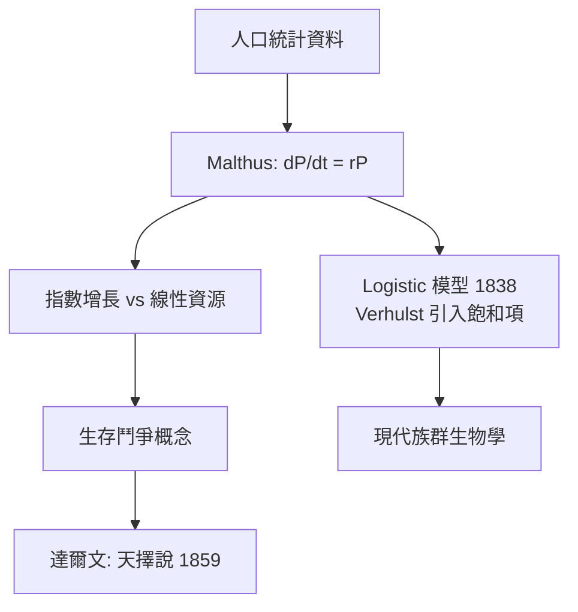

# 1.1 Malthus 人口模型：指數增長與達爾文的靈感（1798）【數學→生物】

## 前因：人口問題逼出第一個生物數學模型

18 世紀末，英國面臨人口快速成長與貧困問題。Malthus（馬爾薩斯）在 1798 年發表《人口論》，提出一個極簡但震撼的數學論證：人口若不受限制，將以**幾何級數（指數）**成長，而食物只能以**算術級數（線性）**成長。這是生物族群 dynamics 第一次被寫成方程。

## 構造

設人口 $P(t)$ ，出生率與死亡率之差為常數 $r$ ：

$$\frac{dP}{dt} = rP \quad \Longrightarrow \quad P(t) = P_0 e^{rt}$$

**指數增長的本質**：增長速率與現有數量成正比——「愈多愈生」。這一個方程就足夠推出 Malthus 的悲觀結論：任何有限資源都追不上指數曲線。

對照食物線性成長 $F(t) = F_0 + at$ ，兩曲線必然相交，此後人口受「生存壓力」抑制。

## 後果

1. **驅動達爾文**：達爾文自述讀 Malthus 後領悟——生存鬥爭中「有利變異被保留」即天擇。*《物種起源》副標題「生存鬥爭中有利變異的保存」直接源於此數學直覺。*
2. **催生 Logistic 模型**：Verhulst（1838）加入飽和項
   $$\frac{dP}{dt} = rP\left(1 - \frac{P}{K}\right)$$
   使 $P \to K$ （環境容納量）。這是人口、腫瘤、細菌、傳染病建模的通用起點，也埋下 20 世紀混沌理論的種子（見 2.2）。
3. **數學方法論的確立**：生物現象可以被「微分方程 + 邊界條件」描述——此後 SIR 模型（1 章 2.1）、Lotka-Volterra 捕食模型都是這條路的延伸。

## 練習與思考

1. 解 $\frac{dP}{dt}=rP$ 並估算：年增率 1% 時人口翻倍需要幾年？（提示： $\ln 2 \approx 0.69$ ）
2. 為什麼 Malthus 的「線性食物」假設在農業革命後失效？這對模型適用性有何啟示？
