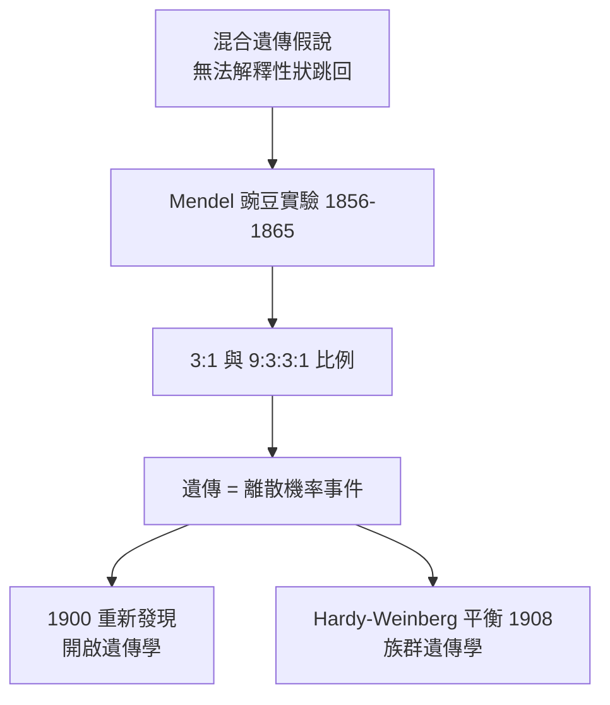

# 1.2 Mendel 豌豆實驗：離散數學進入生物學（1865）【生物→數學】

## 前因：混合遺傳的困境

19 世紀主流的「混合遺傳」認為子代性狀是親代的平均（像調和油漆），但這暗示變異會被迅速沖淡，天擇便無變異可用。Mendel（孟德爾）在修道院花園用 8 年、約 28,000 株豌豆做了當時最嚴謹的生物實驗，發現遺傳是**離散顆粒式**的。

## 構造

Mendel 的七對相對性狀（高/矮、圓/皺…）在雜交 F2 代都呈現穩定的 **3:1** 比例。他提出：

1. **顆粒遺傳**：性狀由成對的「因子」（今稱等位基因）決定，一自親一自母。
2. **分離律**：形成配子時成對因子分開，各保留一個。
3. **顯隱性**：顯性因子掩蓋隱性因子的表現。

這正是純數學的推理：若 F1 為雜合 $Aa$ ，自交時配子 $A:a = 1:1$ 隨機結合，則

$$P(AA) = \tfrac14,\quad P(Aa) = \tfrac12,\quad P(aa) = \tfrac14 \quad \Rightarrow \quad \text{顯:隱} = 3:1$$

Mendel 的偉大在於：**把生物實驗做成了統計假設檢定**——他預期 3:1 並用大樣本計數驗證，誤差在隨機波動範圍內。

## 後果

1. **被忽略 35 年**：1865 年論文發表後乏人問津——因為當時沒有「機率 + 生物學」的閱讀框架。1900 年 Correns、de Vries、Tschermak 三人同時重新發現，史稱「孟德爾的重新發現」。
2. **遺傳學的離散性 vs 生物統計的連續性**：Mendel 學派（處理離散性狀）與 Pearson、Welford 的生物統計學派（處理身高這類連續性狀）激烈對立——這場「衝突」逼出 Fisher 1918 年的統合（見 3.2），是數學調和生物學派系的經典案例。
3. **離散數學滲透生物學**：孟德爾因子最終對應 DNA 鹼基序列——生物的遺傳本質上是**離散符號系統**，這直接預告了 20 世紀的資訊革命（見 4.1）。

## 練習與思考

1. 兩對獨立性狀雜交（ $AaBb \times AaBb$ ），推導 9:3:3:1。
2. 若 Mendel 的性狀由多基因共同決定，還會出現 3:1 嗎？這解釋了哪些「不規則」實驗數據？
