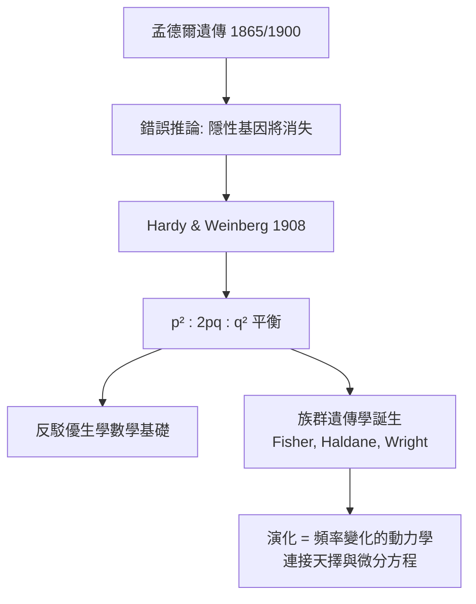

# 1.3 Hardy–Weinberg 平衡：代數檢驗遺傳（1908）【數學→生物】

## 前因：孟德爾學派的「隱性稀釋」誤解

孟德爾學說重新發現後，有人主張：顯性基因會不斷增加，隱性基因（如一些遺傳疾病）幾代內就會消失——進而建議禁止隱性帶原者生育（優生學的法律依據）。這個錯誤需要數學反駁。

## 構造

英國數學家 Hardy 與德國醫生 Weinberg 在 1908 年各自證明：在**隨機交配、無天擇、無突變、無遷移、族群夠大**的條件下，等位基因頻率世代不變。

設顯性等位 $A$ 頻率 $p$、隱性 $a$ 頻率 $q = 1-p$，隨機交配即二項式平方：

$$p^2\,(AA) : 2pq\,(Aa) : q^2\,(aa)$$

**關鍵定理**：$p, q$ 經一代隨機交配後即達此比例並**永遠維持**——隱性基因藏在大量雜合子 $Aa$（不表現性狀）中，**不會被稀釋掉**。

證明只需一代代數：配子頻率不變 $\Rightarrow$ 子代基因型頻率仍為 $p^2:2pq:q^2$。這是乘法原理與二項式定理在生物學中的直接應用。

## 後果

1. **族群遺傳學誕生**：Hardy–Weinberg 平衡成為「零假設」——偏離平衡即表示有天擇、突變或非隨機交配在作用。Fisher、Haldane、Wright 在 1920–30 年代將天擇寫成頻率的微分/差分方程，使**演化論變成可計算的科學**。
2. **醫學遺傳的實用工具**：由隱性疾病發病率 $q^2$ 即可算出帶原者頻率 $2pq$。例如囊性纖維化發病率 $1/2500 \Rightarrow q \approx 1/50 \Rightarrow$ 帶原者約 $1/25$——一條公式支撐整個遺傳諮詢。
3. **法醫 DNA 比對的基礎**：現代 DNA 指紋的「隨機匹配機率」計算就建立在 Hardy–Weinberg 與連鎖平衡之上——法庭上的一條數學定理。

## 練習與思考

1. 白化症發病率 $1/20000$，求帶原者頻率。
2. 若禁止帶原者生育，隱性頻率 $q$ 會如何變化？（提示：寫出 $q$ 的世代遞迴，會發現 $q$ 下降極慢——數學推翻了「幾代根除」的政策口號。）
