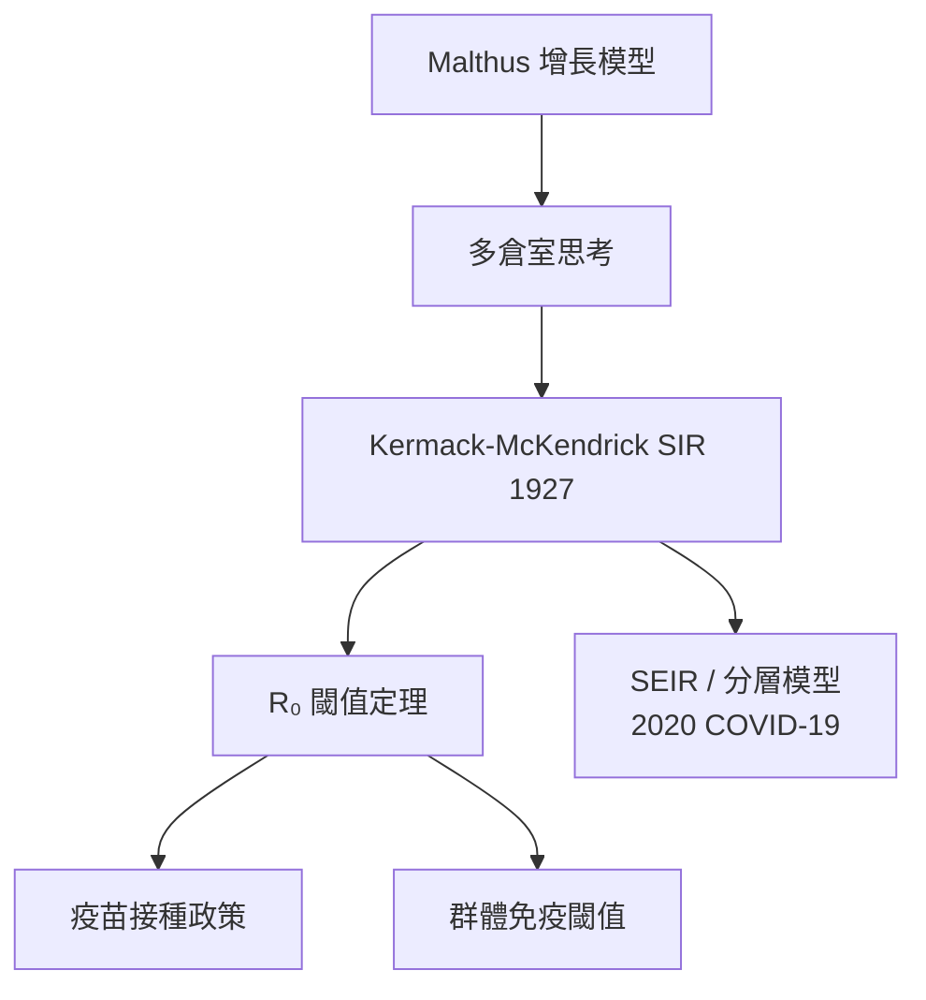

# 2.1 SIR 模型：流行病學的微分方程（1927）【數學→生物】

## 前因：從 Malthus 到傳染病

Malthus 式的單一族群增長模型無法描述傳染病——瘟疫中人口不是均勻成長，而是分成「會傳染人的」與「已被傳染的」。1918–1919 年西班牙流感全球死亡數千萬人，公共衛生迫切需要**預測疫情**的數學。Kermack 與 McKendrick 於 1927 年建立倉室模型。

## 構造

將人口分為三個倉室：易感 $S$ 、感染 $I$ 、康復 $R$ ，寫成常微分方程組：

$$\frac{dS}{dt} = -\beta \frac{S I}{N}, \qquad \frac{dI}{dt} = \beta \frac{S I}{N} - \gamma I, \qquad \frac{dR}{dt} = \gamma I$$

其中 $\beta$ 為傳染率、 $\gamma$ 為康復率（ $1/\gamma$ 為平均傳染期）。

**核心無因次量——基本再生數**：

$$R_0 = \frac{\beta}{\gamma}$$

代表一個感染者在全易感人群中平均傳染的人數。由方程可得三個定理級的結論：

1. **閾值定理**： $R_0 > 1$ 時疫情爆發； $R_0 < 1$ 時自然熄滅。
2. **群體免疫閾值**：疫情停止只需 $S/N < 1/R_0$ ，即接種比例需達 $1 - 1/R_0$ 。
3. **波峰不超過**： $I(t)$ 在 $S = \gamma/\beta$ 時達到峰值——預測醫療負載的關鍵。

## 後果

1. **流行病學成為數學科學**：此後一百年，SEIR、年齡結構、網路傳播模型都由 SIR 擴展； $R_0$ 成為公共衛生最著名的單一數字。
2. **政策由方程驅動**：麻疹 $R_0 \approx 12\text{–}18 \Rightarrow$ 需 92–95% 接種率；天花 $R_0 \approx 3\text{–}6 \Rightarrow$ 全球接種根除（1980）。數學定理直接指導了公共衛生。
3. **2020 年的復興**：COVID-19 期間，各國防疫模型（含英國 Imperial College 模型）都是 SIR 家族；「壓平曲線」一詞就是 $I(t)$ 曲線的圖像描述（見 2.3）。

## 練習與思考

1. 由 $dI/dt > 0$ 的條件推導爆發閾值 $S/N > 1/R_0$ 。
2. 若潛伏期不可忽略，應如何加入 $E$ （暴露）倉室？潛伏期會改變 $R_0$ 嗎？
