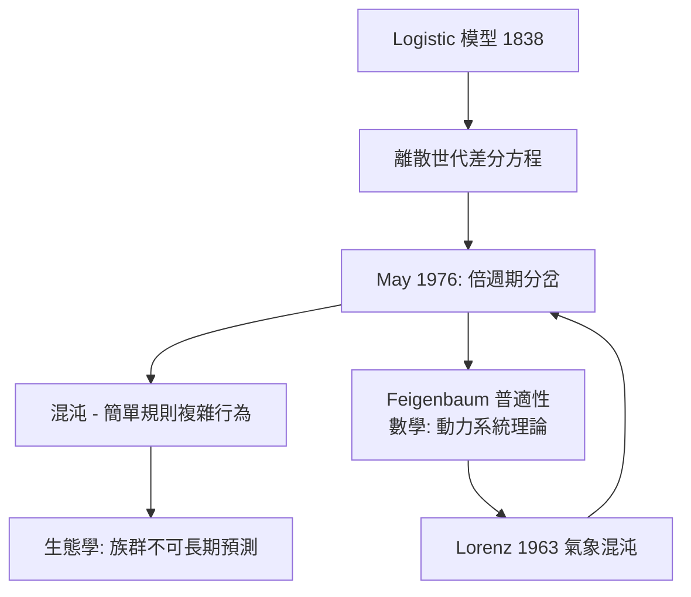

# 2.2 May 方程：混沌進入生態學（1976）【數學↔生物】

## 前因：Logistic 模型的離散版本

連續 Logistic 模型（1.1）行為溫馴——單調趨近 $K$ 。但許多昆蟲族群是**離散世代**（一年一代），模型應寫成差分方程。1976 年生態學家 Robert May 在《Nature》發表論文，指出這個教科書級的簡單模型藏著驚人的複雜性。

## 構造

離散 Logistic 映射：

$$x_{n+1} = r\,x_n(1 - x_n)$$

May 的數值實驗揭示，隨參數 $r$ 增大，行為發生**倍週期分岔**：

| $r$ 範圍 | 長期行為 |
|---|---|
| $1 < r < 3$ | 收斂到不動點 $x^* = 1 - 1/r$ |
| $3 < r < 3.449$ | 2 週期振盪 |
| $3.449 < r < 3.57$ | 4, 8, 16… 週期（每次分岔間距按 Feigenbaum 常數 $\delta \approx 4.669$ 收縮） |
| $3.57 < r \le 4$ | **混沌**：初值微小差異指數放大，Lyapunov 指數 $\lambda > 0$ |

混沌的判準可寫成：相鄰軌跡距離 $d_n \approx d_0 e^{\lambda n}$ ， $\lambda = \lim_{n\to\infty} \frac1n \sum \ln\left|\frac{dx_{n+1}}{dx_n}\right| > 0$ 。

## 後果

1. **顛覆「簡單模型行為簡單」的直覺**：一維、單峰、確定性的方程就能混沌——May 呼籲「教科書應教學生：線性思維是例外」。這是**混沌理論**進入主流的推手之一。
2. **生物學的預測極限**：即使完美知道繁殖率 $r$ ，族群長期仍不可預測——為生態管理、疫情波動提供了「內在隨機性」的解釋，有別於外部雜訊。
3. **數學的新領域**：Feigenbaum 發現倍週期的普適常數（不同映射皆同），催生重整化群方法的動力系統版本；混沌、分形、符號動力學成為 1980 年代數學與物理的熱點。

## 練習與思考

1. 取 $r=2$ ，手算 $x_0=0.2$ 起的軌跡，驗證收斂到 $0.5$ 。
2. 用電腦取 $r=3.9$ ，比較 $x_0=0.2$ 與 $x_0=0.2001$ 在 30 代後的差異——體會「蝴蝶效應」。
