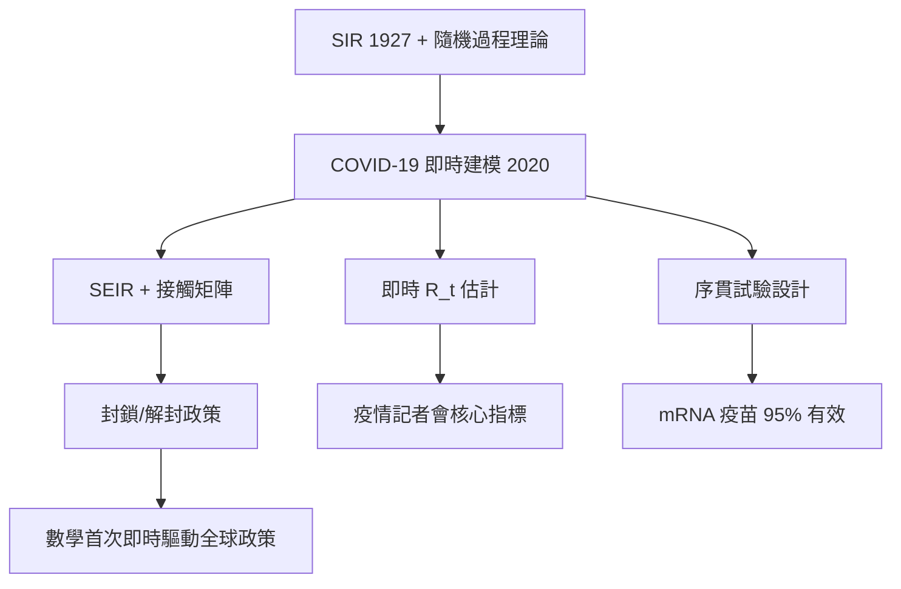

# 2.3 COVID-19：即時數學流行病學（2020）【數學↔生物】

## 前因：百年一度的實戰檢驗

SIR 模型（2.1）理論成熟近百年，但從未在全球即時政策中擔綱。2020 年 1 月，武漢疫情外溢，各國需要在**數天內**回答：會有多少人感染？醫療量能夠嗎？封鎖有無效果？數學流行病學首次被推上決策第一線。

## 構造

**三條數學戰線**：

1. **動力學模型**：SEIR 加上年齡結構、接觸矩陣 $C_{ij}$（年齡層 $i$ 與 $j$ 的接觸頻率）：

$$\frac{dI_i}{dt} = \sum_j \beta C_{ij} \frac{S_j}{N_j} I_i - \gamma I_i$$

Imperial College 報告 9（2020/3/16）用此模型預測不加防護的死亡人數，直接促成英美轉向封鎖政策。

2. **即時估計 $R_t$**：由每日確診序列 $C_t$，用分支過程關係

$$C_t \approx R_t \sum_{s=1}^{t} C_{t-s}\, w_s$$

（$w_s$ 為世代時間分佈）反推**即時再生數** $R_t$，成為各國疫情記者會的核心指標。

3. **統計檢定的極速部署**：mRNA 疫苗第三期試驗用事件驅動的**序貫分析**（group-sequential design）——累積到預定確診數即揭盲，使輝瑞/BNT 在 2020/11 得出 95% 有效性（95% CI: 90.3–97.6%）。

## 後果

1. **公共衛生的典範轉移**：疫情指標（$R_t$、有效再生數、超額死亡）成為政府日常語言；事後各國成立常設疫情建模中心。
2. **模型的可信度爭議**：模型預測誤差、參數不確定性被公開檢視——「模型透明化、程式碼公開」成為新規範，科學計算的可重現性被推上風口。
3. **數據科學與生物醫學的匯流**：基因定序追蹤變異株（Nextstrain 的系統發生樹）、廢水病毒量監測、手機接觸網路——流行病學已全面數位化，預告了 5 章「網路生物學」的世界。

## 練習與思考

1. 已知 $w_s$ 近似平均 5 日的伽瑪分佈，某週 $R_t$ 從 1.2 降至 0.8，解釋疫情從擴張到收縮的轉折。
2. 封鎖降低 $\beta$ 而疫苗降低 $S$——由 $dI/dt$ 方程比較兩者對壓平曲線的不同效果。
