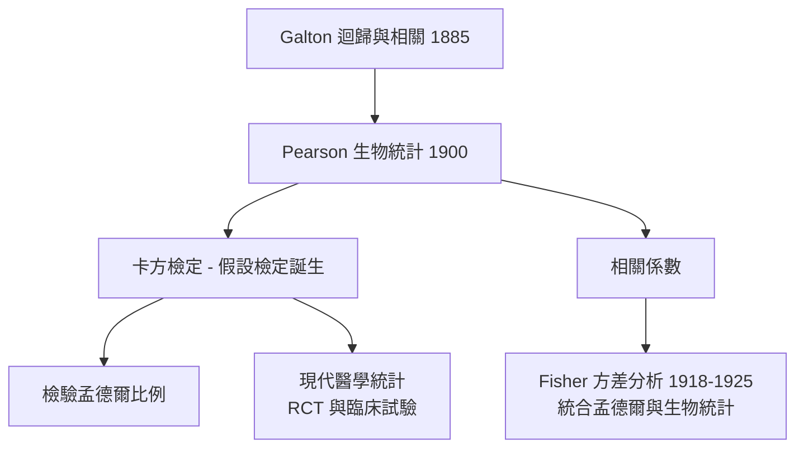

# 3.1 Pearson 卡方檢定與相關：生物統計學誕生（1900）【數學↔生物】

## 前因：生物變異需要新數學

19 世紀末，Galton（達爾文的表弟）研究身高遺傳，發現「子代身高回歸平均值」——但物理學的誤差理論（高斯分佈）假定真值唯一，而生物的變異本身就是主體。Karl Pearson 為處理**族群內的連續變異**，創建一套新統計工具，並於 1901 年創辦《Biometrika》期刊——「生物統計學」（Biometry）正式命名。

## 構造

**三大發明**：

1. **相關係數**（1896）：度量兩變數的線性共同變化

$$r = \frac{\sum (x_i - \bar x)(y_i - \bar y)}{\sqrt{\sum (x_i - \bar x)^2 \sum (y_i - \bar y)^2}} \in [-1, 1]$$

回答「親子身高有多相關」——這正是 Galton 迴歸的量化。

2. **卡方檢定**（1900）：檢驗觀察頻率是否符合理論期望

$$\chi^2 = \sum_i \frac{(O_i - E_i)^2}{E_i}$$

Pearson 證明其漸近分佈自由度為 $k-1$——**這是第一個現代意義的假設檢定**，統計推論的起點。它立即被用來檢驗孟德爾的 3:1 比例。

3. **主成分分析**（1901）：把多變數變異投影到主軸——源自生物測量的降維需求，日後成為機器學習的基石。

## 後果

1. **科學方法的制度化**：「提出零假設 → 計算檢定統計量 → 給出顯著水準」成為 20 世紀實證科學的標準流程，源頭即生物學需求。
2. **學派衝突埋下伏筆**：Pearson 的連續變異觀點與孟德爾的離散顆粒觀點激烈對立——魚與熊掌能否兼得？答案由 Fisher 給出（3.2）。
3. **醫學的量化革命**：從 1948 年第一個隨機對照試驗（鏈黴素治療結核）到今日所有臨床試驗，方法論全部回溯到 Pearson–Fisher 傳統。

## 練習與思考

1. 觀察 556 顆豌豆中圓 423 皺 133，用 $\chi^2$ 檢定是否符合 3:1。（$E: 417, 139$，$\chi^2 \approx 0.35$，不顯著——孟德爾過關。）
2. 相關不等於因果——舉一個生物醫學的例子（如吸菸與咖啡攝取的相關）說明混淆變數。
