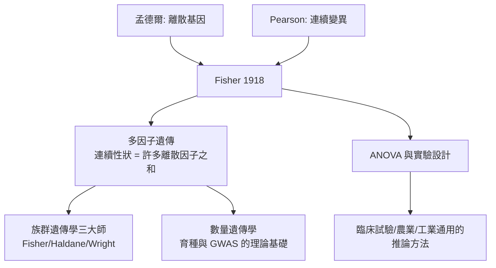

# 3.2 Fisher 方差分析：統合孟德爾與生物統計（1918）【數學→生物】

## 前因：兩個學派的世紀之爭

孟德爾學派說：遺傳是離散因子。生物統計學派說：身高這類性狀連續變化，且親子相關約 0.5，離散因子解釋不了。兩派爭了十餘年，直到 Fisher 在 1918 年發表《孟德爾遺傳假說下親屬間相關》，用一個數學框架同時收編雙方。

## 構造

Fisher 的洞見：**連續性狀由多個離散基因共同決定（多因子遺傳），加上環境變異**。設性狀

$$Y = \underbrace{\sum_k g_k}_{\text{基因效應}} + \underbrace{\varepsilon}_{\text{環境}}, \qquad \mathrm{Var}(Y) = V_G + V_E$$

把變異**分解成可加的成分**——「方差分析」（ANOVA）由此誕生：

- $V_G$ 再拆為加性 $V_A$ 、顯性 $V_D$ 、上位 $V_I$
- 親子相關 $= \dfrac{V_A/2}{V_P}$ ，同胞相關 $= \dfrac{V_A/2 + V_D/4}{V_P}$

數學上，Fisher 用了**變異數的二次型分解**與直交投影的思想——同一套線性代數日後成為迴歸分析、實驗設計、乃至現代機器學習（偏差-方差分解）的通用語言。

他接著在 *Statistical Methods for Research Workers*（1925）與 Rothamsted 農業試驗站的田間實驗中發展出**隨機化、重複、區集**三原則——用數學保證因果推論。

## 後果

1. **現代演化綜論**：Fisher、Haldane、Wright 在 1920–30 年代把天擇寫成基因頻率的動力學（如 Fisher 的自然選擇基本定理 $\dot{\bar W} \propto V_A$ ），孟德爾遺傳 + 達爾文天擇 + 數學動力學三者合流。
2. **數量遺傳學與育種**：作物與家畜的雜交優勢、選拔反應公式 $R = h^2 S$ （遺傳率 × 選拔差），直接餵飽了 20 世紀的綠色革命。
3. **統計學成為獨立學科**：ANOVA、最大概似、充分統計量、顯著性檢定——今日 R 語言裡的每個 `aov()`、`lm()`，都是 1918–1935 這波數學-農業-遺傳互動的產物。

## 練習與思考

1. 已知親子相關 0.45、同胞相關 0.55，估算 $h^2 = V_A/V_P$ 與 $V_D/V_P$ 的相對大小。
2. 為什麼隨機化能消除混淆？用期望值論證：隨機分派下處理組與對照組的混淆變數期望相同。
