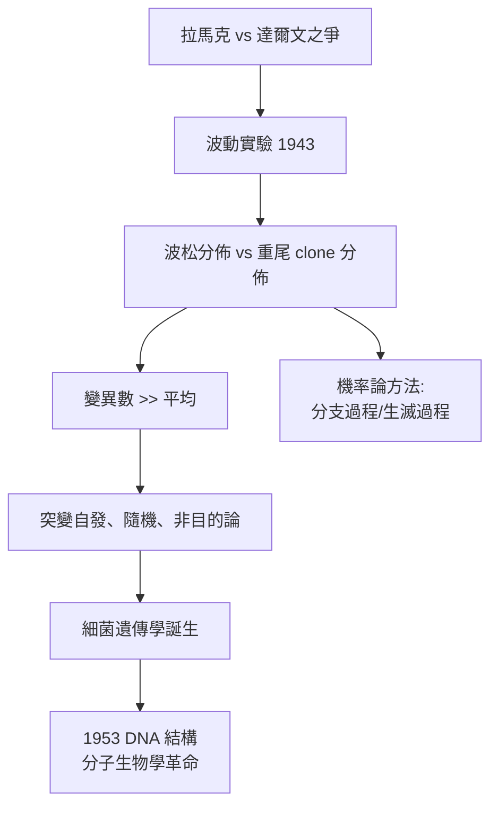

# 3.3 Luria–Delbrück 實驗：波松統計裁定突變的時機（1943）【數學→生物】

## 前因：突變是「誘導」還是「自發」？

1940 年代仍有一派主張細菌突變是環境「訓練」出來的（拉馬克式適應）。要裁定誰對，兩個假說給出**不同的變異數**——這是一場純統計的決鬥。Luria（魯利亞）在晚餐時從同事賭博用的「一鎗多靶」機率得到靈感，與 Delbrück 設計了著名的波動實驗（fluctuation test）。

## 構造

取多管獨立培養的大腸桿菌，各管分別塗佈於含噬菌體的培養皿，統計抗性菌落數。

**兩個假說，兩個分佈**：

1. **誘導假說**：每隻細菌獨立、等機率地被環境誘導突變 → 抗性數服從**波松分佈**，變異數等於平均數：

$$\mathrm{Var} = \lambda, \qquad \text{變異係數小}$$

2. **自發突變假說**：突變發生在**培養早期**的少數個體，其後代（clone）大量抗性 → 某些管「中頭彩」，分佈**重尾**：

$$\mathrm{Var} \gg \lambda, \qquad \text{出現極端值管次}$$

Luria–Delbrück 的數學核心：若突變以機率 $\mu$ 在分裂過程中隨時發生，第 $n$ 代的突變後代數期望為

$$E[N] = \mu\, n\, m\, e^{\mu n m} \cdot (\text{因子}) \quad \text{（遠超波松）}$$

結果：實驗變異數**遠大於**平均——自發突變說獲勝，天擇作用於**事先已存在的隨機變異**，拉馬克主義在微生物學出局。

## 後果

1. **分子生物學的隨機性原則**：突變 = 複製錯誤的隨機事件（後由 Watson–Crick 的化學機制說明），演化論補上了微生物層級的實證基礎。
2. **機率模型的典範**：Luria–Delbrück 分佈成為分支過程（branching process）的教科書案例；同類模型今日用於腫瘤耐藥突變的預測——癌症治療中「為何總會出現抗藥細胞株」的答案，就是這個重尾分佈。
3. **諾貝爾獎的數學味**：Luria、Delbrück、Hersey 1969 年獲諾貝爾生理醫學獎，得獎原因的核心是 1943 年那個「用變異數裁決生物學」的實驗——統計推論直接改寫教科書。

## 練習與思考

1. 波松分佈 $\mathrm{Var} = \lambda$；設計一個數值模擬，比較 20 管培養在兩假說下的菌落數直方圖。
2. 癌細胞群體中抗藥突變在治療前已存在（Luria–Delbrück 邏輯）——這對「合併用藥」策略有何數學含義？
