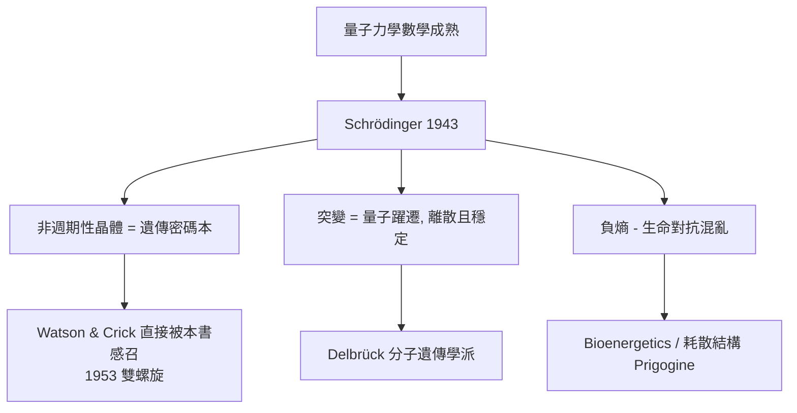

# 4.1 Schrödinger《生命是什麼》：密碼本的預言（1943）【數學→生物】

## 前因：物理學家轉向生命

1930 年代，量子力學的數學框架已然成熟，許多物理學家開始追問：**生命是否違反熱力學與量子力學？** Schrödinger（薛丁格）1943 年在都柏林發表演講，1944 年集結成《生命是什麼？》（*What is Life?*）——一本不到百頁的小書，卻精準預言了分子生物學。

## 構造

**三個數學論證**：

1. **非週期性晶體**：遺傳物質必須是固體骨架才能穩定，又必須編碼海量資訊。「週期性晶體」重複太多、資訊量少；唯有**非週期性**結構——像書本由少數字母排成無限語句——才能在少量原子中儲存複雜密碼：

$$I \sim \log_2 N_{\text{可能的排列}}$$

這實為資訊熵 $H = -\sum p_i \log_2 p_i$ 的直觀表述（Shannon 1948 年稍後形式化）。

2. **$N^{1/2}$ 定律與突變的量子性**：物理量的相對漲落 $\sim 1/\sqrt{N}$，若遺傳只靠經典統計，$N$ 需極大而無法穩定。Schrödinger 主張遺傳的穩定來自**量子能階**——突變是「量子躍遷」，如同同位素的穩定。這解釋了為何突變是離散跳變（呼應 1.2 的孟德爾顆粒性）。

3. **負熵**：生物以「吃負熵」（秩序）對抗熱力學第二定律——$$\Delta S_{\text{生物}} < 0 \text{ 伴隨 } \Delta S_{\text{環境}} > 0$$ 開啟了熱力學生物學。

## 後果

1. **召喚物理學家進入生物學**：Delbrück 自述受此書啟發轉行；Watson 稱雙螺旋研究「一開始就想找那個非週期性晶體」——**一本書驅動一個學門的人才遷移**。
2. **資訊觀點確立**：遺傳 = 符號序列 = 編碼問題。這直接鋪路：遗传密碼（1961 Nirenberg 破譯）、資訊論進入生物序列分析、最終到今天的生物資訊學（4.3、5 章）。
3. **數學結構的預言成真**：DNA 正是「非週期性晶體」——四種鹼基 A/T/C/G 的一維序列。Schrödinger 沒看到分子，只靠數學論證就鎖定了它的抽象性質：**理論先於觀測**的又一案例。

## 練習與思考

1. 估算長度 $n$ 的鹼基序列資訊量 $2n$ bits；人類基因體 $3\times10^9$ 鹼基約多少位元？與一本 500 頁書比較。
2. 為什麼「週期性晶體」不能做遺傳物質？用資訊容量論證。
