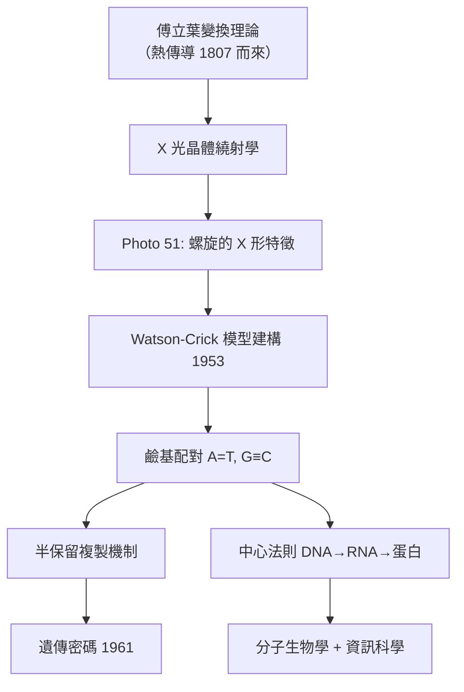

# 4.2 DNA 雙螺旋：X 光繞射與傅立葉的勝利（1953）【數學→生物】

## 前因：看見分子的唯一方法是數學

分子太小，無法用光學顯微鏡。要看見 DNA 的結構，唯一途徑是 **X 光晶體繞射**——其原理正是傅立葉變換：晶體的電子密度 $\rho(\mathbf r)$ 與繞射振幅 $F(\mathbf h)$ 互為傅立葉對：

$$F(\mathbf h) = \int \rho(\mathbf r)\, e^{2\pi i\, \mathbf h \cdot \mathbf r}\, d\mathbf r, \qquad \rho(\mathbf r) = \sum_{\mathbf h} F(\mathbf h)\, e^{-2\pi i\, \mathbf h \cdot \mathbf r}$$

測到的是強度 $|F|^2$（相位丟失，即「相位問題」）——解結構就是從有限繞射點**反推三維密度函數**。Franklin 1952 年拍得的 Photo 51 顯示清晰的 **X 形交叉**——這是螺旋的傅立葉特徵（十字對稱來自螺旋的週期性）。

## 構造

Watson 與 Crick（1953）不需要「解出」完整繞射，而是**建構-檢驗**：提出候選模型，計算其理論繞射圖，與 Photo 51 比對。他們的方法論是純數學的：

1. **對稱性約束**：Photo 51 的 X 形與第 4 層線缺失 → 雙股螺旋、兩股反向平行、直徑 $20\,\text{Å}$、螺距 $34\,\text{Å}$、每圈 10 鹼基。
2. **化學鍵長與立體幾何**：Crick 的晶體學計算 + 鹼基的酮式互變異體（Donohue 指正）。
3. **鹼基配對的幾何必然**：A-T 兩條氫鍵、G-C 三條，且兩對的幾何尺寸相同 → 骨架距離恆定，**任何序列都放得進同一個規則螺旋**：

$$\text{A}=\text{T},\quad \text{G}\equiv\text{C} \quad\Longrightarrow\quad \text{一股序列決定另一股}$$

這立刻給出複製機制的數學雛形：$2 \to 1+1$ 的半保留複製（1958 Meselson–Stahl 以密度梯度離心證實）。

## 後果

1. **遺傳學獲得物理化學基礎**：孟德爾因子（1.2）= DNA 片段 = 鹼基序列；突變 = 鹼基改變（呼應 4.1 的量子躍遷、3.3 的隨機突變）。**四條歷史線索在 1953 匯合**。
2. **結構生物學產業**：以後每個重要分子（血紅素 1959、tRNA 1974、核糖體 2000 諾獎、膜蛋白 GPCR 2012）都靠傅立葉晶體學解出——數學方法統治了結構生物學七十年。
3. **序列時代的開端**：既然遺傳是一維符號串，比較、搜尋、比對序列就成了核心數學問題——直接催生 4.3 的動態規劃比對與 5 章的基因體學。

## 練習與思考

1. 用螺旋的傅立葉性質解釋：為何繞射圖呈 X 形且層線間距對應螺距？
2. 相位問題為何無解？舉一種破解法（同晶置換/MAD）並說明其數學思路。
