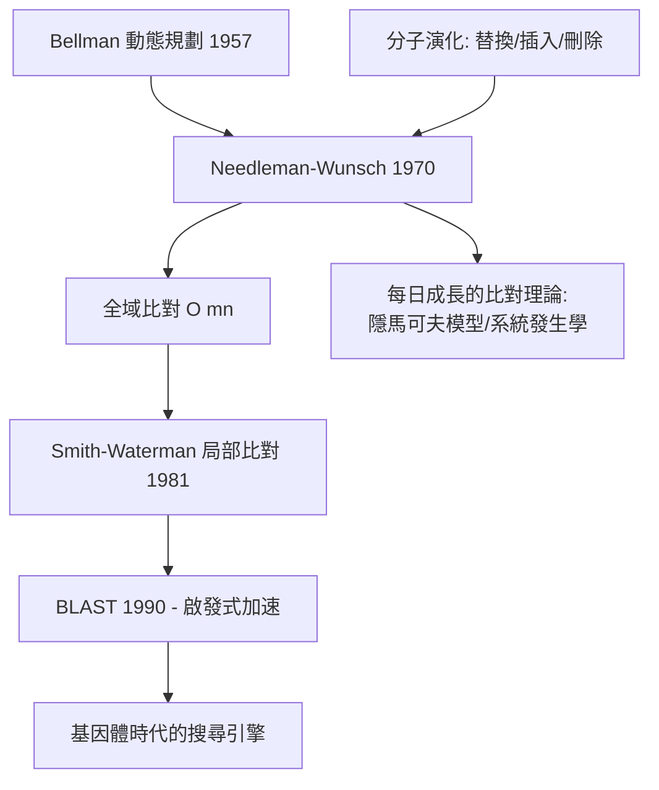

# 4.3 Needleman–Wunsch：動態規劃進入生物序列（1970）【數學→生物】

## 前因：序列資料開始湧現

1970 年代初，胺基酸定序（Edman 降解）與早期 DNA 定序產生了第一批序列資料。核心問題立刻浮現：**兩條序列像不像？** 進化使序列發生替換、插入、刪除（indel），需要一種在所有可能對齊（alignment）中找最佳者的方法。暴力搜尋的對齊方式數量是**指數級**的——需要演算法突破。

## 構造

Needleman 與 Wunsch（1970）把問題寫成**最佳化**：給評分函數（配對加分、錯配減分、缺隙罰分），找總分最高的對齊。用**動態規劃**（Bellman 1957 年的原則：最佳路徑的子路徑亦最佳）定義

$$H(i,j) = \max\begin{cases} H(i-1,j-1) + s(x_i, y_j) & \text{配對/錯配} \\ H(i-1,j) - d & \text{缺隙} \\ H(i,j-1) - d & \text{缺隙} \end{cases}$$

填滿 $m \times n$ 矩陣後回溯得最佳對齊。**複雜度 $O(mn)$，把指數問題壓成多項式**。Smith–Waterman（1981）再改為局部比對（找相似片段），成為結構類比搜尋的黃金標準。

## 後果

1. **生物資訊學誕生**：比對成為一切下游分析的原子操作——建演化樹、找功能域、設計引子。GenBank（1982）成立後，資料庫搜尋（BLAST，1990）是全世界生物學家最常用的演算法。
2. **數學演算法的通用性展示**：動態規劃同一套技術也解決了語音辨識、拼字檢查、diff 工具（Unix `diff` 用的演算法就是序列比對）——**生物學需求與計算機科學共進**。
3. **定量演化假說可檢驗**：Dayhoff 替換矩陣（PAM, 1978）、Kimura 中性理論的 $dN/dS$ 檢定——比對分數有了統計意義，分子演化從敘述變成推論。
4. **鋪路基因體組裝**：比對是組裝（5.2）、註解、變異偵測的基礎；今天比對到參考基因體（BWA、Bowtie）每天在醫院基因檢測中執行數百萬次。

## 練習與思考

1. 手算 S1=`ACG` 與 S2=`AG` 的 Needleman–Wunsch 矩陣（match +1, mismatch −1, gap −1），寫出最佳對齊。
2. BLAST 為何不追求最佳解？在「資料庫規模 vs 精確度」的取捨上，這反映了什麼演算法設計哲學？
