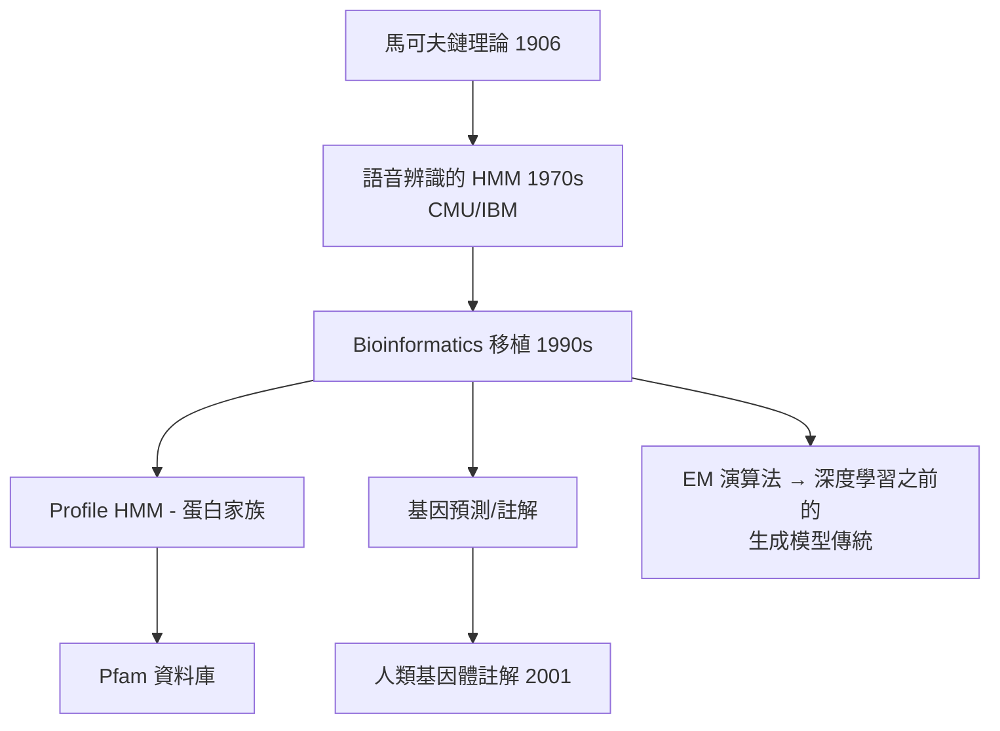

# 5.1 隱藏馬可夫模型：序列中的統計密碼（1990s）【數學→生物】

## 前因：比對不夠了——需要「家族的機率模型」

Needleman–Wunsch（4.3）比對兩條序列，但生物學家真正想要的是：給定一個**蛋白質家族**（如數千個激酶），判斷新序列是否屬於這個家族；以及：在基因體長序列中，**哪裡是基因？哪裡是垃圾？** 這需要把「家族」表示成一個可學習的機率模型——隱藏馬可夫模型（HMM）應運而生。

## 構造

HMM = 有隱藏狀態 $z_t$ 的馬可鏈 + 每個狀態發射可觀察符號 $x_t$：

$$P(x_1\ldots x_T, z_1 \ldots z_T) = \pi_{z_1} b_{z_1}(x_1) \prod_{t=2}^{T} a_{z_{t-1} z_t}\, b_{z_t}(x_t)$$

**三大演算法**（皆為動態規劃的變形，血脈直承 4.3）：

| 問題 | 演算法 | 複雜度 |
|---|---|---|
| 給模型算序列機率 | 前向演算法 | $O(T N^2)$ |
| 找最可能狀態路徑 | Viterbi | $O(T N^2)$ |
| 從資料學參數 | Baum–Welch（EM） | 迭代 |

**生物應用的兩大類**：

1. **Profile HMM**：由多重比對建立「家族剖面」，match/insertion/deletion 三種隱藏狀態對應序列演化事件——HMMER 套件至今是蛋白質家族資料庫（Pfam）的引擎。
2. **基因預測**：隱藏狀態 = 外顯子/內含子/基因間區，發射機率描述密碼子統計——早期基因體註解（如 GENSCAN, 1997）全靠 HMM。

## 後果

1. **基因體註解的工業化**：人類基因體草稿（5.2）的基因預測大量使用 HMM——沒有統計模型，「30 億鹼基中找出 2 萬個基因」無從下手。
2. **語音→生物的技術遷移**：HMM 在語音辨識中成熟後整套搬進生物——這是「AI 技術外溢到生物醫學」的第一波，預告 AlphaFold（5.3）之前，方法論早就在雙向流動。
3. **通往深度學習的橋樑**：Baum–Welch 就是 EM 演算法；Viterbi 是動態規劃；HMM 的參數化與發射模型的思想直接延續到 RNN/LSTM 語言模型——生物序列分析是機器學習的重要訓練場。今日蛋白質語言模型（ESM）正是「把序列當文字」這條 HMM 思路的極致版。

## 練習與思考

1. 寫一個兩狀態天氣 HMM（雨天/晴天），手算序列「走路濕了、沒帶傘」的最可能隱藏狀態。
2. Profile HMM 的插入狀態為何必要？若省略，哪些真實演化事件會被錯誤建模？
