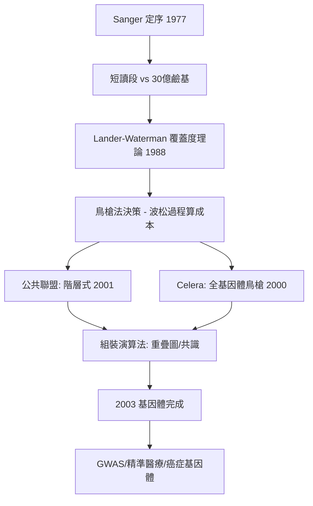

# 5.2 人類基因體計畫：演算法組裝 30 億鹼基（2003）【數學→生物】

## 前因：定序機器只會讀短句

Sanger 定序（1977，雙脫氧鏈終止法）一次只能可靠讀出數百鹼基，人類基因體卻有 $3 \times 10^9$ 鹼基。這是**巨大的拼圖問題**：把數千萬條短讀段（reads）重新拼回染色體。人類基因體計畫（HGP, 1990–2003）能夠完成，靠的是把整個問題轉化成**圖論與組合最佳化**。

## 構造

**兩條演算法路線**：

1. **階層式鳥槍法**（HGP 公共聯盟）：先建成 BAC 文庫（每段約 150kb），物理圖定位，再對每個 BAC 鳥槍定序。組裝核心是**最小重疊路徑**：把 reads 當節點、重疊當邊，求

$$\text{Hamilton 路徑式的} \; \text{重疊-佈局-共識} \; (\text{Overlap–Layout–Consensus})$$

2. **全基因體鳥槍法**（Celera, Venter, 1998）：跳過物理圖，直接對全基因體的 reads 求重疊圖，用端點配對（mate-pair）資訊約束——此路線的可行性本身就是計算理論的賭注，逼出了更強的組裝演算法與圖簡化（去重複、去尖峰）。

**數學支柱**：

- **Lander–Waterman 數學**（1988）：覆蓋度 $c = NL/G$ 下，缺口數與 contig 數的機率公式，指導定序量 $N$ 的規劃——**用波松過程事先算出要花多少錢**。
- **組裝的理論下界**：重複序列使組裝本質上有歧義（Ukkonen 的重複圖論結果）——解釋了為何著絲點與端粒到今日才完成（T2T 聯盟 2022）。

## 後果

1. **大科學模式的建立**：HGP 證明「資料共享 + 演算法 + 國際分工」可以完成任何規模的資訊工程，直接成為全球共享資料庫文化的原型。
2. **成本崩塌與個人化醫療**：定序成本從 30 億美元降至數百美元（超越摩爾定律），全基因體定序進入臨床——新生兒罕病診斷、腫瘤體細胞突變圖譜（TCGA）皆建基於此。
3. **後基因體的數學化**：GWAS（2005–）以線性迴歸 + 貝葉斯方法找性狀-變異關聯；單細胞定序（2009–）用流形學習（UMAP）可視化細胞狀態空間；Hi-C 用圖論重建染色體三維結構——**生物學已經全面運行在演算法之上**，為 AlphaFold（5.3）鋪好舞台。

## 練習與思考

1. 用 Lander–Waterman 公式：$G = 3\times10^9$、讀長 $L=500$、覆蓋 $c=10$，估算缺口數量級。
2. 為什麼重複序列使「單靠 reads 無法唯一組裝」？用重複將 reads 連成錯誤圖的例子說明。
