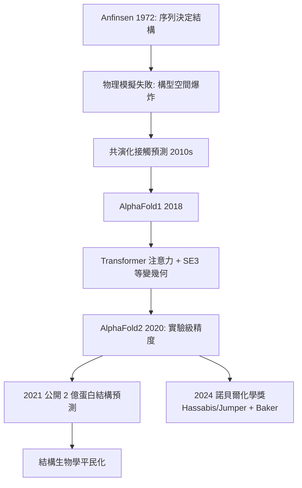

# 5.3 AlphaFold：深度學習解開蛋白質摺疊（2020）【數學↔生物】

## 前因：五十年未解的「摺疊密碼」

Anfinsen（1972 諾獎）證明：胺基酸序列決定蛋白質三維結構——那麼理論上應能由序列計算結構。但物理路線（分子動力學模擬自由能最低態）面對 $10^{300}$ 量級的構型空間（Levinthal 悖論）寸步難行；1994 年起 CASP 競賽每兩年檢驗各家方法，三十年來始終沒有可靠的解。

## 構造

DeepMind 的 AlphaFold2（CASP14, 2020，GDT 中位數約 92.4，達到實驗誤差等級）把問題轉成**幾何 + 機率學習**：

1. **共演化訊號 = 幾何約束**：演化上互相接觸的殘基會共同突變（否則結構破壞）。多重序列比對（MSA，技術上承襲 4.3–5.1）中，計算殘基對的互資訊

$$\mathrm{MI}(i,j) = \sum_{a,b} p_{ij}(a,b) \log \frac{p_{ij}(a,b)}{p_i(a) p_j(b)}$$

高 MI 的殘基對在 3D 中多半相鄰——**序列統計直接洩露三維接觸圖**。

2. **注意力機制 = 可微分的幾何推理**：Transformer 的 self-attention（Evoformer）讓每個殘基「看見」整條序列與 MSA 中的約束，迭代精煉；結構模組直接輸出 3D 座標，並以**等變性**（旋轉/平移不改變預測， $SE(3)$ 群對稱）作為歸納偏置。

3. **端對端訓練**：以 PDB 中 17 萬個已知結構為監督訊號，損失函數包含 FAPE（座標誤差）與蒸餾的距離分佈。

## 後果

1. **結構知識民主化**：AlphaFold 資料庫（2021）放出 2 億個結構預測，覆蓋幾乎所有已知蛋白——過去一個博士後花數年解一個結構，現在數秒可得；藥物設計、酵素工程、罕病變異解讀全面受益。
2. **物理直覺的反思**：AlphaFold 不是模擬摺疊過程，而是**學習演化留下的統計痕跡**——「演化即計算」的觀點開啟新哲學：自然界五十億年的選擇已經完成搜尋，AI 只需讀懂結果。
3. **數學-生物的雙向驅動再現**：生物問題（蛋白幾何）反哺 AI（等變網路、幾何深度學習）；AI 反過來設計全新蛋白（Baker 的 RFdiffusion，2024 同獲諾獎）——從 Malthus（數學→生物）到 AlphaFold（數學↔生物），驅動關係完成對稱閉環，本書的歷史弧線在此收束。

## 練習與思考

1. 說明為何共演化訊號會有假陽性（兩殘基同時受第三者中介），以及 Potts 模型/深度網路如何消解。
2. AlphaFold 無法預測變構與動態構象——對「結構 = 一張靜態圖」的假設提出你的批判。
