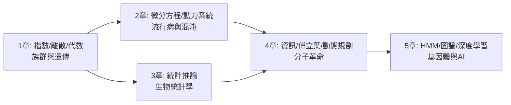

# 數學與生物醫學：四百年的相互驅動

一本關於**數學與生物醫學如何互相驅動**的歷史-理論教科書。每節採用「前因 → 構造 → 後果」的結構，呈現技術與理論的因果鏈。

## 目錄

* 第0章-導論
    * [0.1-雙螺旋-數學與生物的相互驅動](00.1-雙螺旋-數學與生物的相互驅動.md)
* 第1章-族群、遺傳與演化的數學起源
    * [1.1-1798-Malthus人口模型-指數增長與達爾文的靈感](01.1-1798-Malthus人口模型-指數增長與達爾文的靈感.md)
    * [1.2-1865-Mendel豌豆實驗-離散數學進入生物學](01.2-1865-Mendel豌豆實驗-離散數學進入生物學.md)
    * [1.3-1908-Hardy-Weinberg平衡-代數檢驗遺傳](01.3-1908-Hardy-Weinberg平衡-代數檢驗遺傳.md)
* 第2章-動力系統與流行病
    * [2.1-1927-SIR模型-流行病學的微分方程](02.1-1927-SIR模型-流行病學的微分方程.md)
    * [2.2-1976-May方程-混沌進入生態學](02.2-1976-May方程-混沌進入生態學.md)
    * [2.3-2020-COVID-19-即時數學流行病學](02.3-2020-COVID-19-即時數學流行病學.md)
* 第3章-統計與遺傳學的聯姻
    * [3.1-1900-Pearson卡方與相關-生物統計學誕生](03.1-1900-Pearson卡方與相關-生物統計學誕生.md)
    * [3.2-1918-Fisher方差分析-統合孟德爾與生物統計](03.2-1918-Fisher方差分析-統合孟德爾與生物統計.md)
    * [3.3-1943-Luria-Delbrück實驗-波松統計裁定突變的時機](03.3-1943-Luria-Delbrück實驗-波松統計裁定突變時機.md)
* 第4章-分子生物的資訊革命
    * [4.1-1943-Schrodinger生命是什麼-密碼本的預言](04.1-1943-Schrodinger生命是什麼-密碼本的預言.md)
    * [4.2-1953-DNA雙螺旋-X光繞射與傅立葉的勝利](04.2-1953-DNA雙螺旋-X光繞射與傅立葉的勝利.md)
    * [4.3-1970-Needleman-Wunsch-動態規劃進入生物序列](04.3-1970-Needleman-Wunsch-動態規劃進入生物序列.md)
* 第5章-基因體時代與計算生物學
    * [5.1-1990-隱藏馬可夫模型-序列中的統計密碼](05.1-1990-隱藏馬可夫模型-序列中的統計密碼.md)
    * [5.2-2003-人類基因體計畫-演算法組裝30億鹼基](05.2-2003-人類基因體計畫-演算法組裝30億鹼基.md)
    * [5.3-2020-AlphaFold-深度學習解開蛋白質摺疊](05.3-2020-AlphaFold-深度學習解開蛋白質摺疊.md)

## 閱讀路線

## 本書的主線

1. **數學→生物**：Malthus 的方程啟發達爾文；傅立葉變換使 DNA 可被「看見」；波松分佈裁定突變時機。
2. **生物→數學**：生物變異逼出迴歸與 ANOVA；序列資料催生動態規劃與 HMM 的應用擴張。
3. **雙向閉環**：AlphaFold 中演化統計餵給幾何深度學習，AI 再設計新蛋白——兩者的驅動關係成為對稱的閉環。
