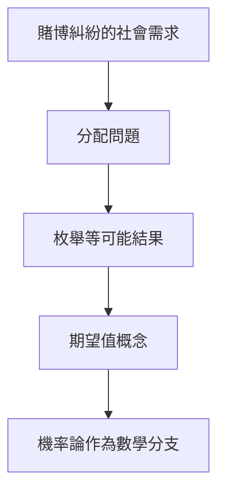

# 1.1 1654年：帕斯卡與費馬的通信——機率論的誕生

## 1. 問題：賭桌上的哲學難題

十七世紀的法國，賭博是貴族社會的核心社交活動，但「如何公平分賭金」卻沒有公認答案。著名的「賭注分配問題」（problem of points）：

> 甲、乙兩人擲一枚公平硬幣，甲先贏 3 次者得全部賭金。當甲贏 2 次、乙贏 1 次時遊戲中斷，賭金該如何分配？

直覺式的答案（按已贏局數比例 2:1 分）是錯的——它忽略了「未來的可能」。這不只是賭博問題，它本質上是**如何在資訊不完整的情況下，對未來的不確定性賦予數值**。這正是社會科學一切定量分析的起點。

## 2. 數學：期望值的發明

1654 年，帕斯卡（Blaise Pascal）與費馬（Pierre de Fermat）以書信往來解決此題。關鍵洞見是：**分配比例不應取決於過去，而應取決於雙方在剩餘賽局中獲勝的機率**。

設需再擲兩局定勝負，四種等可能結果：

| 結果 | 勝者 |
|------|------|
| 甲甲 | 甲 |
| 甲乙 | 甲 |
| 乙甲 | 甲 |
| 乙乙 | 乙 |

甲獲勝機率為 $3/4$，故甲應得賭金的 $3/4$，乙得 $1/4$。

由此誕生了**期望值**（expected value）的概念：

$$
E[X] = \sum_i p_i x_i
$$

其中 $p_i$ 是各結果的機率，$x_i$ 是對應的報酬。帕斯卡更進一步，在同一批通信中建立了早期的**條件機率**與決策樹推論，日後發展成帕斯卡定理（貝氏定理的前身）。

## 3. 後果：從賭桌到社會

- **決策理論的雛形**：帕斯卡著名的「帕斯卡的賭注」（Pascal's Wager, 1670）用期望值論證是否信仰上帝——這是第一次將期望值應用於人生決策，是理性選擇理論的遠祖。
- **保險業的科學化**：有了機率，人壽保險從投機變成可定價的行業（見 3.1 節格蘭特的生命表）。
- **司法與證據理論**：萊布尼茲等人開始思考「證據的機率」，為法學的定量分析鋪路。

## 4. 回饋：機率的哲學危機

期望值的成功立刻引發新問題：如果期望值是理性的唯一準則，那麼「聖彼得堡悖論」（見 1.2 節）顯示期望值準則會導出荒謬結論。**社會科學的需求反過來逼迫數學家發明「效用」概念**——這是下一節的主題。

## 5. 延伸思考

1. 「等可能結果」的定義本身是否循環？（不充分理由原則的爭議）
2. 機率是客觀頻率，還是主觀信念？這場爭論至今未歇（頻率派 vs. 貝氏派），並直接影響統計推論（第 3 章）。
