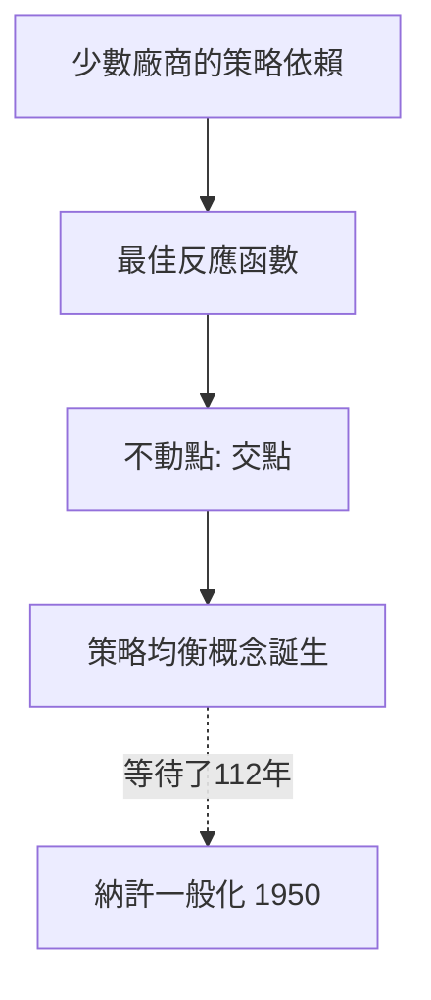

# 2.1 1838年：古諾雙佔模型——納許均衡的前身

## 1. 問題：經濟學缺少「策略」的數學

十九世紀的新古典經濟學有一個盲點：它假設每個廠商把市場價格視為給定（價格接受者），但當市場上只有**少數幾家**廠商時，你的最適決策取決於**對手的決策**，而對手的決策又取決於你的。這種「我的最適化內含對手的最適化」的循環結構，當時的數學（單人最優化、微積分極值問題）完全無法處理。

1838 年，法國數學家古諾（Antoine Cournot）在《財富理論的數學原理研究》中首次正面攻擊這個問題。

## 2. 數學：最佳反應的交點

古諾考慮兩家礦泉水面對線性需求 $p(Q) = a - Q$，$Q = q_1 + q_2$，邊際成本為常數 $c$。廠商 1 的利潤：

$$
\pi_1(q_1, q_2) = (a - q_1 - q_2 - c)\, q_1
$$

廠商 1 對給定 $q_2$ 的**最佳反應**（best response）由一階條件得出：

$$
q_1^*(q_2) = \frac{a - c - q_2}{2}
$$

對稱地有 $q_2^*(q_1)$。均衡是兩條最佳反應曲線的**交點**——彼此互為最佳反應的策略組合：

$$
q_1^* = q_2^* = \frac{a-c}{3}, \qquad p^* = \frac{a + 2c}{3}
$$

注意其結構性意義：均衡不是任何人「期望」的結果，而是**沒有人有誘因單方面偏離**的不動點。用現代語言說，這正是納許均衡（Nash equilibrium）——比納許早了 112 年。

數學上，這是**不動點**（fixed point）思想的社會科學應用：$q_1 = R_1(q_2)$、$q_2 = R_2(q_1)$ 的聯立解。當反應函數是連續壓縮映射時，不動點存在且唯一，並且**古諾的動態調整過程**（各自依對手上期產量調整）收斂於此——這是社會科學中第一個「穩定性分析」。

## 3. 後果

- **寡佔理論的起點**：今日工業組織理論中，古諾模型仍是所有模型的原型；Bertrand（1883）的價格競爭、Stackelberg（1934）的先後手模型都是對它的修正。
- **不動點方法的典範**：證明了「均衡 = 不動點」的路線可行，為 Walras 一般均衡（1874）的存在性問題、以及最終 Arrow–Debreu 證明（1954）鋪路。
- **反托拉斯政策的理論基礎**：古諾均衡價格介於獨佔與完全競爭之間，可用來預測合併對價格的影響。

## 4. 回饋

古諾模型暴露了理論缺口：他的模型只有兩家、一種產品、調整過程靠故事而非嚴格定義。**什麼是「均衡」的一般定義？任意多人的任意賽局一定有均衡嗎？**這個問題直到 1950 年納許以 Kakutani 不動點定理回答（2.2 節）。而古諾調整過程的不穩定案例，也預示了「均衡存在 ≠ 均衡會達成」的問題，最終由演化賽局（2.3 節）接手。

## 5. 延伸思考

1. 若兩廠商可以合謀（如獨佔產量 $(a-c)/4$ 每家），為何合謀難以維持？（一階背叛誘因——重複賽局問題）
2. 最佳反應曲線交點的「唯一性」依賴線性需求；一般化後多重均衡出現，社會預測還可能嗎？
