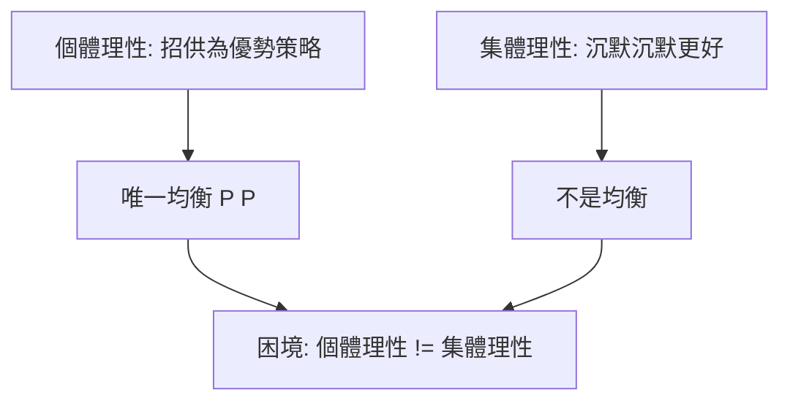

# 2.2 1950年：囚徒困境與納許均衡的存在性定理

## 1. 問題：什麼是「理性互動的解」？

1948–1950 年的蘭德公司（RAND Corporation）面臨冷戰的核心難題：美蘇核武對峙中，每方的最適行動取決於對方行動。賽局理論需要回答：

1. **存在性**：任意有限賽局（多人、混合策略）是否必有「解」？
2. **概念性**：就算存在，什麼樣的結果配稱為「解」？

這不是純數學問題——冷戰軍備競賽、關稅報復、公共財供給，全是同一結構的實例。

## 2. 數學：(a) 納許定理；(b) 囚徒困境

### 納許均衡的存在性

約翰·納許（John Nash, 1950–51）定義：策略組合 $s^* = (s_1^*, \dots, s_n^*)$ 是**納許均衡**，若每個玩家 $i$ 的策略在他人策略給定下為最佳反應：

$$
u_i(s_i^*, s_{-i}^*) \;\ge\; u_i(s_i, s_{-i}^*) \quad \forall s_i,\ \forall i
$$

**納許定理**：任何有限賽局（玩家有限、策略有限）必有混合策略納許均衡。

證明的核心是**角谷不動點定理**（Kakutani fixed point theorem）：最佳反應對應 $BR_i(s_{-i})$ 是凸值、閉圖、非空的多值函數，故聯合最佳反應對應 $BR = BR_1 \times \cdots \times BR_n$ 在緊凸集 $\Delta_1 \times \cdots \times \Delta_n$ 上有不動點。此不動點即均衡。

與古諾（2.1 節）比較：納許把「曲線交點」升級為「一般賽局的不動點」，並證明其普遍存在。**古諾提供概念，納許提供定理。**

### 囚徒困境

同時期，蘭德的 Flood 與 Dresher 做了實驗，Tucker (1950) 將其命名為「囚徒困境」：

| | 乙：沉默 | 乙：招供 |
|---|---|---|
| **甲：沉默** | $-1, -1$ | $-3, 0$ |
| **甲：招供** | $0, -3$ | $-2, -2$ |

結構條件： $T > R > P > S$ （誘惑 > 報酬 > 懲罰 > 傻瓜）。唯一的納許均衡是（招供, 招供）——但（沉默, 沉默）對雙方都更好。

## 3. 後果

- **社會科學的「牛頓力學時刻」**：納許定理保證了分析工具的普適性，賽局論從此可以對任何互動情境給出確定預測。
- **軍事與冷戰**：核嚇阻理論（Schelling, 1960）、美蘇限武談判的分析框架。
- **經濟學的革命**：產業組織、拍賣、貿易談判、契約理論全部改寫為賽局；1994、2005、2007、2012、2014、2016、2020 年諾貝爾經濟學獎多與此相關。
- **政治學**：投票行為、國際關係（嚇阻、安全困境）、立法議事（結構誘導均衡）皆採用納許框架。

## 4. 回饋：均衡概念的反覆精煉

納許均衡馬上面臨批評：均衡可能很多個、可能不合理（含有不可置信威脅的均衡）。社會科學需求驅動了一連串**精煉**（refinement）數學：

- 子賽局完美均衡（Selten, 1965）——要求策略在每個子賽局都合理，處理動態；
- 貝氏納許均衡（Harsanyi, 1967）——處理資訊不對稱；
- 序貫均衡（Kreps–Wilson, 1982）。

反方向，「均衡是否會被達成」的問題則由演化賽局回答（2.3 節）。而不動點方法的計算複雜度問題（PPAD 完全，Daskalakis et al., 2009）則把賽局論推進計算機科學。

## 5. 延伸思考

1. 納許均衡的存在是「數學保證」，但玩家需要多理性才能到達它？（認知層級、知識公理的爭論）
2. 若溝通與承諾可能，困境能否化解？（Schelling 的焦點與可承諾性）
