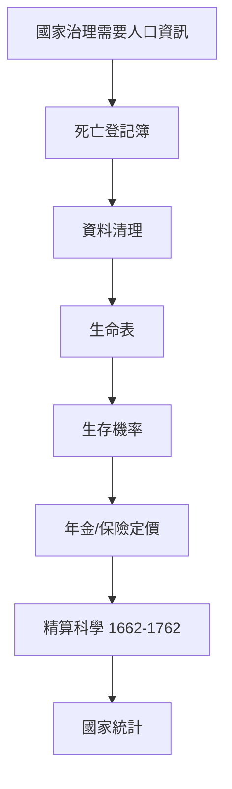

# 3.1 1662年：格蘭特的死亡表與政治算術

## 1. 問題：國家如何「看見」自己？

十七世紀的君主統治著自己從未謀面的千萬臣民，卻對人口、疾病、出生率一無所知。徵兵、課稅、防疫全靠猜測。1662 年，倫敦的布商約翰·格蘭特（John Graunt）出版《關於死亡表的自然與政治觀察》（*Natural and Political Observations Made upon the Bills of Mortality*），第一次系統性地回答：

> 倫敦每年死了多少人？死於什麼？人口結構長什麼樣？

這是社會科學史上第一次**將社會本身當作可測量的對象**。此前，社會只存在於道德論述與政治哲學中；此後，社會成為數字。

## 2. 數學：生命表與生存機率

格蘭特從倫敦教區死亡登記（bills of mortality）出發，面對嚴重的資料品質問題（漏報、死因粗略），發明了一系列至今仍使用的技術：

1. **資料清理與合理性檢驗**：交叉比對出生/死亡記錄、估計漏報率；
2. **生命表**（life table）：估計每 100 個出生者在各年齡的存活人數——他粗估 100 人中，活到 6 歲約 64 人、16 歲約 40 人、76 歲約 3 人；
3. **由死亡資料反推人口結構**（人口學的第一個「間接估計」）。

形式化地，設 $l_x$ 為活到年齡 $x$ 的人數，則條件生存機率為：

$$
P(\text{活過 } y \mid \text{活到 } x) = \frac{l_y}{l_x}
$$

1.2 節的期望效用可以立即應用：若年金給付至死亡，其現值為

$$
E\!\left[\sum_{t=0}^{\infty} \frac{v^t}{(1+i)^t}\right] = \sum_{t} \frac{l_{x+t}}{l_x} \cdot \frac{1}{(1+i)^t}
$$

格蘭特的朋友 William Petty 將這套方法命名為**政治算術**（political arithmetic）：「用數字、重量、尺度來談論政府事務」。

## 3. 後果

- **精算科學誕生**：1693 年 Edmond Halley（哈雷彗星的哈雷）為布雷斯勞市建立更精確的生命表，直接支撐壽險業；1762 年倫敦公平人壽（Equitable Life）成為第一家以精算定價的保險公司。
- **國家的數據化**：人口普查（美國 1790 年首次）、死亡率統計、後來的 GDP（1930 年代）——現代國家的「可視性」始於 1662。
- **公共衛生**：1854 年 John Snow 以死亡地圖追查倫敦霍亂源頭（Broad Street 幫浦），正是格蘭特傳統的直接繼承。
- **社會科學的認識論革命**：證明了「社會規律」存在（即使個體行為混亂，死亡率卻高度穩定），為十九世紀凱特勒的「平均人」（見下）與社會學的誕生奠基。

## 4. 回饋：常態曲線從誤差走進社會

格蘭特與後繼者發現社會數字有驚人的**規律性**（自殺率、犯罪率逐年穩定），這促使天文學出身的凱特勒（Quetelet, 1835）將高斯誤差理論的**常態曲線**套用於人類身高、犯罪行為，提出「平均人」概念。常態分配從「測量誤差的數學」變成「社會差異的數學」——這是物理數學向社會科學的大遷徙，也直接孕育了相關係數（Galton, 1888）與迴歸分析，最終匯入 1920 年代費雪的統計革命（3.2 節）。

## 5. 延伸思考

1. 「為行政目的而測量的數字」會反過來改變被測量的行為（Goodhart 定律、古德哈特效應）——數據化是中性的嗎？
2. 死亡登記簿的階級偏差（窮人漏報更多）如何污染生命表？測量偏差問題貫穿至今天的演算法偏見（5.3 節）。
