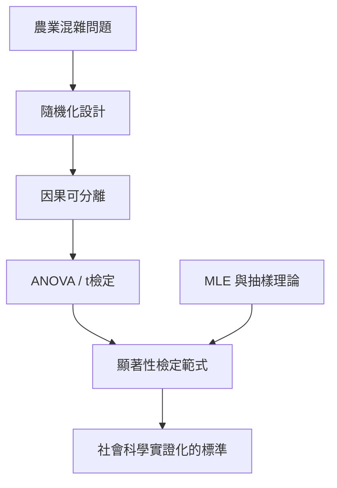

# 3.2 1920年代：費雪的實驗設計與顯著性檢定

## 1. 問題：社會科學如何區分「效果」與「雜訊」？

到 1900 年代，社會改革者面臨尷尬：施肥到底有沒有效？新教學法到底有沒有效？採用新工資制度到底有沒有效？觀察性比較總是混淆了其他因素（好田地恰好施肥、好學生恰好用新法）。

農業試驗站的實務困境是催化劑：田地有土壤肥力的系統性梯度，如果「處理區」剛好在較肥的一側，效果全被污染。**如何安排實驗，使「因果效應」與「其他一切差異」在數學上可分離？**

R. A. 費雪（Ronald Fisher）1919 年進入羅森斯特（Rothamsted）農業試驗站，面對數十年的田間資料，發明了答案。

## 2. 數學：隨機化、變異數分析與檢定

### 隨機化：因果分離的核心發明

費雪的天才洞見：**用隨機指派**把不可觀測的混雜因素（土壤肥力、日照、蟲害）變成「平均上無關」：

- 處理組與對照組的差異期望上**只**來自處理本身；
- 而且隨機化讓我們能**計算**觀察到的差異在「純運氣」下出現的機率。

實驗單位的設計（如隨機區組、拉丁方格）則控制已知混雜、對未知混雜隨機化：

$$
Y_{ij} = \mu + \tau_i + \beta_j + \varepsilon_{ij}
$$

（處理效應 $\tau_i$、區組效應 $\beta_j$、隨機誤差 $\varepsilon$），用**變異數分析**（ANOVA）將總變異分解、以 $F$ 檢定比較組間與組內變異。

### 顯著性檢定

虛無假設 $H_0$（處理無效）下，檢定統計量 $T$ 有已知分配 $F$；定義 p 值：

$$
p = P_{H_0}\big(|T| \ge |t_{\text{obs}}|\big)
$$

$p$ 小於某門檻 $\alpha$（費雪慣用 0.05），則「結果太不可能只是運氣」，拒絕 $H_0$。費雪也同時建立了**最大概似估計**（MLE, 1922）與充分性、有效性理論，奠定現代數理統計。

## 3. 後果

- **社會科學的實證範式**：心理學、教育學、社會學在 1930–60 年代全面採用「隨機實驗 + 檢定」；研究方法課程的核心至今仍是 ANOVA 與 t 檢定。
- **醫學與政策**：隨機對照試驗（RCT）成為醫學證據等級的頂點；社會政策評估（3.3 節）繼承此傳統。
- **經濟計量的問題**：經濟學無法對工資、政策做隨機實驗，只能用觀察資料，於是發展出工具變數、自然實驗等替代方案（2021 年諾獎）——**實驗的不可行性反而催生了另一套因果推斷數學**。

## 4. 回饋：檢定範式的內在矛盾與修正

費雪的顯著性檢定與 Neyman–Pearson 的決策理論（型一/型二錯誤、檢定力）在 1930 年代激烈論戰，最後被教科書**不合邏輯地混雜**成今日通行的「p < 0.05 範式」。其社會後果在 2010 年代爆發：

1. **可複製性危機**（psychology, 2011–2015）：p-hacking、出版偏差使大量「顯著」結果無法重現；
2. **p 值的誤用**：$p > 0.05$ 被誤讀為「無效果」，$p < 0.05$ 被誤讀為「假設為真」；
3. 修正運動：預註冊、效果量與信賴區間、貝氏方法回歸（利用 1.3 節的決策理論基礎）。

**社會科學的實踐危機，反過來重塑了統計學本身**——這是本書主題（數學與社會科學互為驅動）最鮮明的例子之一。

## 5. 延伸思考

1. 隨機化保證的是「平均上」可比；單一實驗的隨機指派可能運氣很差——實驗的「可重複性」如何補救？
2. 當隨機化違反倫理（如貧窮、教育剝奪），準實驗設計（3.3 節）能走多遠？
