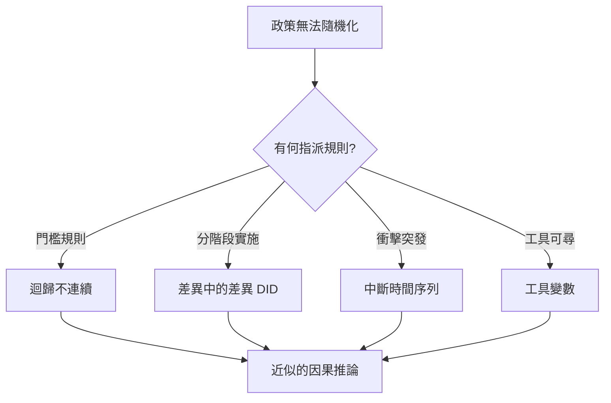

# 3.3 1963年：唐納·坎貝爾與準實驗設計——社會改革的評估科學

## 1. 問題：大社會計畫的「有效性」危機

1960 年代，美國推動「大社會」（Great Society）改革：啟蒙計畫（Head Start）、職業訓練、社區行動。國會與社會科學家很快發現兩個殘酷事實：

1. **不能隨機化**：你無法隨機決定哪些孩子「得不到」學前教育、哪些社區「得不到」補助——政治與倫理不允許（3.2 節方法的極限）。
2. **觀察比較全是陷阱**：參加計畫的人本來就不同（自我選擇）；政策在經濟衰退時啟動（時點混淆）；受助者知道自己在被觀察（Hawthorne 效應）。

沒有隨機化，還能做因果推論嗎？這是政策科學的存亡問題。Donald Campbell 與 Julian Stanley 的《實驗與準實驗設計》（*Experimental and Quasi-Experimental Designs for Research*, 1963）正面回答。

## 2. 數學：潛在結果與設計對策

### 潛在結果框架的直覺

個體 $i$ 的處理效應定義為兩個「潛在結果」之差：

$$
\tau_i = Y_i(1) - Y_i(0)
$$

但 $Y_i(1)$ 與 $Y_i(0)$ 中永遠只有一個可觀測（因果推論的根本缺失資料問題）。簡單比較觀測平均值：

$$
E[Y \mid D=1] - E[Y \mid D=0] = \underbrace{E[\tau]}_{\text{想要的效果}} + \underbrace{\text{選擇偏差}}_{\text{混雜}}
$$

隨機化（3.2 節）使選擇偏差為零；準實驗的任務是**用設計與假設**把它削掉。

### Campbell 的設計清單

Campbell 將「威脅效度的因素」（歷史事件、成熟效應、測驗效應、迴歸到平均…）系統化，並為每個威脅開出**設計處方**：

| 設計 | 邏輯 |
|------|------|
| 前後測對照組（nonequivalent control group） | 對照組吸收「歷史/成熟」共變 |
| 時間序列設計（interrupted time series） | 政策前後多點趨勢比較，排除長期趨勢 |
| 迴歸不連續設計（RDD） | 以門檻規則（如 60 分及格）指派：門檻附近的比較近似隨機 |

其中 RDD 的數學最優雅：若指派變數為 $X$、門檻 $c$，則

$$
\tau_{\text{RDD}} = \lim_{x \downarrow c} E[Y \mid X = x] - \lim_{x \uparrow c} E[Y \mid X = x]
$$

只要個體無法精確操縱 $X$ 達門檻，門檻兩側的個體「近乎同質」，因果詮釋成立——**制度規則中的「一刀切」原來是免費的隨機化**。

差異中的差異（DID，Snow 1855 年霍亂分析已是原型；Ashenfelter 1970 年代發揚）則用兩次差分消除固定差異：

$$
\hat\tau_{\text{DID}} = (\bar Y_{\text{處理,後}} - \bar Y_{\text{處理,前}}) - (\bar Y_{\text{對照,後}} - \bar Y_{\text{對照,前}})
$$

## 3. 後果

- **政策評估成為學科**：美國國會 1974 年設立評估辦公室；世界銀行的影響評估（impact evaluation）工業化；Duflo、Banerjee、Kremer 以田野 RCT 獲 2019 諾獎，其方法譜系正是 Campbell（+3.2 費雪）。
- **社會科學的認識論轉向**：「因果推論」從哲學爭論變成**設計工程**——Rubin (1974) 的潛在結果模型將 Campbell 的設計直覺形式化，此後「因果 = 潛在結果比較」成為統一的數學語言。
- **證據位階**：系統性回顧與證據等級制度（醫學、教育、發展經濟學）以設計強度排序證據。

## 4. 回饋

Campbell 的設計清單原本是「技巧集」，1990 年代被 Pearl 的**有向無環圖**（DAG）與 do-演算法、以及 Rubin 潛在結果框架**公理化**：因果假設被畫成圖、可辨識性變成圖上的可判定問題。社會科學的設計智慧反哺統計學，形成今日「因果推斷」這一大顯學——並成為機器學習時代的核心課題（5.3 節：相關不是因果，演算法尤其如此）。

## 5. 延伸思考

1. Campbell 自己警告「通用定律的社會科學」之限，晚年轉向「演化認識論」——設計得再好，結論能外推多遠？
2. 政策評估的「有效」是對誰有效？（分配問題 vs. 效率問題，通往 5.1 節社會選擇）
