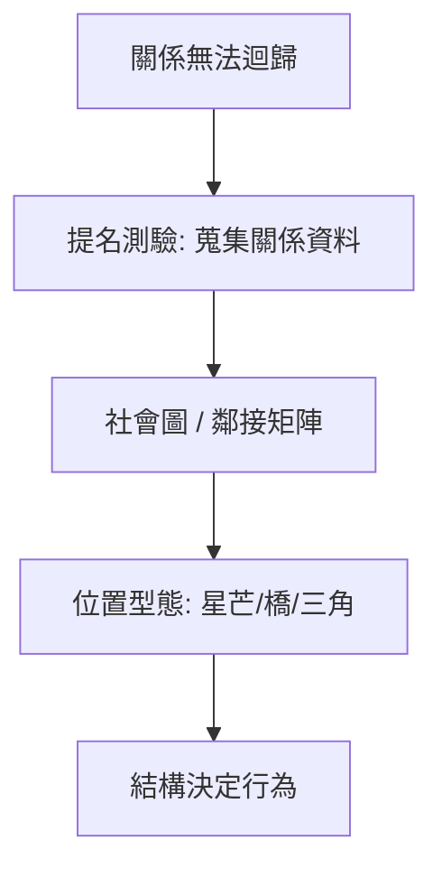

# 4.1 1934年：莫雷諾的社會計量學與社會網絡分析的誕生

## 1. 問題：關係是看不見的變數

1930 年代的社會科學有兩個盲區：

1. **統計上**：主流工具（相關、迴歸，見 3.1–3.2 節）處理的是**個體屬性**（年齡、收入、教育），而社會學的核心物件——**關係**（友誼、影響、信任）——根本不是屬性，無法放進迴歸方程。
2. **實務上**：莫雷諾（Jacob Moreno）在紐約哈德遜女子學校遇到逃家事件。個案資料（家庭、成績）毫無異常；但若畫出「誰想和誰同桌」的關係圖，立刻可見逃跑者位於某個被孤立的連通成分中——**位置，而非屬性，才是行為的預測子**。

莫雷諾的問題：如何把「關係」變成可測量、可畫、可計算的數學物件？

## 2. 數學：社會圖、社會矩陣與圖論的引入

1933 年莫雷諾在美國社會學會年會展示第一張「社會圖」（sociogram），1934 年出版《誰會存活？》（*Who Shall Survive?*），正式創立**社會計量學**（sociometry）。其數學貢獻：

1. **關係的編碼**：以圖 $G = (V, E)$ 表示，點為人、邊為關係；或等價地以**社會矩陣**（鄰接矩陣） $A$ 表示， $A_{ij} = 1$ 表 $i$ 選擇 $j$ ；
2. **位置的量化**：
   - 星芒（star，中心人物）、孤立（isolate）、對偶（dyad）、三角（triad）等**結構型態**；
   - 節點度數 $\deg(i) = \sum_j A_{ij}$ 作為最早的「中心性」指標（社經地位 SES 的前身）；
3. **社會計量測驗**：以「選擇題式」的提名（你最想和誰一起工作？）系統性蒐集關係資料。

莫雷諾與其弟子 Jenning 的關鍵命題是**結構決定行為**：同一個「屬性」的人，因網絡位置不同而有不同命運。這是社會學對「方法論個體主義」（第 1、2 章的理性選擇傳統）最早、最重要的制衡。

## 3. 後果

- **圖論成為社會科學語言**：Harary 與 Cartwright 在 1950 年代將圖論系統引進社會學；「結構平衡」（Heider 1946；Cartwright–Harary 1956 定理：平衡圖可分割為兩陣營）以三角關係解釋國際聯盟與人際緊張。
- **橋與弱連帶**：Granovetter (1973) 的「弱連帶的力量」——找工作靠的常是點頭之交而非摯友，因為弱連帶是跨群體的**橋**（Burt 後形式化為「結構洞」）。此理論成為社會學 30 年來被引用最多的成果之一。
- **六度分隔**：Milgram (1967) 的連鎖信實驗，60 年後被 Watts–Strogatz (1998) 與 Barabási–Albert (1999) 的網絡模型數學化（小世界、無尺度）。
- **傳染與擴散**：創新擴散（Rogers）、疾病傳播、簡單接觸傳染模型 $dI/dt = \beta S I$ 在網絡上的推廣，成為流行病學與行銷的共同數學。

## 4. 回饋

社會網絡分析的資料需求（誰連誰）長期受限於問卷；1990 年代末，**網際網路自己變成了社會圖**（電子郵件、社交平台），資料洪流反過來改造數學：

1. 巨大網絡需要**隨機圖論**與機率方法（Erdős–Rényi 之外的模型）；
2. 「網絡上的賽局」（2.3 節演化賽局 + 4.1 網絡）合流為 Jackson、Goyal 等人的網絡經濟學；
3. 網絡上的因果推斷（處理效應會溢出到鄰居，違反 3.3 節 RCT 的 SUTVA 假設）成為統計前沿——**網絡結構連隨機實驗的數學都必須重寫**。

## 5. 延伸思考

1. 莫雷諾主張社會計量資料可用「治療」社會（重新安排座位可治逃家）——測量、預測與干預的界線在哪？（呼應 3.3 節的 do-思考）
2. 若社會位置決定機會，網絡不平等（誰有橋、誰被孤立）是否是比所得不平等更根本的社會問題？
