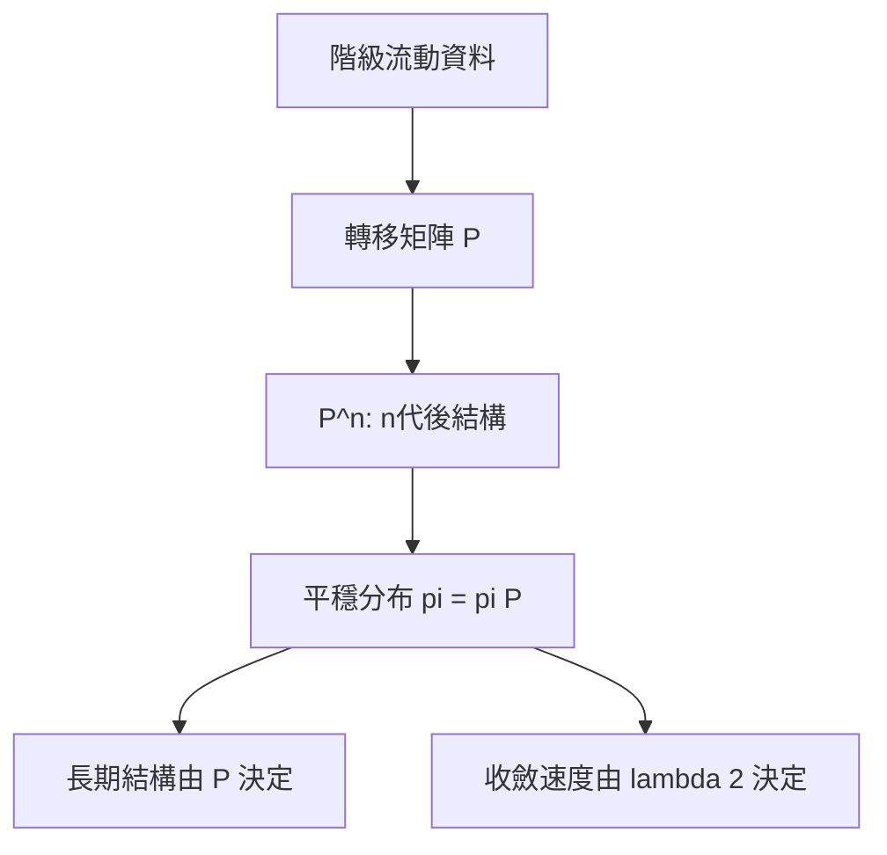

# 4.2 1958年：馬可夫鏈與社會流動的數學模型

## 1. 問題：「階級」能被數學化嗎？

戰後英國面臨核心政治問題：福利國家真的促進了社會流動嗎？「從貧民到富豪」的故事有多少是真實的？要回答，必須把模糊的「階級」變成**可測量、可跨代追蹤的變數**，並且把「流動」變成**動態過程**——不是一張靜態的快照，而是「父代地位 → 子代地位」的轉移結構。

1950 年代 Glass 等人主持大規模社會流動調查；1958 年 sociologist S. J. Prais 與統計學家將**馬可夫鏈**引進這個資料，社會流動首次獲得嚴格的動態數學。

## 2. 數學：轉移矩陣與穩態分布

將社會分為 $k$ 個階級，估計**轉移矩陣** $P$，其中

$$
P_{ij} = P(\text{子代在階級 } j \mid \text{父代在階級 } i)
$$

每列和為 1（隨機矩陣）。若轉移機率跨代不變，第 $n$ 代的階級分布 $x^{(n)}$ 滿足：

$$
x^{(n)} = x^{(0)} P^{n}
$$

**馬可夫鏈收斂定理**：若 $P$ 不可約且非週期，則 $P^n \to \Pi$（每列相同），任意初始分布收斂到**平穩分布** $\pi$，滿足 $\pi = \pi P$。

其社會學詮釋極為深刻：

1. **長期不平等與起點無關**：無論今天的不平等多嚴重，只要轉移結構不變，社會終將走向 $\pi$——「歷史的終結」（結構決定長期，路徑不重要）；
2. **對角線的意義**：$P_{ii}$ 大表繼承性強、流動性低；
3. **譜分解解釋收斂速度**：第二特徵值 $|\lambda_2|$ 決定「接近穩態要多快」——$\lambda_2$ 越接近 1，流動越「黏」，階級結構越頑固。

## 3. 後果

- **社會分層研究的標準工具**：Blau–Duncan (1967) 的地位取得模型（路徑分析）將馬可夫思想擴充為連續變數的結構方程；職業流動表的分析技術（對數線性模型，Goodman 1970 年代）成為社會學統計的核心。
- **人口學與勞動經濟學**：失業持續期間、所得動態、貧窮陷阱都用馬可夫模型刻畫；收入流動的「轉移核」估計成為不平等研究的常備工具。
- **其他社會領域的遷移**：選民政黨认同的變動、品牌忠誠度、都市土地使用的轉換、語言的代際傳遞（瀕危語言模型）——凡「狀態 + 跨期轉移」的社會過程皆可用之。

## 4. 回饋：齊次性假設的崩潰與新數學

馬可夫模型的社會學致命傷是其**齊次性假設**（轉移機率不變）。1970 年代的實證發現：

1. **非齊次**：轉移機率隨教育擴張、產業結構變化而變（結構流動 vs. 交換流動之分）；
2. **路徑依賴**：過去狀態不只影響當期，還影響轉移機率本身（非馬可夫性）；
3. **異質個體**：「流動性」在人口內部不同（不可觀測異質性），造成表列流動率隨時間偏移的假象（Sorokin 早就警告）。

社會科學的需求驅動了統計學的新分支：

- **面板資料與事件史分析**（Cox 比例風險模型 1972、半馬可夫過程）；
- **潛在類別與混合模型**（處理不可觀測異質性）；
- **路徑依賴的正式理論**（Arthur、David 1985；與 2.3 節隨機演化賽局中的長期極限相通）——「歷史重要」獲得數學證明，直接反駁了馬可夫鏈的「歷史無關」結論。

## 5. 延伸思考

1. 平穩分布 $\pi$ 是「預測」還是「規範」？若政策改變 $P$（教育改革）， $\pi$ 會變——但改變 $P$ 的政治過程本身是否也是馬可夫過程？（層次混雜）
2. 若流動機會依賴於社會網絡（4.1 節），階級轉移就不是獨立的跨代抽樣——馬可夫假設在網絡社會中還成立嗎？
