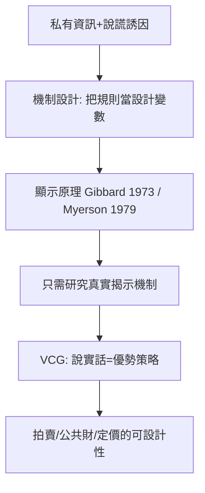

# 5.2 1961年：維克里拍賣與機制設計的誕生

## 1. 問題：人不會說實話

Arrow 定理（5.1 節）否定了「完美的社會加總」，但留下了實用問題：**在特定情境下，能否設計出不會被操縱的集體決策規則？**

關鍵障礙是**私有資訊**：拍賣中買家願付多少、稅制中納稅人賺多少、公共財計畫中居民受益多少——這些只有當事人知道，而且**他們有說謊的誘因**（低報以逃稅、低報以壓價）。任何機制若依賴人們主動誠實申報，就會被策略行為扭曲。

哥倫比亞大學的 William Vickrey (1961)〈Counterspeculation, Auctions, and Competitive Sealed Tenders〉正面解決了拍賣版本：**能否設計一種拍賣，使說實話是每個人的最佳策略？**

## 2. 數學：誘因相容與真實揭示

### 二價拍賣（Vickrey auction）

規則：密封投標，**出價最高者得標，但只付第二高出價**。

設買家 $i$ 對物品的真實估值為 $v_i$ （私有），投標 $b_i$ 。得標時淨效用為 $v_i - p$ （ $p$ = 第二高價，**與自己的出價無關**）；未得標效用為 0。

**定理**：真實出價 $b_i = v_i$ 是優勢策略。證明極簡：

- 高報（ $b_i > v_i$ ）：可能以 $p > v_i$ 得標，虧損 $v_i - p < 0$ ；
- 低報（ $b_i < v_i$ ）：可能在 $p < v_i$ 時錯失正利潤 $v_i - p > 0$ 。

兩種偏離只可能變差，不會變好——**說實話是優勢策略**（dominant-strategy truthful）。這個性質稱為**誘因相容**（incentive compatibility）或**真實揭示**（truthful revelation）。

### 推廣：VCG 機制

Clarke (1971)、Groves (1973) 將其推廣到多物品、公共財：對每個參與者，收費等於其對他人造成的**外部性**：

$$
p_i = \sum_{j \ne i} u_j(\text{有 } i \text{ 的結果}) - \sum_{j \ne i} u_j(\text{無 } i \text{ 的結果})
$$

**VCG 機制**在準線性偏好下實現：社會最適結果 + 優勢策略說實話。**它正面回答了 Arrow 之問**：放棄「全域加總」，在受限環境（準線性、可轉移效用）中，完美的機制存在。

### 顯示原理（Revelation Principle）

Myerson (1979) 等人證明：任何機制的任何均衡結果，都可由某個「真實揭示」的等價機制實現。這是方法論革命——**機制設計師只需研究說實話機制**，搜尋空間大幅縮減，整個領域因此可操作化。

## 3. 後果

- **機制設計成為學科**：Hurwicz（1960 年代即開始，2007 諾獎）、Myerson、Maskin（2007 諾獎）將其形式化為「逆向賽局」：給定想要的社會結果，反推什麼遊戲規則能誘出它。賽局論（第 2 章）問「規則下會發生什麼」；機制設計問「想要什麼結果，該定什麼規則」。
- **現實工程**：
  - **頻譜拍賣**：美國 FCC 1994 年起採用設計過的同步多輪拍賣（Milgrom–Wilson，2020 諾獎），數千億美元的公共收入；
  - **Google 廣告拍賣**：搜尋廣告採用廣義二價（GSP，源自 Vickrey 思想），是史上最大的拍賣市場；
  - **拍賣設計的失敗教訓**：歐洲 3G 之後各國頻譜拍賣的成敗比較，證明「機制設計=應用數學工程」；
  - **公共財、稅制（Mirrlees 最適所得稅，1996 諾獎）、規制（Laffont–Tirole，2014 諾獎）**。
- **匹配市場**：Gale–Shapley 延遲接受法（1962）與 Roth 的腎臟交換、學校選擇設計（2012 諾獎）——同一綱領在「不可轉移效用」世界的延伸。

## 4. 回饋

機制設計的成功立刻撞上兩個新邊界，各自催生新數學：

1. **不可能又回來了**：Myerson–Satterthwaite (1983) 證明：雙邊交易中，個人理性 + 誘因相容 + 預算平衡**不能同時成立**——VCG 的「預算不平衡」不是技術瑕疵而是必然。機制設計的本質是**在不可能性中選擇犧牲哪一項**。
2. **計算維度**：VCG 需解開一個最佳化問題，在組合拍賣中是 NP-hard。Nisan、Roughgarden 等人建立**演算法賽局理論**：誘因相容 + 計算可行性 + 近似比的三邊權衡，成為電腦科學與經濟學的交會點——網路廣告、區塊鏈、平台經濟的理論基礎，直接匯入 5.3 節的計算社會科學。

## 5. 延伸思考

1. Vickrey 拍賣在實驗中人們仍常高報——為何理論上優勢策略說實話，行為上卻不？（風險趨避、誤解、與 2.3 節有限理性的呼應）
2. 機制設計是「價值中立」的嗎？設計者選擇優化什麼（效率、收入、公平），本身就是 5.1 節的社會選擇問題——**工程問題的底部永遠墊著規範問題**。
