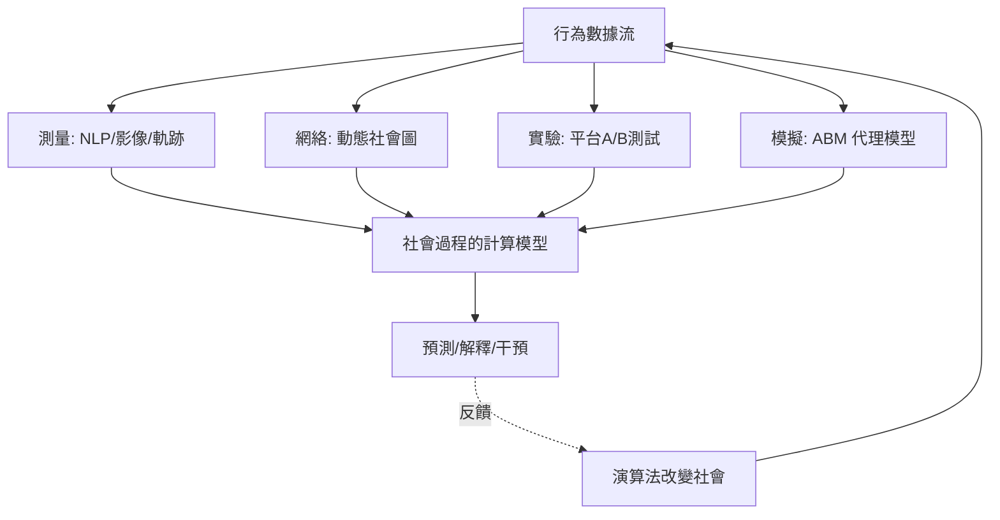

# 5.3 2000年代：計算社會科學與大數據時代的社會科學

## 1. 問題：社會自己開始產生資料

2000 年代，人類社會的行為首次被**自動、大規模、即時**地記錄：手機通話與移動軌跡、社群媒體的互動圖、搜尋紀錄、電子支付。規模從社會調查的數千人躍升到**數億人、數十億次互動**。

這同時是機會與危機：

1. **機會**：4.1 節莫雷諾夢想的「全景社會圖」、4.3 節謝林的棋盤、2.3 節的演化動態——**首次可用真實資料直接觀察**；社會科學第一次擁有近似物理實驗的資料密度。
2. **危機**：資料是「行為的副產品」而非「為研究而設計」（3.2 節的隨機化不在）；演算法自己開始介入社會（推薦系統、信用評分），**觀察者改變了被觀察的社會**；隱私與不平等成為方法論問題。

計算社會科學（Lazer et al., 2009, *Science*〈Computational Social Science〉宣言）正是在此張力中誕生。

## 2. 數學：四條工具線的合流

本書前四章的數學在此匯流：

| 傳統（本書章節） | 大數據時代的化身 |
|---|---|
| 機率與效用（第1章） | 貝氏層級模型、機器學習的損失函數設計 |
| 賽局與演化（第2章） | 演算法賽局、平台機制、多主體強化學習 |
| 統計與因果（第3章） | 大規模 A/B 測試、DAG 因果推斷、遷移學習 |
| 網絡與動態（第4章） | 時變網絡、圖神經網路、網絡上的傳染模型 |

三個代表性的數學核心：

1. **複雜系統與 ABM**：4.3 節謝林路線的成熟。當解析解不存在（非線性、異質、網絡互動），模擬成為「數學實驗」；**代理基模型作為理論**：模型本身即是可檢驗的社會理論表述。
2. **網絡傳染與因果**：社交平台上的 A/B 測試違反 SUTVA（3.3 節）——鄰居的處理會溢出（network interference），需要新的估計量（exposure mapping、cluster randomized designs）。
3. **文字與行為的向量化**：NLP（從 LSA 到 transformer）把「意義」變成高維向量，使思想傳播、政治極化、文化變遷首次可定量追蹤——**質性社會科學的物件被數學化了**。

## 3. 後果

- **學科重組**：社會科學、電腦科學、物理學（網絡科學出自統計物理）交叉；Google、Meta 內的經濟學家團隊成為最大雇主之一；「數位人文」興起。
- **公共部門的數據化**：疫情即時傳播模型（R_t 估計）、數位足跡貧窮預測、選舉預測（民意調查的衰落下，模型化民調與政治資金市場）。
- **政策的演算法化**：信用評分、風險預測、資源分配演算法進入司法、社福、教育——機制設計（5.2 節）成為**演算法設計的規範核心**。
- **預測的社會效應**：搜尋趨勢預測流感（Google Flu Trends 的失敗）、社會預測的自我實現/自我否認——Goodhart 定律（3.1 節遺留問題）成為顯學。

## 4. 回饋：大數據時代的三重教訓

計算社會科學的十年，恰是本書主題（數學 ⇄ 社會科學互驅）的最新一章：

1. **大數據 ≠ 好資料**：Google Flu Trends 2013 年高估流感兩倍——數位足跡的系統偏差（誰上網、平台如何過濾）重演了 1662 年格蘭特的漏報問題（3.1 節）。**測量理論沒有過時，只是換了形式**。
2. **相關性爆炸、因果稀缺**：機器學習的預測力建立在相關之上，但政策需要干預（3.3 節 do-問題）。因果機器學習（causal ML、uplift modeling）成為顯學——**社會科學的因果傳統反哺電腦科學**。
3. **演算法回饋迴圈**：推薦系統改變用戶行為、行為再訓練演算法（2.3 節的演化動態 + 4.3 節的湧現，現在由演算法驅動）——**數學模型成為社會的組成部分**，社會科學第一次必須研究「自己模型所造出的社會」。

最後一點標記了一個歷史轉折：從帕斯卡（1.1 節）到謝林（4.3 節），數學是社會的**鏡子**；在計算社會科學時代，數學成為社會的**零件**。研究社會的人，同時在建造社會——這是下一版教科書要回答的問題。

## 5. 延伸思考

1. 若演算法的訓練資料反映歷史歧視，模型會複製並放大歧視（演算法偏見）——這是 3.1 節測量偏差、5.2 節機制設計目標設定、5.1 節分配正義的三重疊加。你要在哪一層介入？
2. 當社會科學模型被政府與平台採用，模型的「預測」變成政策的「目標」——社會科學能否避免成為自我實現的預言機器？（計量經濟學的 Lucas 批判之社會版本）
