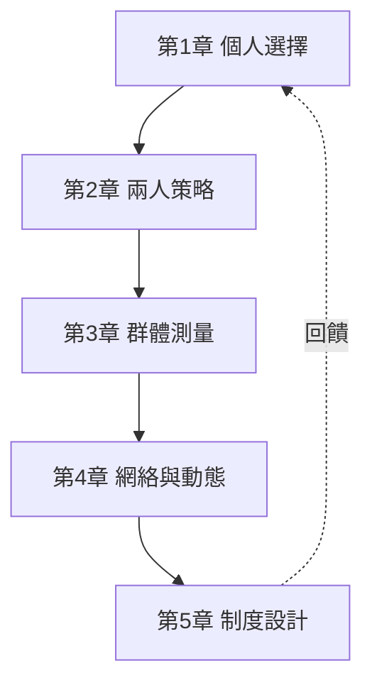

# 數學與社會科學

一本探討數學如何塑造、並被社會科學塑造的教科書。全書以「前因後果」為主軸：每一個數學工具的誕生，都是為了回應某個真實的社會問題；而每一個社會科學理論的突破，又往往反過來催生新的數學。

## 目錄

* 第1章-理性選擇的數學化：從賭博到效用
    * [1.1-1654年：帕斯卡與費馬的通信——機率論的誕生](01.1-1654年帕斯卡與費馬的通信——機率論的誕生.md)
    * [1.2-1738年：聖彼得堡悖論與伯努利的效用革命](01.2-1738年聖彼得堡悖論與伯努利的效用革命.md)
    * [1.3-1944年：馮諾伊曼—摩根斯坦期望效用理論與偏好公理](01.3-1944年馮諾伊曼摩根斯坦期望效用理論與偏好公理.md)
* 第2章-賽局理論：策略互動的幾何學
    * [2.1-1838年：古諾雙佔模型——納許均衡的前身](02.1-1838年古諾雙佔模型——納許均衡的前身.md)
    * [2.2-1950年：囚徒困境與納許均衡的存在性定理](02.2-1950年囚徒困境與納許均衡的存在性定理.md)
    * [2.3-1970年代：演化賽局與有限理性的回歸](02.3-1970年代演化賽局與有限理性的回歸.md)
* 第3章-統計推論：讓社會可以被「測量」
    * [3.1-1662年：格蘭特的死亡表與政治算術](03.1-1662年格蘭特的死亡表與政治算術.md)
    * [3.2-1920年代：費雪的實驗設計與顯著性檢定](03.2-1920年代費雪的實驗設計與顯著性檢定.md)
    * [3.3-1963年：唐納·坎貝爾與準實驗設計——社會改革的評估科學](03.3-1963年唐納坎貝爾與準實驗設計——社會改革的評估科學.md)
* 第4章-網絡與動態：集體行為的湧現
    * [4.1-1934年：莫雷諾的社會計量學與社會網絡分析的誕生](04.1-1934年莫雷諾的社會計量學與社會網絡分析的誕生.md)
    * [4.2-1958年：馬可夫鏈與社會流動的數學模型](04.2-1958年馬可夫鏈與社會流動的數學模型.md)
    * [4.3-1971年：謝林的隔離模型——微觀偏好如何湧現出宏觀秩序](04.3-1971年謝林的隔離模型——微觀偏好如何湧現出宏觀秩序.md)
* 第5章-設計社會：機制、選擇與計算
    * [5.1-1951年：阿羅不可能定理——民主數學的極限](05.1-1951年阿羅不可能定理——民主數學的極限.md)
    * [5.2-1961年：維克里拍賣與機制設計的誕生](05.2-1961年維克里拍賣與機制設計的誕生.md)
    * [5.3-2000年代：計算社會科學與大數據時代的社會科學](05.3-2000年代計算社會科學與大數據時代的社會科學.md)

## 閱讀路線

## 本書的方法論

每一節都遵循同一個敘事結構：

1. **問題**：當時社會面臨什麼真實困境？
2. **數學**：什麼數學工具被發明出來回應它？
3. **後果**：這個工具如何改變了社會科學？
4. **回饋**：社會科學的反省又如何催生新的數學？
