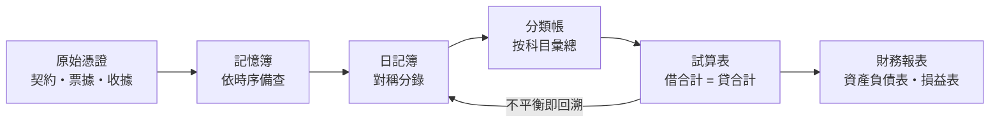

# 1.1 Pacioli與複式簿記1494

## 本章導言

會計的第一個數學動作不是「算」，而是「拆」——把每一樁生意拆成地位對等的兩邊。1494 年，方濟各會修士 **Luca Pacioli（帕喬利，約 1447–1517）** 在威尼斯出版《算術、幾何、比與比例摘要》（Summa de arithmetica, geometria, proportioni et proportionalita），其中第十三部分「簿記與記錄」（De computis et scripturis）第一次以**印刷術**把這套方法公諸於世。它不是發明，而是總結：複式簿記（partita doppia）在此前四百年間已由義大利商埠的帳房默默演化。本節要追問的是：一個商人的記帳習慣，為何蘊含了日後線性代數與守恆定律的種子。

### 一、商埠帳房裡長出來的技術

地中海貿易的節奏決定帳簿的形狀。船一去數月、貨分批裝卸、合夥人各自出資又各自分紅，於是帳房面臨三件麻煩事：**同一筆錢可能同時屬於兩個人**、**損益必須能拆開歸屬**、**帳目必須能被第三者驗證**。單式簿記只記現金進出，遇到賒購、賒銷、代墊就無從下手；複式簿記的解法極其乾脆——**每筆交易都記兩次，一次記「從哪來」，一次記「到哪去」**。

現存最早的複式帳簿之一是 1299–1300 年細耶納（Siena）商人 Farolfi 商號的總分類帳；1340 年熱那亞的聖喬治銀行（Banco di San Giorgio）帳簿更已具備日記簿與分類帳的完整分工。到了十五世紀，威尼斯、佛羅倫斯、熱那亞的商埠把這套做法磨成標準工序：大宗貿易、遠洋風險、匯票流通，全都要求「每塊錢都有來源與去向」的記錄。

### 二、Cotrugli：比 Pacioli 早三十六年的手稿

1458 年，拉古薩（Ragusa，今克羅埃西亞杜布羅夫尼克）商人 **Benedetto Cotrugli** 寫成《商人的書與真實的商人》（Libro de la mercatura e della vera mercatantia），其中已描述分錄、過帳、試算與結帳的完整流程。但這份手稿長期僅以抄本流傳，影響力有限。歷史在這裡給了一個典型教訓：**方法的正確性不等於方法的傳播力**，而 1494 年恰逢印刷術成熟——Pacioli 的書是用古騰堡的技術為複式簿記做了「版本固定」。

### 三、1494 年：《摘要》與其中的簿記篇

Pacioli 生於聖塞波爾克羅（Sansepolcro），早年隨畫家 Piero della Francesca 學數學，後來在米蘭與 **Leonardo da Vinci** 同為盧多維科．斯福爾扎服務，數學聲譽日隆。他的《摘要》是一部面向商人子弟的實用百科，涵蓋印度—阿拉伯數字、商業算術、比例、利息、匯兌與簿記。

簿記篇的組織方式本身就是數學敘事的雛形：

1. **記憶簿（memoriale）**：依發生順序記錄交易原始憑證；
2. **日記簿（giornale）**：把每筆交易改寫成一組對稱的分錄；
3. **分類帳（mastro）**：把分錄按科目拆開、逐筆過入；
4. **試算（prova）**：結算各科目餘額，核對總借方與總貸方是否相等；
5. **結帳**：盤點存貨、結轉損益，編出「財產與負債清單」（inventory）。

Pacioli 在書中明言他記述的是威尼斯商人通用的作法，並以條列規則逐類說明交易該如何下帳。他的規則裡最要害的一條可以濃縮成一句話：**每一筆分錄，借方總額必等於貸方總額**。這不是書寫習慣，而是一個可以被證明的恆等式——它是本書 1.2 節的主題。

### 四、從憑證到報表：一條不間斷的資訊流

流程圖裡每一個箭頭都是**資訊的保真搬運**：分錄的總額不因過帳而改變，科目餘額不因結算而改變。會計師用「平衡」來驗錯，本質上是在做物理學家做的事——檢查某個量在變換下是否守恆。

### 例題 1.1.1

某商號 12 月發生下列交易（金額單位：元）：

1. 業主投資現金 50,000；
2. 賒購商品 12,000；
3. 現購商品 8,000；
4. 銷貨 18,000，收現 11,000，餘為賒欠；
5. 支付租金 3,000；
6. 上述銷貨之進貨成本為 13,000。

試依複式簿記流程編製分錄，並編出試算表，驗證「借方合計＝貸方合計」與「資產＝負債＋權益」。

**解**：六筆交易寫成六組分錄（借方在上、貸方在下）：

| # | 借方科目 | 金額 | 貸方科目 | 金額 |
|---|---------|-----:|---------|-----:|
| 1 | 現金 | 50,000 | 業主資本 | 50,000 |
| 2 | 存貨 | 12,000 | 應付帳款 | 12,000 |
| 3 | 存貨 | 8,000 | 現金 | 8,000 |
| 4 | 現金 11,000／應收帳款 7,000 | 18,000 | 銷貨收入 | 18,000 |
| 5 | 租金費用 | 3,000 | 現金 | 3,000 |
| 6 | 銷貨成本 | 13,000 | 存貨 | 13,000 |

過帳後各科目餘額：現金 $50{,}000-8{,}000+11{,}000-3{,}000=50{,}000$ （借）、應收帳款 7,000（借）、存貨 $12{,}000+8{,}000-13{,}000=7{,}000$ （借）、應付帳款 12,000（貸）、業主資本 50,000（貸）、銷貨收入 18,000（貸）、銷貨成本 13,000（借）、租金費用 3,000（借）。

| 科目 | 借方 | 貸方 |
|------|-----:|-----:|
| 現金 | 50,000 | |
| 應收帳款 | 7,000 | |
| 存貨 | 7,000 | |
| 銷貨成本 | 13,000 | |
| 租金費用 | 3,000 | |
| 應付帳款 | | 12,000 |
| 業主資本 | | 50,000 |
| 銷貨收入 | | 18,000 |
| **合計** | **80,000** | **80,000** |

兩邊同為 80,000，試算表平衡。再驗會計方程：資產 $=50{,}000+7{,}000+7{,}000=64{,}000$ ；負債＋權益 $=12{,}000+50{,}000+(18{,}000-13{,}000-3{,}000)=12{,}000+52{,}000=64{,}000$ ，兩邊相等。當期淨利 $=18{,}000-16{,}000=2{,}000$ ，已包含在權益之中。

## 前因後果與驅動關係

- **實務驅動**：遠洋貿易的合夥、賒欠與匯票逼出了「雙向記錄」。沒有「代墊與歸屬」的問題，就不需要分錄；沒有分錄，就不會出現「兩邊必須相等」這個可檢驗的條件。
- **技術的外溢**：一旦「每筆交易是兩個科目之間的一次轉移」被固定下來，帳簿就變成一個**有向圖**——這正是 1.3 節要處理的對象；而全部科目餘額湊成的向量，則是 2.1 節的向量空間。
- **理論反過來改變實務**：印刷術與《摘要》使複式簿記成為跨國商業語言，帳簿從「東家的私產」變成**可被審計的公開結構**；到了十九世紀，這套「兩邊相等」的紀律又成為公司法、所得稅與證券規範的技術基礎。今日的審計抽樣（9.3 節）、合併報表的消除分錄（10.2 節），仍然依賴 1494 年那條「借貸必相等」的規則。
- **兄弟書接點**：《金融的數學》第 1 章的時間價值，解釋了為何帳簿後來必須再加一欄「日期與利率」；《管理的數學》第 5 章的存貨模型，其成本資料來源正是本節流程圖中的分類帳。

## 練習

1. 承例題 1.1.1，若交易 2 改為現購 12,000（其餘不變），試算表是否仍然平衡？資產總額與應付帳款各為多少？
2. 某商號期初無任何帳戶，業主投資現金 30,000、同時以其中 18,000 賒購設備。請編分錄並算出試算表兩方合計。
3. 若試算表借方合計 96,400、貸方合計 95,500，差額 900，這一定代表有 900 的交易「只記了一邊」嗎？舉一個反例（提示：金額抄錯也可能造成差額）。
4. 依 1.1 節流程圖，說明「過帳」這一步為何不會改變借貸總額相等這件事。
5. 思考題：Cotrugli 的方法與 Pacioli 幾乎相同，前者未成為「標準」、後者成為。若 1494 年沒有印刷術，你認為複式簿記會延後多久才普及？請從「可複製性」與「可檢驗性」兩點作答。

### 年表速查

- 約 1299–1300：細耶納 Farolfi 商號總分類帳，現存最早的複式帳簿之一。
- 1340：熱那亞聖喬治銀行帳簿，日記簿與分類帳分工成形。
- 1458：Cotrugli 寫成《商人的書與真實的商人》（長期手稿流傳）。
- 約 1447：Pacioli 生於聖塞波爾克羅。
- 1494：《算術、幾何、比與比例摘要》在威尼斯出版，簿記篇問世。
- 1517：Pacioli 卒於故鄉。

### 名詞速查表

- **複式簿記（partita doppia）**：每筆交易同時記入貸方科目與借方科目的記帳法。
- **分錄**：日記簿中一組借貸相等的記錄。
- **過帳**：把日記簿分錄依科目拆解、登入分類帳的步驟。
- **試算（prova）**：結算各科目餘額並核對借貸兩方合計的程序。
- **記憶簿／日記簿／分類帳**：原始備查、時序分錄、科目彙總的三層帳簿結構。

（本節完）
