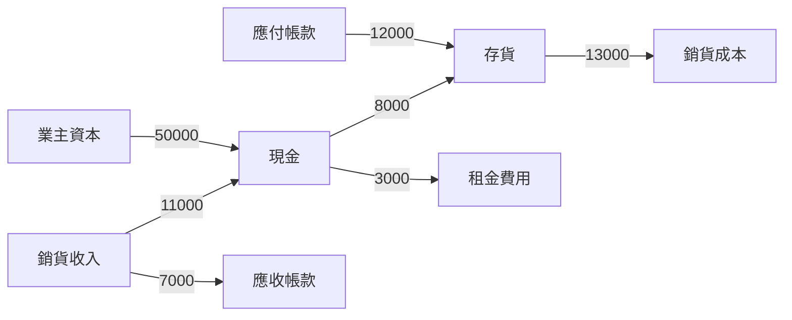

# 1.3 分錄圖論與流守恆

## 本章導言

把 1.1 節的分錄表攤平來看，會發現一個規律：**每一筆分錄都是「一個科目指向另一個科目」的箭頭**。日記簿其實是一張有向圖——科目是節點，分錄是邊，金額是邊上的權重。這個觀察不是比喻，而是一個精確的結構轉換：一旦轉成圖，1.2 節的守恆式就會立刻變成電機工程中著名的**節點電流定律**（Kirchhoff 現代流守恆）與圖論中的**關聯矩陣**。本節先建立這座橋，第 2 章的線性代數將由此整體升級。

### 一、從分錄到有向邊

定義方向慣例：**每條邊由貸方科目指向借方科目**，表示「價值從哪裡來、流到哪裡去」。例如「借存貨 12,000／貸應付帳款 12,000」是應付帳款 $\to$ 存貨、權重 12,000。

於是 1.1 節的六筆交易變成一張圖 $G=(V,E)$ ， $V$ 是全部科目， $E$ 是全部分錄，每條邊 $e_k$ 帶有金額 $w_k$ 。對任一節點 $i$ ，定義

$$
\text{net}(i) = \sum_{\text{流入 }i} w_k - \sum_{\text{流出 }i} w_k .
$$

**流守恆命題**：每個節點的淨流入，等於該科目餘額的變動量。

這句話之所以成立，是因為過帳的定義本身就是「把所有指向該科目的金額加起來、減去所有離開的金額」。於是整張圖的淨流入總和

$$
\sum_{i \in V} \text{net}(i) = 0,
$$

因為每條邊被一加一減各數一次，**全部抵銷**——這是 1.2 節守恆式的圖論版本，也是 2.3 節矩陣零空間的前身。

### 二、圖像：資金在科目之間繞行

注意最後兩條邊：存貨變成銷貨成本、現金支付租金，這是價值**離開資產體系**、轉入費用的過程。若把「結帳」也畫進來（借業主資本、貸銷貨成本；借業主資本、貸租金費用），資金就沿著 $C \to M \to K \to E \to C$ 這樣的**有向環**繞回起點。環的存在正是 2.3 節零空間（一組分錄淨效應為零）的直觀來源。

### 三、一個可驗算的例子

**例題 1.3.1**：以下為 1.1 節的六筆交易，試逐節點計算淨流入，驗證（一）每個節點的淨流入等於其餘額變動、（二）全體淨流入之和為 0。

**解**：先列邊表（方向：貸方 $\to$ 借方）：

| 邊 | 起點（貸） | 終點（借） | 金額 |
|----|-----------|-----------|-----:|
| e1 | 業主資本 | 現金 | 50,000 |
| e2 | 應付帳款 | 存貨 | 12,000 |
| e3 | 現金 | 存貨 | 8,000 |
| e4 | 銷貨收入 | 現金 | 11,000 |
| e5 | 銷貨收入 | 應收帳款 | 7,000 |
| e6 | 現金 | 租金費用 | 3,000 |
| e7 | 存貨 | 銷貨成本 | 13,000 |

逐節點淨流入（流入減流出）：

| 節點 | 計算 | 淨流入 |
|------|------|-------:|
| 現金 | $+50{,}000-8{,}000+11{,}000-3{,}000$ | 50,000 |
| 應收帳款 | $+7{,}000$ | 7,000 |
| 存貨 | $+12{,}000+8{,}000-13{,}000$ | 7,000 |
| 應付帳款 | $-12{,}000$ | $-12{,}000$ |
| 業主資本 | $-50{,}000$ | $-50{,}000$ |
| 銷貨收入 | $-11{,}000-7{,}000$ | $-18{,}000$ |
| 租金費用 | $+3{,}000$ | 3,000 |
| 銷貨成本 | $+13{,}000$ | 13,000 |

對照 1.1 節的試算表：現金借方 50,000、應收 7,000、存貨 7,000、銷貨成本 13,000、租金 3,000 恰為正（借方）；應付 12,000、資本 50,000、收入 18,000 恰為負（貸方）。**圖論的淨流入與會計的餘額，逐科目一對一吻合。**

最後求和：

$$
50{,}000+7{,}000+7{,}000-12{,}000-50{,}000-18{,}000+3{,}000+13{,}000 = 0 .
$$

正項合計 $=80{,}000$ 、負項合計 $=-80{,}000$ ，**恰好就是 1.1 節試算表的兩方合計**；兩者相消為零，守恆式成立。

### 四、圖論視角帶來的三個新問題

1. **連通性**：若科目圖不連通，代表兩群帳目彼此獨立，試算表會「假平衡」——分區各自平衡而整體無關聯，這是大型集團合併報表必須處理的問題（10.2 節）。
2. **環（cycle）**：存在一組邊使淨效應為零，對應「繞一圈回來」的分錄組合，是 2.3 節零空間的具體樣本。
3. **最小割**：切開某刀把圖分成兩半，割邊的權重和就是該「子集團」對外的淨流量，這是分析部門資金移轉（3.2 節成本分攤）的圖論語言。

## 前因後果與驅動關係

- **實務驅動**：會計師在試算表不平時，靠的不是重算全部，而是「沿著金流找斷點」。這種排查天然是**圖上追蹤**；現代審計軟體把總分類帳建成有向圖，用連通分量與環偵測自動標記異常分錄。
- **理論的回饋**：圖論視角使「守恆」從一個會計規則升級為數學定理——**任何網路流都守恆**。於是會計可以借用成熟的圖論工具：關聯矩陣（2.3 節）、最短路徑（資金移轉路徑）、最大流（集團內資金調度上限）。
- **跨章接點**：本節的邊表直接就是 2.3 節的分錄矩陣；節點餘額向量就是 2.1 節的座標；「差額定位」在 7.2 節升級為差異分解，在 9.3 節升級為抽樣稽核。
- **兄弟書接點**：《管理的數學》第 9 章「網路與組合」把同一套有向圖用在物流與專案網路上；《金融的數學》第 9 章金融危機中的「支付鏈」崩潰，正是本節流守恆被「無力支付」強行打破的極端案例——守恆在會計上是恆真的，在真實結算卻可能因違約而破缺。

## 練習

1. 承例題 1.3.1，若刪去 e6（付租金 3,000），哪些節點的淨流入改變？全體淨流入之和是否仍為 0？為什麼？
2. 補上兩筆結帳分錄「借業主資本 16,000／貸銷貨成本 13,000 與租金費用 3,000」，畫出新增的兩條邊，並驗證此時每個損益科目節點的淨流入變為 0。
3. 某商號只有三個交易：業主投資現金 20,000、現購商品 12,000、賒銷商品售價 15,000（成本 9,000）。請畫出全部分錄的有向圖，逐節點算淨流入，並驗證總和為 0。
4. 試說明：若一組分錄使「所有節點淨流入皆為 0」，則這組分錄對應的邊集合在圖論中必可分解為若干有向環。
5. 思考題：把「公司」與「銀行」都當節點，簽發支票等於銀行先替你流出現金。若支票尚未兌現，這條邊存在於哪張圖上？試用本節語言說明「未兌現支票」為何會造成對帳差額（可先讀 3.3 節的銀行調節表）。

### 名詞速查表

- **有向圖 $G=(V,E)$ **：節點為科目、有向邊為分錄的帳簿表示法。
- **邊的權重**：該筆分錄的金額。
- **淨流入**：流入某節點的權重和減去流出的權重和。
- **流守恆**：全體節點淨流入之和恆為 0，即 1.2 節守恆式的圖論形式。
- **有向環**：起訖節點相同的邊序列，對應淨效應為零的分錄組合。
- **關聯矩陣**：以節點為列、邊為列，用 $+1/-1$ 編碼邊方向的矩陣（見 2.3 節）。

（本節完）
