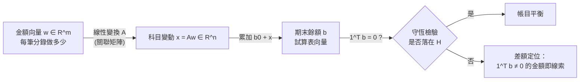

# 2.3 分錄矩陣與線性變換

## 本章導言

1.3 節把帳簿畫成了有向圖，2.2 節把過帳寫成了矩陣乘法。本節把兩者合體：**有向圖的關聯矩陣（incidence matrix）就是分錄矩陣的嚴格形式**，而「所有分錄能到達的狀態」的維度——秩——成為一個可計算的量。線性變換的視角還回答了一個實務問題：**一家公司的帳目「自由度」究竟有多大？** 這個數字決定了審計要查幾筆、系統要驗幾條件，也是 10.3 節區塊鏈帳本設計斷言的理論基礎。

### 一、關聯矩陣：把 1.3 節的邊表變成矩陣

設科目（節點） $n$ 個、分錄（邊） $m$ 條。定義 $n\times m$ 的關聯矩陣 $A$ ：

$$
A_{ik} = \begin{cases} +1, & \text{邊 } e_k \text{ 進入節點 } i \ (\text{借方}),\\ -1, & \text{邊 } e_k \text{ 離開節點 } i \ (\text{貸方}),\\ 0, & \text{其他}. \end{cases}
$$

把金額向量 $\mathbf{w} = (w_1,\ldots,w_m)^{\mathsf T}$ 右乘上去，得

$$
\mathbf{x} = A\mathbf{w},
$$

$\mathbf{x}$ 的第 $i$ 個分量恰是節點 $i$ 的淨流入——1.3 節逐節點算的表格，其實就是 $A\mathbf{w}$ 的逐行展開。**過帳是一個線性變換** $\mathbb{R}^m \to \mathbb{R}^n$ ：輸入是「每筆分錄做多少」的金額向量，輸出是「每個科目變動多少」的餘額向量。

### 二、守恆的矩陣證明： $\mathbf{1}^{\mathsf T}A = \mathbf{0}^{\mathsf T}$

$A$ 的每一**行**只有一個 $+1$ 與一個 $-1$ ，故每行元素和為 0：

$$
\mathbf{1}^{\mathsf T}A = \mathbf{0}^{\mathsf T}
\;\Longrightarrow\;
\mathbf{1}^{\mathsf T}\mathbf{x} = \mathbf{1}^{\mathsf T}A\mathbf{w} = 0 \quad \text{對一切 } \mathbf{w}.
$$

這就是 1.2 節守恆式的最短證明：**每一筆分錄都把 1 元從一個科目搬到另一個科目，所以全體科目的帶號總和不變**。注意這裡的 $\mathbf{1}^{\mathsf T}A=\mathbf{0}^{\mathsf T}$ 是「行和為零」，與 2.1 節「分錄屬於超平面 $H$ 」是同一件事的兩種寫法。

### 三、秩：一家公司能到達多遠的狀態

$A$ 的秩 $\operatorname{rank}(A)$ 是線性代數的核心量，它有精確的會計讀法。對連通的科目圖（圖論定理）： $m \ge n-1$ 時

$$
\operatorname{rank}(A) = n - 1 = \dim H .
$$

**秩等於守恆超平面的維度**，意思是：只要科目圖連通（每一對科目之間都有一條分錄路徑），理論上**任何平衡的期末狀態都能被某組分錄到達**。會計的可敘述性因此有了下界——凡是 $H$ 中的點，都可能是某家公司的真實帳目；審計（第 9 章）的工作不是「猜狀態」，而是「在無窮多個可到達狀態中，找證據支持那一個」。

反之，若圖有 $c$ 個連通分支， $\operatorname{rank}(A) = n - c$ ：帳目被切成 $c$ 塊互不相通的子空間，試算表可能「分區各自平衡而整體無關」——這正是集團合併（10.2 節）必須先建立內部往來對應的原因。

### 四、零空間：繞一圈回來的分錄組合

滿足 $A\mathbf{w}=\mathbf{0}$ 的金額向量構成**零空間** $\ker A$ ，其意義是：**所有科目都沒動，錢卻繞了一圈**。由秩–零度定理，

$$
\dim\ker A = m - \operatorname{rank}(A) = m - (n-1) \quad (\text{連通時}),
$$

獨立的「零效應分錄環」恰有 $m-n+1$ 個——這在圖論中正是**獨立迴路數**（cyclomatic number）。例如 1.3 節的帳： $n=8$ 、 $m=7$ ，零空間維度為 0，表示每筆分錄的金額一有更動，必然有科目餘額跟著變；而補上結帳分錄、內部往來沖銷之後 $m$ 增大，零空間隨之出現——**帳越複雜，「空轉」的分錄組合越多**，這是內部控制要盯住沖銷與對沖分錄的數學理由。

### 例題 2.3.1

承 1.3 節的七筆分錄（科目編號：1 現金、2 應收帳款、3 存貨、4 應付帳款、5 業主資本、6 銷貨收入、7 租金費用、8 銷貨成本）。試寫出關聯矩陣 $A$ （ $8\times 7$ ）、驗證 $\mathbf{1}^{\mathsf T}A=\mathbf{0}^{\mathsf T}$ 、計算 $A\mathbf{w}$ 並對照 1.3 節的淨流入表。

**解**：依邊表 e1–e7（貸方為 $-1$ 、借方為 $+1$ ）：

$$
A=\begin{pmatrix}
+1 & 0 & -1 & +1 & 0 & -1 & 0\\
0 & 0 & 0 & 0 & +1 & 0 & 0\\
0 & +1 & +1 & 0 & 0 & 0 & -1\\
0 & -1 & 0 & 0 & 0 & 0 & 0\\
-1 & 0 & 0 & 0 & 0 & 0 & 0\\
0 & 0 & 0 & -1 & -1 & 0 & 0\\
0 & 0 & 0 & 0 & 0 & +1 & 0\\
0 & 0 & 0 & 0 & 0 & 0 & +1
\end{pmatrix},\qquad
\mathbf{w}=(50{,}000,\,12{,}000,\,8{,}000,\,11{,}000,\,7{,}000,\,3{,}000,\,13{,}000)^{\mathsf T}.
$$

**(1) 行和檢驗**：每一行恰有一個 $+1$ 與一個 $-1$ ，逐行相加皆為 0，故 $\mathbf{1}^{\mathsf T}A=\mathbf{0}^{\mathsf T}$ ✓。

**(2) 計算 $A\mathbf{w}$ **（逐節點）：

$$
A\mathbf{w} = (50{,}000,\; 7{,}000,\; 7{,}000,\; -12{,}000,\; -50{,}000,\; -18{,}000,\; 3{,}000,\; 13{,}000)^{\mathsf T},
$$

與 1.3 節例題的淨流入表**逐項一致** ✓。帶號總和：

$$
50{,}000+7{,}000+7{,}000-12{,}000-50{,}000-18{,}000+3{,}000+13{,}000 = 0,
$$

即 $\mathbf{1}^{\mathsf T}A\mathbf{w}=0$ ✓。

**(3) 秩**：科目圖連通（現金經由 e1、e3、e4、e6 連通各方）， $n=8$ ，故 $\operatorname{rank}(A)=7$ ， $\dim\ker A = 7-7=0$ ：金額向量 $\mathbf{w}$ 由期末狀態唯一決定，沒有多餘的自由環。

**(4) 加一筆結帳分錄** e8「借業主資本 16,000／貸銷貨成本 13,000 與租金費用 3,000」需拆成兩條邊 e8a（ $-16{,}000$ 進節點 5 之外：借 5、貸 8 金額 13,000）與 e8b（借 5、貸 7 金額 3,000）。此時 $m=9$ 、 $n=8$ ，若圖仍連通則 $\dim\ker A = 9-7 = 2$ ：出現兩個獨立零效應環（結帳環 $C\to M\to K\to E\to C$ 與 $C\to X\to E\to C$ ），印證 1.3 節「資金沿有向環繞行」的直觀。

## 前因後果與驅動關係

- **實務驅動**：十九世紀鐵路與電報公司的會計師已發現「帳目結構」可以抽象化——1863 年美國鐵路會計師社群使用的「帳戶相關表」實質上是關聯矩陣的雛形；真正的理論化則要等到 Kirchhoff（1845）以關聯矩陣分析電路，圖論與線性代數在二十世紀合流後，會計才回收這套語言。
- **理論的回饋**：「秩 $=n-1$ 」給了審計一個結構性事實——**平衡狀態的自由度是固定的**，抽樣查核（9.3 節）的樣本量設計由此出發；「零空間」解釋了為何沖銷、對沖、內部往來是舞弊與錯誤的高危地帶，內控準則要求對此類分錄逐筆留痕。10.3 節的區塊鏈帳本，其共識規則正是「每個區塊都必須滿足 $\mathbf{1}^{\mathsf T}A\mathbf{w}=0$ 」的程式化。
- **跨章接點**：本節的 $A\mathbf{w}$ 是 2.2 節 $JD\mathbf{1}$ 的嚴格版（把金額從對角陣移到向量）；3.2 節的聯立方程正是「在 $\operatorname{rank}$ 條件下反解金額」的應用；7.3 節把「餘額異常」機率化，需要先有本節確定性的結構。
- **兄弟書接點**：《管理的數學》第 9 章的網路流與本節共用關聯矩陣與最大流演算法；《經濟的數學》第 5 章一般均衡的「超平面上的均衡點」，其存在性證明的線性骨架就是本節的秩與零空間；《金融的數學》第 9 章金融危機的「結算網路斷鏈」，可讀作流守恆在現實違約下的破缺。

## 練習

1. 三科目（現金、存貨、資本）、兩筆分錄：借現金/貸資本 20,000、借存貨/貸現金 8,000。寫出 $A$ 與 $\mathbf{w}$ ，計算 $A\mathbf{w}$ ，並驗證秩為 $n-1=2$ 。
2. 承例題 2.3.1，若再新增一筆「借現金 2,000／貸應收帳款 2,000」（收款），寫出新增的行，並計算新的 $\dim\ker A$ 。
3. 證明：連通圖的關聯矩陣（不考慮方向時）秩至少為 $n-1$ 。（提示：任取 $n$ 列的線性組合為零的係數，說明係數必全相同。）
4. 某公司科目圖有兩個連通分支（A 部門帳與 B 部門帳互不往來）、共 10 個科目。全公司試算表兩方相等，請說明這個「平衡」的資訊量為何只有 $\dim H = 9$ 的一部分，並指出哪一類錯誤不會被發現。
5. 思考題：線性變換 $A$ 把「分錄空間」映到「餘額空間」。若兩家公司的 $A$ 不同（科目結構不同），它們的帳目還能直接相加嗎？請討論合併報表（10.2 節）為何需要先把科目對映到共同座標系，這個對映在線性代數中是什麼？

### 名詞速查表

- **關聯矩陣 $A$ **： $n\times m$ ，行為分錄、列為科目，以 $\pm 1$ 編碼借貸方向。
- **線性變換**： $\mathbf{x}=A\mathbf{w}$ ，把金額空間 $\mathbb{R}^m$ 映到餘額空間 $\mathbb{R}^n$ 。
- **秩 $n-1$ **：連通科目圖可到達的平衡狀態維度，等於 $\dim H$ 。
- **零空間 $\ker A$ **：淨效應為零的分錄金額組合，維度 $m-n+1$ （連通時）。
- **獨立迴路數**：圖論中的 $m-n+1$ ，對應帳簿中獨立的「空轉環」。

（本節完）
