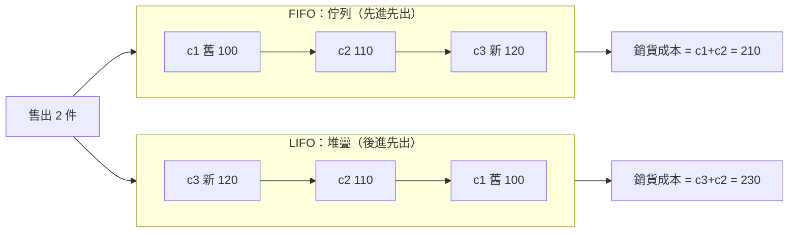

# 5.1 FIFO 與 LIFO 的數列比較

## 本章導言

存貨成本流動假設（cost flow assumption）是會計裡少數「明說了是假設」的地方：實體的貨可能同一批進貨同一批出，但**帳上得決定先出哪一層成本**。先進先出（FIFO）假設舊成本先轉出，後進先出（LIFO）假設新成本先轉出——在物價上漲的時代，兩者給出截然不同的銷貨成本與毛利。本節用數列的語言把兩法並排：FIFO 是**佇列（queue）**、LIFO 是**堆疊（stack）**，差異不在「算術」而在「取出順序」，而順序差異的經濟後果，正是二十世紀通貨膨脹把 LIFO 推上舞台的原因。

### 一、兩種資料結構，一張成本表

設期初存貨成本依進貨先後排成數列

$$
c = (c_1, c_2, \ldots, c_m) \quad (c_1 \text{ 最舊})， 
$$

售出 $q$ 件時：

- **FIFO**：從**數列前端**取出 $c_1, c_2, \ldots$ ，銷貨成本是 $c$ 的**前綴和**；
- **LIFO**：從**數列後端**取出 $c_m, c_{m-1}, \ldots$ ，銷貨成本是 $c$ 的**後綴和**。

當 $c_1\le c_2\le\cdots\le c_m$ （物價上漲）時，**前綴和 $\le$ 後綴和**：FIFO 的銷貨成本較低、毛利與期末存貨較高；LIFO 則相反。反之在物價下跌時全部反轉。這個比較不需要任何新公式，只是**同一數列的兩種讀法**——但它的所得稅後果是真金白銀。

### 二、一個完整算例

**例題 5.1.1**：某商店 3 月的存貨收發如下（單位：件、元）：

| 日期 | 交易 | 數量 | 單位成本 | 總成本 |
|-----:|------|-----:|--------:|-------:|
| 3/1 | 期初 | 100 | 20 | 2,000 |
| 3/8 | 進貨 | 150 | 24 | 3,600 |
| 3/15 | 銷售 | 180 | 售價 35 | — |
| 3/22 | 進貨 | 120 | 28 | 3,360 |
| 3/28 | 銷售 | 90 | 售價 38 | — |

分別以 FIFO 與 LIFO（永續盤存制）計算各次銷貨成本、期末存貨與毛利。

**解**：

**FIFO**：
- 3/15 銷 180 件：先出期初 100 件（ $100\times20=2{,}000$ ），再出 3/8 批 80 件（ $80\times24=1{,}920$ ），成本 3,920；
- 3/8 批餘 70 件；3/28 銷 90 件：出 3/8 餘 70 件（ $70\times24=1{,}680$ ），再出 3/22 批 20 件（ $20\times28=560$ ），成本 2,240；
- 銷貨成本合計 $3{,}920+2{,}240=6{,}160$ ；期末存貨 $=100\times28=2{,}800$ （3/22 批餘 100 件）。

**LIFO**：
- 3/15 銷 180 件：先出 3/8 批 150 件（ $150\times24=3{,}600$ ），再出期初 30 件（ $30\times20=600$ ），成本 4,200；期初餘 70 件；
- 3/28 銷 90 件：出 3/22 批 90 件（ $90\times28=2{,}520$ ），成本 2,520；
- 銷貨成本合計 $4{,}200+2{,}520=6{,}720$ ；期末存貨 $=$ 期初餘 70 件 $\times20 +$ 3/22 餘 30 件 $\times28 = 1{,}400+840=2{,}240$ 。

**彙總**：銷貨收入 $=180\times35+90\times38=6{,}300+3{,}420=9{,}720$ 。

| 項目 | FIFO | LIFO | 差額（FIFO − LIFO） |
|------|-----:|-----:|----------:|
| 銷貨成本 | 6,160 | 6,720 | −560 |
| 期末存貨 | 2,800 | 2,240 | +560 |
| 毛利 | 3,560 | 3,000 | +560 |

**守恆驗證**：兩法的「可供銷售商品成本」皆為 $2{,}000+3{,}600+3{,}360=8{,}960$ ，且 $6{,}160+2{,}800=8{,}960$ 、 $6{,}720+2{,}240=8{,}960$ ✓——**銷貨成本＋期末存貨＝可供銷售成本**（存貨恆等式，5.3 節），兩法只是把同一塊 8,960 切成不同的兩份；毛利差額 560 恰與期末存貨差額互相抵消（本期毛利高者，期末存貨也高，利得被「存進存貨」而非實現）。

### 三、LIFO 為何存在：通貨膨脹的產物

FIFO 的毛利 3,560 中，有一部分是**持有利得（holding gain）**：以 20 元買進的貨在 24、28 元的成本環境中賣出，帳面毛利混合了「經營利得」與「物價上漲的意外之財」。LIFO 以最新的成本對應目前的收入，**毛利更接近「可重置存貨後真正剩下的錢」**，因此課稅基礎較穩健——這是美國 1939 年正式承認 LIFO 的背景：1930 年代物價劇烈波動，鋼鐵與化學業者主張以 LIFO 抑制帳面利得的虛胖。代價也同樣數學：LIFO 期末存貨停留在**最舊的成本層**，通膨數十年後帳面存貨可能嚴重背離市價，此差額被披露為 **LIFO 準備**（LIFO reserve），8.1 節的比率分析必須調整之。

### 四、順序假設的數學性格

FIFO／LIFO 之別還揭示了會計資料的抽象結構：**成本數列 + 取出規則 = 成本流動模型**。取出規則是佇列（FIFO）、堆疊（LIFO），第三種是「不排隊、按重量平均」（5.2 節加權平均）。三種規則給出的銷貨成本必然滿足：

$$
\text{FIFO 成本} \;\le\; \text{平均成本} \;\le\; \text{LIFO 成本} \qquad (\text{物價上漲時}),
$$

因為前綴和、全體平均、後綴和三者對遞增數列必然如此排序。**平均成本是兩極之間的內點**——這個看似平凡的排序，是選擇會計政策時最常用的直覺指南。

## 前因後果與驅動關係

- **實務驅動**：十九世紀大宗物資貿易（穀物、棉花、金屬）的批次進貨使「成本層」問題無可迴避；1910–1940 年代的兩次通貨膨脹則把 FIFO／LIFO 的選擇從記帳細節升級為**稅務與財務報導的政策決策**。
- **理論的回饋**：數列與前綴／後綴和的視角使「政策差異」可量化：本例 560 元的差異占毛利 3,560 的 15.7%——政策選擇不是會計師的潔癖，而是直接改寫損益表。LIFO 準備的披露，使分析師能在兩種政策之間「翻譯」（8.2 節 DuPont 分解前的標準調整）。
- **跨章接點**：存貨恆定式在 5.3 節成為毛利結構分析的主軸；加權平均法在 5.2 節登場；物價變動的長期後果通往 10.1 節通貨膨脹會計；「先進先出」的佇列結構與《管理的數學》第 5 章存貨管理的先到先服務排隊規則同構。
- **兄弟書接點**：《金融的數學》第 1 章時間價值解釋為何 LIFO 的節稅（遞延繳稅）有現值利益；《經濟的數學》第 10 章計量經濟提醒：跨公司比較毛利率時，成本流動假設是必須控制的「制度變數」。

## 練習

1. 承例題 5.1.1，若 3/28 的銷售量改為 120 件，用 FIFO 與 LIFO 分別重算銷貨成本與期末存貨（注意 LIFO 需動用期初層）。
2. 某公司成本層為 $(50, 55, 60, 65)$ （元/件），售出 120 件。驗證 FIFO 成本與 LIFO 成本之差等於「首 120 件與末 120 件成本之差」，並算出數值。
3. 證明：對遞增成本數列，「FIFO 期末存貨 $\ge$ LIFO 期末存貨」。
4. 例題 5.1.1 中，兩法「可供銷售商品成本」皆為 8,960。請說明這個守恆式為何不依成本流動假設而改變，以及它對應第 1 章哪一個數學結構。
5. 思考題：若所有進貨價格完全相同，FIFO 與 LIFO 是否等價？若進貨價格隨機波動（時漲時跌），兩法的相對優勢還有意義嗎？請討論「物價趨勢」與「波動」何者才是 LIFO 存亡的關鍵，並連結 10.1 節。

### 名詞速查表

- **成本流動假設**：實體物流與帳面成本流動可以脫鉤，帳上須自訂取出規則。
- **FIFO**：先進先出，銷貨成本取數列前綴；期末存貨接近最新成本。
- **LIFO**：後進先出，銷貨成本取數列後綴；期末存貨停留在舊成本層。
- **LIFO 準備**：FIFO 口徑與 LIFO 口徑期末存貨之差，披露供分析調整。
- **持有利得**：持有期間物價上漲帶來的帳面利得，混入 FIFO 毛利之中。
- **前綴和／後綴和**：數列由前（後）往後的累加和，FIFO（LIFO）的數學物件。

（本節完）
