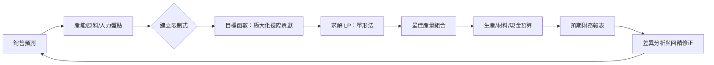

# 7.1 預算編製的線性規劃雛形

## 本章導言

預算（budget）原本只是「編列數字、控制支出」的工具。隨著企業規模擴大，資源有限（人力、原料、產能、資金），單純按歷史或需求加總已不足以回答一個最現實的問題：**在有限資源下，如何配置才能最有效達成目標？**

預算編製最早的系統化嘗試可追溯至十九世紀末的工業會計。亨利．福特（Henry Ford）的早期成本控制作為管理會計先驅，而二十世紀初的「彈性預算」（flexible budget）與「全面預算」（master budget）逐漸成形。然而，真正將「資源配置」提升為**數學最佳化**的契機，來自二次大戰期間軍事後勤。

二次大戰中，美、英為了最有效運用有限燃料、船隻、飛機與原料，發展出**線性規劃（linear programming, LP）**。1947 年 George Dantzig 發表**單形法（simplex method）**，使得大規模線性最佳化成為可行。戰後不久，這套方法便迅速移植到企業經營：生產排程、混合配方、運輸規劃等。預算編製也從「平衡預估」逐漸邁向「在限制條件下追求最大利潤（或最小成本）」的線性規劃雛形。

## 一、從全面預算到資源限制下的最佳化

全面預算把銷售預算、生產預算、直接材料預算、現金預算等環環相扣，最終匯成預期損益表與資產負債表。傳統做法多半是「由銷售預測倒推生產」，再檢查產能、人力是否足夠。若發現不足，便「刪減計畫」或「加班」。

但這種「試誤」方式隱含一個未明確表達的假設：**企業的目標是盡量滿足銷售預測**。對追求利潤極大化的企業而言，更自然的問題是：**在現有產能、原料、人力等限制下，應生產哪些產品、各多少，才能使邊際貢獻（或利潤）總額最大？**

此時，預算編製的思路已悄然從「預測與控制」轉向「最佳配置」。

## 二、線性規劃的基本要素

線性規劃處理的問題必須滿足線性假設：

- **決策變數（decision variables）**：欲決定的數量，如 $x_1, x_2$ 分別代表產品 1、2 的產量。
- **目標函數（objective function）**：欲極大化或極小化的線性函數。以利潤導向的生產預算最常用極大化邊際貢獻： $Z = c_1 x_1 + c_2 x_2 \to \max$ ，其中 $c_i$ 為單位邊際貢獻（見第 6.3 節）。
- **限制式（constraints）**：資源或市場的限制，皆為線性不等式或等式： $a_{i1}x_1 + a_{i2}x_2 \le b_i$ 。
- **非負限制（non-negativity）**：產量不可能為負： $x_1 \ge 0, x_2 \ge 0$ 。

## 例題 7.1.1：簡單生產配製的 LP 雛形

某公司生產甲、乙兩種產品。每單位甲產品的邊際貢獻 40 元，每單位乙產品的邊際貢獻 30 元。生產所需資源及供應如下：

| 資源 | 甲產品（每單位） | 乙產品（每單位） | 可用數量 |
|------|------------------|------------------|----------|
| 機器小時 | 2 小時           | 1 小時           | 40 小時  |
| 原料公斤 | 1 公斤           | 2 公斤           | 30 公斤  |

試建立線性規劃模型，求在資源限制下使邊際貢獻總額最大化的產量組合。

**解**：

設 $x_1$ 為甲產品產量（單位）， $x_2$ 為乙產品產量（單位）。

目標函數（極大化邊際貢獻）
$$
\max Z = 40x_1 + 30x_2.
$$

限制式
$$
\begin{aligned}
2x_1 + x_2 &\le 40\quad (\text{機器小時})\\
x_1 + 2x_2 &\le 30\quad (\text{原料})\\
x_1 \ge 0,\; x_2 &\ge 0.
\end{aligned}
$$

此模型即「預算編製中產量決策」的線性規劃雛形。若僅考慮滿足預測而不考量邊際貢獻，極易選擇錯誤組合；若考量邊際貢獻並納入限制，方能選出最有利的資源配置。

## 三、圖解法求可行解區域與最佳解

對兩個決策變數的 LP，最直觀的是圖解法。

繪製限制式直線：
- $L_1: 2x_1 + x_2 = 40$ ：截距 $(20,0), (0,40)$
- $L_2: x_1 + 2x_2 = 30$ ：截距 $(30,0), (0,15)$

可行區域（feasible region）為同時滿足所有不等式與非負限制的點集合。目標函數 $40x_1 + 30x_2 = k$ 為一族平行直線，斜率 $-\frac{4}{3}$ 。欲極大化 $k$ ，即沿著可行區域朝「遠離原點」方向平行移動目標線，最先觸及可行區域邊界的頂點（corner point）即為最佳解。

求交點 $L_1 \cap L_2$ ：
$$
\begin{cases}
2x_1 + x_2 = 40\\
x_1 + 2x_2 = 30
\end{cases}
$$
解得 $x_1=\frac{50}{3}\approx 16.67$ ， $x_2=\frac{20}{3}\approx 6.67$ 。

各頂點計算 $Z$ ：
- $(0,0): Z=0$
- $(20,0): Z=800$
- $(50/3, 20/3): Z=40\cdot\frac{50}{3}+30\cdot\frac{20}{3}=\frac{2000+600}{3}=\frac{2600}{3}\approx 866.67$
- $(0,15): Z=450$

故最佳解為 $x_1=50/3, x_2=20/3$ ，最大邊際貢獻約 866.67 元。

## 四、預算編製中的雛形意涵

線性規劃把「全面預算」中原本零散的檢查整合成一個**統一的最佳化模型**：

- **銷售考量**：若有市場需求上限，可加入 $x_i \le D_i$ 限制。
- **生產考量**：產能、人力、原料直接化為限制式。
- **財務考量**：現金預算中的資金限制亦可納入。
- **目標導向**：不再「盡量達成銷售」，而是「在限制下極大化邊際貢獻」，這更貼近利潤導向的經營邏輯。

這正是「預算編製的線性規劃雛形」命名的由來。單形法問世後，企業得以處理數十、上百個變數與限制的真實預算配置問題，管理會計也因此與運籌學（operations research）正式結盟。

### 預算編製與最佳化的流程

上圖顯示 LP 如何嵌入全面預算循環：第 2 章的矩陣運算負責彙總各預算表，本節的 LP 負責「最佳配置」這一環，而第 7.2 節的差異分析則是迴路上的回饋修正機制。

## 前因後果與驅動關係

- **實務驅動（前因）**：二次大戰軍事後勤亟需在極度有限的資源下最有效配置人員、物資、運輸。Dantzig 的單形法正是為解決「美軍配給與運輸」問題而發展。戰後這套工具迅速轉向民間經營。
- **理論承襲**：LP 的目標函數係數正是第 6.3 節定義的「單位邊際貢獻」。限制式則是將生產預算中常見的產能、原料、人力等轉寫為線性不等式。整體結構也呼應第 2 章的聯立方程與線性系統思路。
- **理論回饋（後果）**：線性規劃成為《管理的數學》第 3 章的核心主題。預算編製從經驗式規劃走向量化最佳化，促成了「資本預算」（capital budgeting）的定量化、存貨管理（見《管理的數學》第 4 章）等領域的數學化。
- **跨書聯繫**：《管理的數學》第 3 章：線性規劃。將系統介紹圖解法、單形法、對偶理論與敏感度分析。《經濟的數學》第 3 章（供給需求與均衡）關注市場整體均衡，與本節關注「個別企業內部資源配置」角度不同，卻同屬最適化思維。
- **歷史啟示**：會計與數學的交會往往發生在「實際限制逼出最佳化」的時刻。預算編製原屬會計範疇，卻在戰時需求下吸收了線性代數與幾何最佳化，反過來豐富了管理會計的決策功能。

## 練習

1. **模型建立**：某公司生產 A、B 兩種產品。單位邊際貢獻：A 25 元、B 20 元。限制：車床小時每單位 A 3 小時、B 2 小時，總可用 120 小時；裝配小時每單位 A 1 小時、B 2 小時，總可用 80 小時。建立 LP 模型。
2. **圖解計算**：承上題，用圖解法求可行區域頂點並計算各頂點的 $Z$ ，找出最佳產量組合與最大邊際貢獻。
3. **應用題**：若市場對 B 產品的需求上限為 25 單位，請在原模型中加入此限制，並說明對最佳解的可能影響（不必重算全圖，說明邏輯即可）。
4. **比較題**：比較「傳統全面預算（先預測銷售再檢查產能）」與「LP 導向預算（先列限制再求最佳配置）」的思路差異。
5. **思考題**：線性規劃假設「係數固定」（單位邊際貢獻、單位資源耗用固定）。在實際預算編製中，哪些因素最可能違反此假設？管理者該如何因應？

## 名詞速查表

- **全面預算（master budget）**：企業整體預算體系，涵蓋銷售、生產、材料、勞工、製造費用、現金、預期財務報表等。
- **線性規劃（linear programming, LP）**：在一組線性限制下，極大化或極小化線性目標函數的數學方法。
- **決策變數（decision variables）**：模型中欲決定的未知數（如各產品產量）。
- **目標函數（objective function）**：LP 欲達成的最佳化目標（ $\max/\min$ 線性式）。
- **限制式（constraints）**：對決策變數的線性限制（ $\le, =, \ge$ ）。
- **可行區域（feasible region）**：所有滿足限制式與非負限制的解集合。
- **頂點（corner point）**：可行區域的角點。對線性 LP，若有最佳解，至少有一個最佳解位於頂點。
- **單形法（simplex method）**：Dantzig 於 1947 年提出的系統化求解 LP 的演算法。

（本節完）
