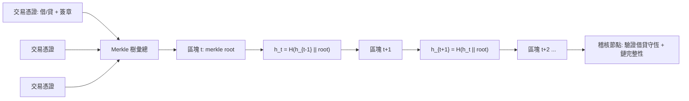

# 10.3 XBRL、區塊鏈與會計守恆式的數位化

## 本章導言

1494 年 Pacioli 為複式簿記寫下借貸必須相等的規則（本書第 1.1 節），此後五百年，這條**守恆式**一直靠人工核對：試算表、驗算、稽核抽樣（9.3 節）都在檢查它有沒有被破壞。二十一世紀的問題換了一個面貌：財務資訊以 PDF、Excel、網頁的形態在全球流動，**數字本身不失衡，卻在「被閱讀」的過程中失真**——分析師把報表重打進試算表時打錯一格，全部分析報廢。

兩波技術回應了這個問題。第一波是 **XBRL（eXtensible Business Reporting Language）**：1998 年美國會計師 Charles Hoffman 提出以 XML 標記財務數字的構想，2000 年 AICPA 發布第一版規格，2009 年起美國 SEC 強制上市公司以 XBRL 申報。第二波是**區塊鏈（blockchain）**：2008 年中本聰（Satoshi Nakamoto）的比特幣論文展示瞭如何在無中央機構下維持一本不可竄改的帳——其核心機制（鏈式雜湊、共識、餘額守恆檢查）與複式簿記有深刻的同構性。本節用數學語言檢視：**會計守恆式如何被編碼進這些系統**。

## 一、XBRL：把報表變成標記的圖

XBRL 的做法是給每個財務概念一個**標籤（tag）**，例如 `us-gaap:Revenues`，再把報表中每個數字標上「哪個概念、哪個期間、哪個個體、哪種單位、哪種情境（如合併/母公司個體）」。一份 XBRL 文件本質上是**五維度坐標系中的賦值**：

$$
\text{事實} f = \big(\text{概念}\,c,\; \text{個體}\,e,\; \text{期間}\,p,\; \text{單位}\,u,\; \text{情境}\,s\big) \mapsto v.
$$

這個結構使「勾稽關係」（calculation linkbase）可以被寫成**代數恆等式**：申報檔中可以宣告「資產總額 = 流動資產 + 非流動資產」，申報系統自動驗證：

$$
\sum_{i \in S} v_i - v_{\text{總額}} = 0.
$$

五百年前靠人工「軋平」的守恆式，第一次成為**機器強制執行的約束**。SEC 的驗證器每日自動退回不合格申報——守恆式的檢查成本從「稽核人力」降到「零邊際成本」。

## 二、複式簿記的雜湊鏈：三重記帳的構想

比特幣帳本的每一筆交易滿足**輸入總和 = 輸出總和**：

$$
\sum \text{inputs} = \sum \text{outputs} + \text{手續費},
$$

這正是借貸平衡。更深的同構在帳本的組織方式。設區塊 $b_t$ 的雜湊值：

$$
h_t = H\big(h_{t-1} \,\|\, \text{merkle root}(b_t)\big),
$$

其中 $H$ 是密碼學雜湊函數，merkle root 是該區塊全部交易的樹狀摘要。任何一筆歷史分錄被竄改，其 merkle root 變、 $h_t$ 變、之後**所有** $h_{t'}$ （ $t' \ge t$ ）連鎖失效——這是一個**全局完整性檢查**。2014 年前後，Ian Grigg 等人據此提出**三重記帳（triple-entry accounting）**：借、貸之外，第三個「帳本」是雙方共同簽署、雜湊鏈鎖定的交易憑證，使交易雙方無法各自講一套帳。

用 mermaid 畫出鏈式結構與會計事件的對應：

圖中的稽核節點同時檢查兩條守恆式：**每筆交易內的借貸守恆**（複式簿記，第 1.2 節）與**整條鏈的雜湊守恆**（完整性）。傳統稽核只能抽查第二條，區塊鏈使它可以被全查。

## 三、守恆式的分層架構

把兩種技術合起來看，會計守恆式呈現三層架構：

| 層次 | 守恆式 | 檢查機制 | 失敗的後果 |
|------|--------|---------|-----------|
| 交易層 | $\sum \text{借} = \sum \text{貸}$ | 資料庫/帳本寫入約束 | 分錄被拒絕 |
| 報表層 | 資產 $=$ 負債 $+$ 權益；XBRL 勾稽 | 申報驗證器 | 申報被退回 |
| 記錄層 | 歷史不可改： $h_t = H(h_{t-1}\|\|\cdot)$ | 雜湊鏈＋共識 | 竄改被偵測 |

值得注意的是各層守恆式的**數學性格不同**：交易層是線性等式（第 1.2、2.1 節的向量空間結構），報表層是線性恆等式網（10.2 節的矩陣消除不改變它），記錄層則是**計算不可逆性**（找到碰撞在計算上不可行）——前兩層是代數，第三層是複雜度理論。守恆的概念從「代數平衡」擴展到「計算不可逆」。

## 例題 10.3.1：XBRL 勾稽關係的驗證

某公司 XBRL 申報檔含下列事實（萬元）：

| 標籤 | 金額 |
|------|-----:|
| us-gaap:AssetsCurrent | 3,200 |
| us-gaap:AssetsNoncurrent | 5,800 |
| us-gaap:Assets | 9,100 |
| us-gaap:Liabilities | 4,600 |
| us-gaap:StockholdersEquity | 4,400 |

勾稽規則：(1) $Assets = AssetsCurrent + AssetsNoncurrent$ ；(2) $Assets = Liabilities + StockholdersEquity$ 。驗證此申報是否可通過，若不通過指出違反項。

**解**：

規則 (1)： $3200 + 5800 = 9000 \ne 9100$ ，差 100 萬，**違反**。

規則 (2)： $4600 + 4400 = 9000 \ne 9100$ ，同樣差 100 萬。

兩條規則給出**同一個**差額 100 萬，這不是巧合：在勾稽網中，各條恆等式圍繞同一組事實，差額向量滿足自身的線性關係（第 2.1 節科目餘額向量的餘維結構）。稽核員據此可直接鎖定「有一筆 100 萬的資產被漏標或重複標記」，例如某科目被標成 `Assets` 卻未歸入流動/非流動子項。申報驗證器退回檔案並附上差額，檢查從「找針」變成「解一個線性方程」。

## 四、智能合約：會計規則的程式化

以太坊（2015）的**智能合約（smart contract）** 把「若條件成立則自動記帳」變成程式：收租合約到期自動轉帳並生成收入分錄、供應鏈金融憑提單自動放款。會計上的深遠影響是**確認時點的機械化**——收入認列（IFRS 15 的五步驟）中「履約義務已滿足」的判斷，部分情境可由物聯網感測與合約狀態機自動證明。這使 9.3 節「抽樣稽核」的對象逐漸縮小：連續即時審計（continuous auditing）取代年度抽查，稽核從「事後抽樣」走向「事中全查」。

但邊界也很清楚：雜湊鏈保證**記錄不被改**，不保證**記錄為真**（oracle problem——鏈外事實仍須人與機構背書）。區塊鏈會計的守恆式管得住算術，管不住估計——第 9 章的機率與估計問題（壞帳、或有事項）不會因為帳本上了鏈就消失。

## 前因後果與驅動關係

- **實務驅動（前因）**：2001 年 Enron、WorldCom 醜聞（虛增獲利、隱匿負債）暴露「報表可信度」的危機，Sarbanes–Oxley 法案（2002）要求內控與揭露的機器可查核性，XBRL 強制申報（2009）正是此背景的產物；2008 年金融危機則催生了對去中心化帳本的信任實驗。
- **理論承襲**：XBRL 勾稽是第 1.2 節借貸恆等式與第 2.1 節科目餘額向量空間的資料結構化；雜湊鏈的全局完整性檢查在思想上是第 1.3 節流守恆的計算實現；三重記帳是複式簿記的第三條記錄軸。
- **理論回饋（後果）**：守恆式的自動驗證改變了稽核的成本結構與方法論——連續審計、即時保證（continuous assurance）興起，9.3 節的抽樣邏輯將被重新定義；會計師的角色從「核對數字」轉向「設計與稽核規則本身」。
- **跨書聯繫**：雜湊與共識的數學基礎（雜湊函數、機率分布、拜占庭容錯）連向《機率統計》與《程式與數學》；智能合約對收入認列的衝擊呼應《管理的數學》第 10 章數位管理；《金融的數學》第 10 章現代前沿中的 DeFi 定價，正是本節帳本技術的金融應用。

## 練習

1. 某 XBRL 檔中 $Assets = 7{,}500$ 、 $Liabilities = 3{,}000$ 、 $Equity = 4{,}600$ 。差額多少？若同時知道 $AssetsCurrent = 2{,}900$ 且流動/非流動勾稽通過，違規最可能出現在哪一類標籤？
2. 一條鏈共 10 個區塊，攻擊者竄改第 7 個區塊的某筆交易。要使鏈重新「合法」，至少必須重算哪些區塊的雜湊？說明連鎖失效的傳播路徑。
3. 三重記帳中，交易憑證由買賣雙方共同簽署。說明這如何解決「雙方各記一套帳」的傳統對帳問題，及其與複式簿記借貸平衡的對應。
4. 智能合約租金系統：每月 1 日自動從租戶扣款 5 萬並記錄租金收入。從會計角度看，此自動化解决了「應計制」中的哪個問題？又遺留哪些仍需人工判斷的問題？
5. 思考題：區塊鏈保證「記錄不可改」但「垃圾進、垃圾出」（oracle problem）。有人主張這使審計需求消失，有人主張審計重點只是轉移。你同意哪一種？請區分「算術正確性」「記錄完整性」「經濟實質認定」三個層次論證。

## 名詞速查表

- **XBRL**：以 XML 標記財務數字的申報語言，使報表機器可讀、可勾稽。
- **勾稽關係（calculation linkbase）**：XBRL 中宣告的加總恆等式網。
- **雜湊鏈**： $h_t = H(h_{t-1} \| \cdot)$ 的鏈式完整性結構，竄改任一環即連鎖失效。
- **Merkle 樹**：交易兩兩雜湊彙總成根值的二元樹，可高效證明單筆交易在鏈上。
- **三重記帳**：借、貸之外加入雜湊鏈憑證的記帳構想（Grigg 提出，2014 年後廣為討論）。
- **智能合約**：部署於區塊鏈、條件滿足即自動執行的程式化合約。
- **Oracle 問題**：鏈上系統無法自行驗證鏈外事實真偽的根本限制。
- **連續審計**：以自動化即時檢查取代週期性抽樣稽核的方法論。

### 年表速查

- 1494：Pacioli 出版複式簿記法，守恆式以人工軋平。
- 1998：Charles Hoffman 提出 XBRL 構想。
- 2000：AICPA 發布 XBRL 1.0 規格。
- 2002：美國 Sarbanes–Oxley 法案，內控與揭露責任法制化。
- 2008：中本聰發表比特幣論文，去中心化帳本問世。
- 2009：美國 SEC 強制大型上市公司 XBRL 申報。
- 2014–2015：三重記帳構想推廣；以太坊上線，智能合約普及。
- 2018：歐盟 ESEF 規範要求 iXBRL 年報格式（2021 年起適用）。
- 2020 年代：SEC 與各國申報系統全面結構化，即時保證與 DeFi 會計成為研究前沿。

（本節完）
