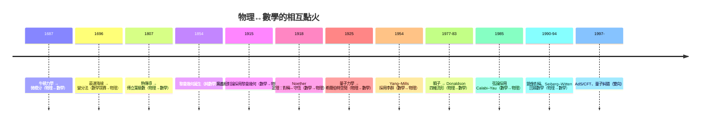

# 0.1 雙螺旋：四百年的相互驅動

## 一條相互點火的鏈

物理與數學的關係不是「應用」兩字能概括的。回顧歷史，兩者像雙螺旋互相纏繞上升：

## 三種驅動模式

1. **物理危機逼出數學發明**：牛頓要描述運動，古典幾何不夠用，微積分應運而生；傅立葉研究熱，「函數」概念被迫擴張；龐加萊研究三體，混沌與動態系統誕生。
2. **數學寶庫供給物理語言**：Riemann 1854 年的演講在 60 年後成為廣義相對論；Cartan 的纖維叢與陳類在 1970 年代成為規範場論的母語；E8 李代數在弦論中成為宇宙的規範群。
3. **雙向共演化**：對稱（Noether ↔ 李群）、對偶（S-對偶 ↔ 朗蘭茲）、全息（AdS/CFT ↔ 範疇論）——兩邊的直覺互相遷移，工具互相輸送。

## 本書的寫法

每節標註驅動方向（物理→數學／數學→物理／雙向），並回答三個問題：物理問題是什麼？數學工具如何誕生或被取用？之後誰又回饋了誰？

## 練習與思考

1. 找出一段歷史中「數學先於物理 60 年以上」的例子，並解釋為何可能。
2. 「物理逼出數學」與「數學供給物理」兩種模式，哪一個在 20 世紀後半更常見？為什麼？
