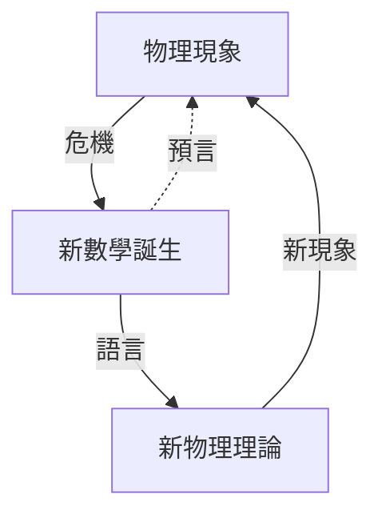

# 0.2 本書的視角：危機、語言與預言

## 三個關鍵詞

### 1. 危機（物理→數學的引擎）

物理實驗或理論遇到無法表述的現象時，舊數學不夠用：

- 「瞬時速度」如何定義？→ 極限與導數（1687）。
- 「任意形狀的熱源」如何展開？→ 傅立葉級數（1807）。
- 「彎曲時空中的重力」如何寫下？→ 張量與曲率（1915）。
- 「不同拓撲的四維空間」如何分類？→ 規範場論的反哺（1983）。

### 2. 語言（數學→物理的供給）

數學不只計算，還提供**表述方式**。同一物理現象在不同數學語言下的表述力不同：向量語言使馬克士威方程從 20 條壓縮成 4 條；李群語言使粒子分類從經驗表格變成數學必然。

### 3. 預言（最深刻的回饋）

數學結構有時**預言**物理：

- Dirac 方程（數學要求平方根）預言反物質（1928→1932 發現正子）。
- $\mathrm{SU}(3)$ 十重態預言 $\Omega^-$ 粒子（1962→1964 發現）。
- 陳類整數性預言磁荷量子化與量子霍爾電導。

## 閱讀方法

每節用「驅動方向標籤」開頭，讀者可依興趣抽取同一方向的連續故事（例如只讀「物理→數學」線，會看到微積分—傅立葉—混沌—Donaldson 的譜系）。

## 練習與思考

1. 「語言」與「計算工具」的差別是什麼？各舉一例。
2. 為什麼數學預言物理總是發生在「結構」層面（群、拓撲）而非「公式」層面？
