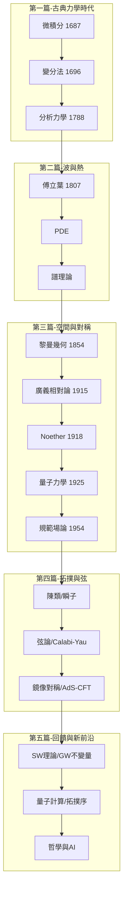

# 0.3 閱讀地圖

## 全景圖

## 依驅動方向的路徑

| 想讀的主題 | 路徑 |
|---|---|
| 物理→數學譜系 | 1, 2, 6.2, 9, 11 |
| 數學→物理譜系 | 3, 4, 5, 8.1–8.2 |
| 雙向共演化 | 4.1, 6, 7, 8, 10, 12 |

## 符號約定

- $c, \hbar, G$：光速、約化普朗克常數、重力常數。
- $L, H$：拉格朗日量、漢米頓量；$S = \int L\, dt$：作用量。
- $A_\mu, F_{\mu\nu}$：規範場、場強（聯絡與曲率）。
- $\psi, \hat H$：波函數、能量算符。
- $g_{\mu\nu}$：度規張量；$ds^2 = g_{\mu\nu}dx^\mu dx^\nu$。

## 練習與思考

1. 挑一條路徑走完，記錄哪些數學在「供給」、哪些在「受惠」。
2. 為什麼 20 世紀後半「雙向」事件比例大增？
