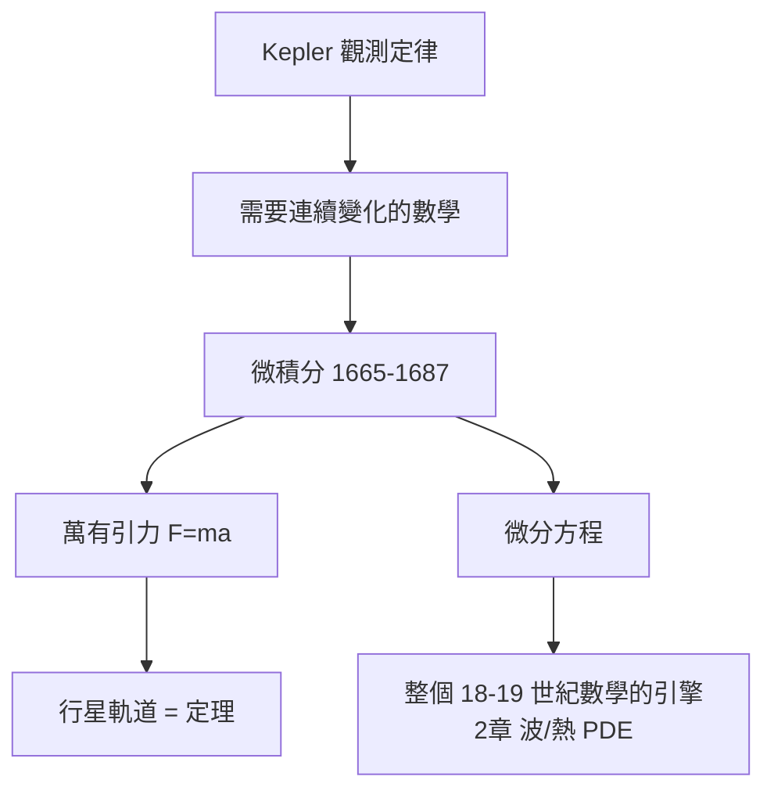

# 1.1 牛頓與萊布尼茲：微積分為力學而生（1687）【物理→數學】

## 前因：行星不聽古典幾何的話

Kepler（1609–19）由觀測歸納三定律，但「為什麼」無人能答。要從「瞬時速度不斷變化」推出橢圓軌道，需要一門描述**連續變化**的數學——古希臘幾何只處理靜態圖形，窮竭法太笨重。牛頓（流數術，1665–）與萊布尼茲（1675–）各自發明微積分；牛頓在《自然哲學的數學原理》（1687）中用它統一了蘋果與月亮。

## 構造

**三個互相支撐的發明**：

1. **導數**：瞬時變化率 $v = \dot x = \dfrac{dx}{dt}$ ——「瞬時速度」從悖論變成定義。
2. **積分**：變力作的功 $W = \int F\, dx$ 、掃過面積。
3. **微分方程**：力學定律本身寫成方程

$$F = m\ddot x \quad \Longleftrightarrow \quad m\ddot x = -\frac{GMm}{r^2}$$

**牛頓的推理鏈**（數學證明物理）：平方反比力 → 圓錐曲線軌道 → Kepler 三定律。物理第一次以「定理」的形式出現。

**萊布尼茲的貢獻**：記號 $\frac{dy}{dx}$ 、 $\int$ ，以及「微積分基本定理」的清晰表述——求積（面積）與求率（切線）互逆。**記號即語言**：萊布尼茲式記號主導了歐陸，使分析學迅速擴張。

## 後果

1. **數學的加速度**：為解力學 PDE，伯努利家族、Euler、Lagrange 開創流體力學、剛體力學、分析學——18 世紀被稱為「力學的世紀」。
2. **嚴格化的債**：無窮小的邏輯漏洞（Berkeley 的批評）要到 19 世紀實分析（見本書姊妹篇 3.1）才還清——**物理先行、邏輯後補**成為常見模式。
3. **預測力的展示**：海王星（1846）由攝動計算預言並被望遠鏡找到——數學預言物理的第一個世紀級案例。

## 練習與思考

1. 由圓軌道 $v^2/r = GM/r^2$ 與 Kepler 第三定律 $T^2 \propto r^3$ 導出 $F \propto 1/r^2$ 。
2. 為什麼「微分方程」的發明比「計算工具」更根本？
