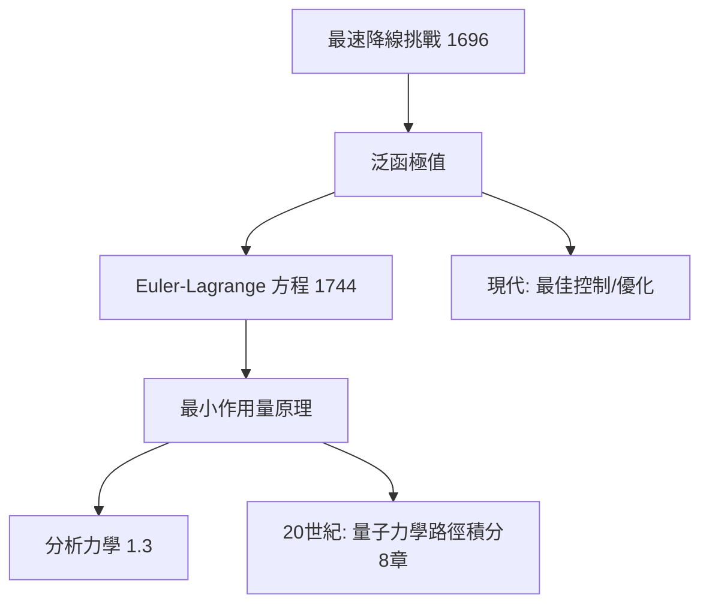

# 1.2 最速降線與變分法（1696）【數學→物理】

## 前因：一個數學挑戰改寫力學

1696 年 Johann Bernoulli 公開挑戰：質點在重力下沿哪條曲線從 $A$ 滑到 $B$ 最快（非直線！）。Newton 匿名一夜解出（擺線）。這類問題的共同點：**極小化的對象不是數，而是整條曲線**——需要全新的數學：變分法。

## 構造

**問題**：極小化泛函

$$T[y] = \int_A^B \frac{\sqrt{1 + y'^2}}{\sqrt{2gy}}\, dx$$

**Euler–Lagrange 方程（1744）**：極值曲線滿足

$$\frac{\partial L}{\partial y} - \frac{d}{dx}\frac{\partial L}{\partial y'} = 0$$

**答案**：擺線（圓滾線）。Bernoulli 用 Fermat 最短時間原理（光學）解出——光線折射與力學質點在數學上**同構**。

**Maupertuis 最小作用量原理（1744–46）**：自然選擇使作用量 $S = \int p\, dq$ 極小的路徑。力學從「力推動質點」改寫為「**整體極值原理決定路徑**」——物理定律獲得變分法的形式。

## 後果

1. **分析力學**（1.3）：Lagrange 把力學完全變分法化。
2. **幾何光學與力學的統一**：Hamilton 延續此同構，發現波動與軌跡的對應——百年後成為 Schrödinger 方程的靈感（4.2）。
3. **諾特定理的地基**（4.1）：對稱與守恆的橋樑就建立在作用量泛函上。
4. **數學內部**：變分法催生泛函分析（函數空間上的微積分）、極小曲面、測地線理論（3.1）。

## 練習與思考

1. 證明：若 $L$ 不顯含 $x$，則 $\frac{\partial L}{\partial y'} y' - L = $ 常數（Beltrami 恆等式），並用它解最速降線。
2. 「局部方程（E–L）」與「整體極值（作用量）」兩種表述為什麼等價又各有優勢？
