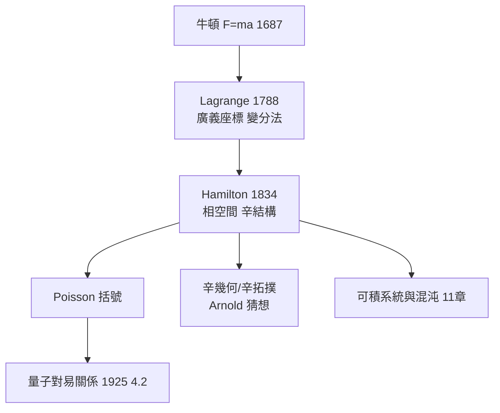

# 1.3 拉格朗日與漢米頓力學：對稱的代數化（1788）【雙向】

## 前因：拋棄力向量，擁抱能量

Lagrange《分析力學》（1788）宣告：本書**沒有一張圖**——力學被完全代數化。廣義座標 $q_i$ （角度、長度……任選）取代笛卡兒座標；約束力自動消失。Hamilton（1834）進一步把方程對稱化。

## 構造

**拉格朗日力學**：以動能減位能定義 $L = T - V$ ，運動方程即 E–L 方程：

$$\frac{d}{dt}\frac{\partial L}{\partial \dot q_i} - \frac{\partial L}{\partial q_i} = 0$$

**漢米頓力學**：以動量取代速度 $p_i = \partial L/\partial\dot q_i$ ，在**相空間** $(q, p)$ 上：

$$H(q, p) = \sum p_i \dot q_i - L, \qquad \dot q_i = \frac{\partial H}{\partial p_i}, \quad \dot p_i = -\frac{\partial H}{\partial q_i}$$

**Poisson 括號**：任意力學量 $f$ 的演化

$$\dot f = \{f, H\}, \qquad \{f, g\} = \sum_i \left(\frac{\partial f}{\partial q_i}\frac{\partial g}{\partial p_i} - \frac{\partial f}{\partial p_i}\frac{\partial g}{\partial q_i}\right)$$

**深刻的發現**： $\{f, g\} = 0$ 時 $f$ 是守恆量——**守恆律 = 與漢米頓量交換**。這個代數結構（辛流形上的括號）正是 100 年後量子力學對易關係 $[\hat f, \hat g] = \mathrm{i}\hbar\{f,g\}$ 的原型（4.2）。

**幾何化身**：相空間上有自然辛形式 $\omega = \sum dq_i \wedge dp_i$ ；漢米頓流 = 辛流形上的流。**物理逼出的座標變換不變量，正是辛幾何的誕生**——這是「不變量思想」（Erlangen 前奏）在力學中的獨立發現。

## 後果

1. **量子力學的直譯**：矩陣力學（Heisenberg）= 把 Poisson 括號換成對易子；路徑積分（Feynman）= 作用量泛函的量子版（8 章伏筆）。
2. **辛幾何成為獨立領域**：Arnold 猜想、Gromov 非擠壓定理（1985）——由物理相空間啟發的純數學。
3. **可積系統**：劉維爾定理、KAM（11.2）——「哪些系統可解」的數學判準。
4. **本書觀點**：這是第一次「物理結構 → 數學結構」的完整搬運：力學的座標不變性直接預演了群論的不變量哲學。

## 練習與思考

1. 驗證單擺的 $L = \tfrac12 ml^2\dot\theta^2 + ml^2\omega^2\cos\theta$ 的 E–L 方程回到 $\ddot\theta = -\omega^2\sin\theta$ 。
2. 為什麼「守恆 = 與 H 交換」預示了量子力學的測量理論？
