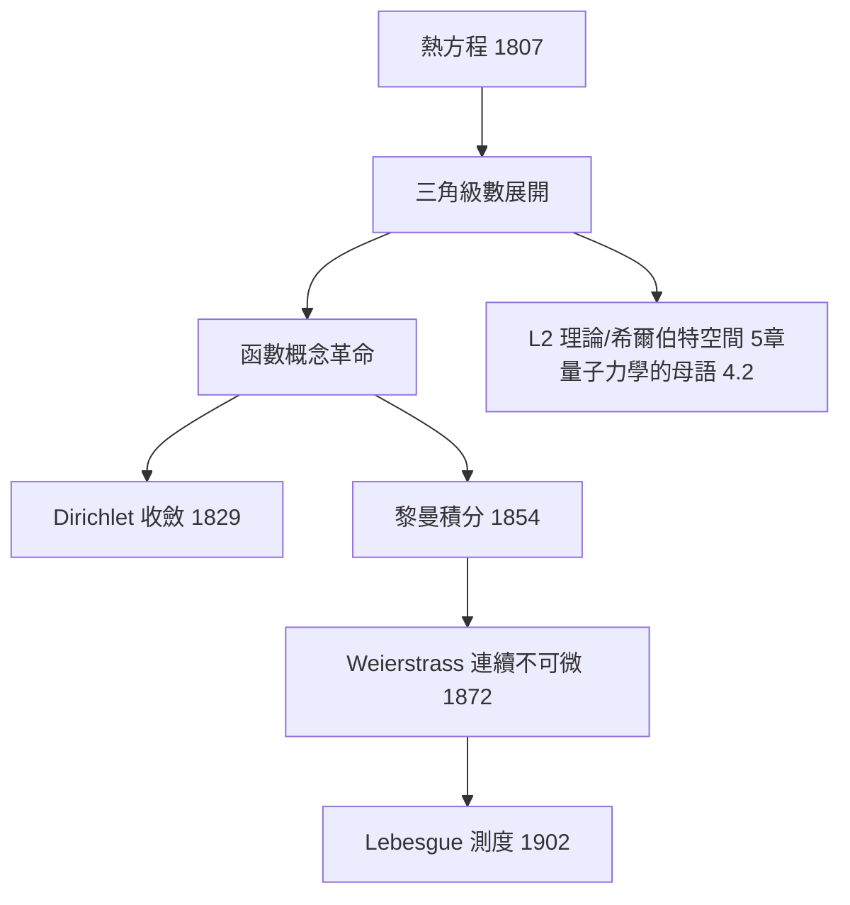

# 2.1 傅立葉級數：熱傳導逼出函數概念的革命（1807）【物理→數學】

## 前因：一根熱棒的數學危機

Fourier 研究熱傳導（1807 論文、1822《熱的解析理論》），斷言：**任意函數**都能展開為三角級數：

$$f(x) = \frac{a_0}{2} + \sum_{n=1}^\infty \left(a_n \cos\frac{n\pi x}{L} + b_n \sin\frac{n\pi x}{L}\right), \qquad a_n = \frac1L\int_{-L}^L f(x)\cos\frac{n\pi x}{L}\,dx$$

當時的「函數」定義是解析式（一個公式）。但鋸齒波、方波（斷點函數）也能展開？——**函數概念被迫革命**：函數可以是任意的點對點對應。這是「物理問題改寫數學定義」的教科書案例。

## 構造

**熱方程**：

$$\frac{\partial u}{\partial t} = \alpha \frac{\partial^2 u}{\partial x^2}$$

分離變數 $u = X(x)T(t)$ 得特徵函數 $\sin(n\pi x/L)$——**三角函數是 Laplacian 的特徵函數**（本書姊妹篇 11.1 譜理論的物理起源）。疊加原理 + 初始條件的展開係數 = 傅立葉係數。

**數學家的爭論與回應**：

| 批評 | 回應 | 誕生 |
|---|---|---|
| 任意函數真能展開？ | Dirichlet（1829）證明分段光滑函數可展 | 收斂理論 |
| 收斂在斷點如何？ | Gibbs 現象（1848） | 黎曼積分（1854） |
| 「任意」到底多任意？ | 黎曼函數（不可積函數） | 實分析危機 → Lebesgue（1902） |

## 後果

1. **調和分析**：從級數到傅立葉變換、群上的調和分析（Pontryagin 對偶）——訊號處理的數學基礎。
2. **無窮維空間**：「函數是空間中的點」由此萌芽（5.2），最終成為量子力學的語言（4.2、5.3）。
3. **純數學的誕生**：嚴格化傅立葉級數的需求直接生產了 19 世紀分析學的骨架（極限、積分、一致收斂）。
4. **本書觀點**：這是「物理→數學」模式的最強案例——**一根熱棒改寫了「函數」的定義**。

## 練習與思考

1. 計算方波 $f(x) = \mathrm{sgn}(\sin x)$ 的傅立葉級數，說明 Gibbs 現象。
2. 為什麼「任意函數可展開」會威脅 19 世紀初的函數定義？
