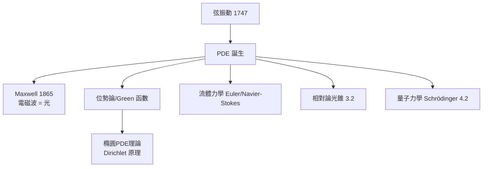

# 2.2 波動方程與偏微分方程的誕生【物理→數學】

## 前因：弦、聲、光都需要「第二階時間導數」

1747 年 d'Alembert 給出弦振動方程

$$\frac{\partial^2 u}{\partial t^2} = c^2 \frac{\partial^2 u}{\partial x^2}, \qquad \text{通解 } u = f(x - ct) + g(x + ct)$$

波以速度 $c$ 傳播——**行波**第一次被數學捕捉。之後 Euler 的流體方程、Maxwell 的電磁方程組（1865）、Schrödinger 方程（1926）：**連續介質的物理全部以 PDE 為語言**。與 ODE 相比，PDE 帶來全新的數學現象（邊界、初值、特徵線）。

## 構造：三大原型與其數學

| 方程 | 物理 | 數學性格 |
|---|---|---|
| 波動方程 | 弦、聲、光 | 雙曲：有限傳播速度、特徵線、能量守恆 |
| 熱方程 | 熱擴散 | 橢圓化/拋物：無窮傳播速度、極值原理、平滑化（12.1 里奇流的祖先） |
| Laplace 方程 $\Delta u = 0$ | 靜電勢、穩態 | 橢圓：調和函數、極大值原理、解析性 |

**新數學現象**：

1. **邊界條件決定一切**：Dirichlet/Neumann 條件下的解存在唯一（後成為 Hilbert 空間正定算子理論，5.3）。
2. **特徵線**：訊息沿特定曲線傳播——雙曲方程的因果結構，後成為相對論光錐的數學（3.2）。
3. **Green 函數（1828）**：把求解化為積分算子——「點源的影響函數」，預示分佈理論。
4. **最大值原理**：橢圓/拋物方程解的極值在邊界/初始——唯一性與穩定性的引擎。

## 後果

1. **Maxwell 的預言**：從 PDE 的波速 $c = 1/\sqrt{\epsilon_0\mu_0}$ 恰為光速，推斷光是電磁波——**數學推理預言物理現象**的經典。
2. **位勢論與幾何**：Dirichlet 原理的修復（Hilbert）催生泛函分析；調和映射、極小曲面成為幾何分析。
3. **本書觀點**：PDE 是物理輸出給數學的最大單筆資產——20 世紀幾何分析（Yau、Perelman）的整個譜系源於此。

## 練習與思考

1. 用變數代換 $\xi = x - ct,\ \eta = x + ct$ 解波動方程。
2. 為什麼「有限傳播速度」是波動方程與熱方程的本質差異？
