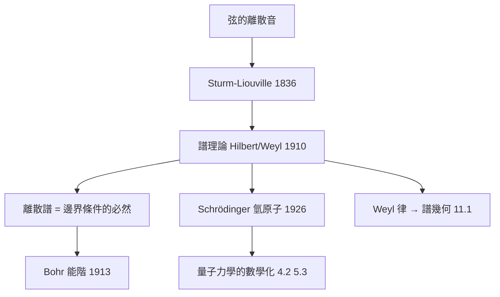

# 2.3 弦振動與譜理論（1910）【雙向】

## 前因：從可聽的音到不可聽的譜

吉他弦只發特定頻率——邊界條件 $u(0)=u(L)=0$ 使 $-u'' = \lambda u$ 只在 $\lambda_k = (k\pi/L)^2$ 有非零解。19 世紀的 Sturm–Liouville 理論（1836–）系統化此現象；1910 年前後，Hilbert、Weyl 把它抽象化為**譜理論**：微分算子在希爾伯特空間上的特徵值問題（本書姊妹篇 11.1）。

## 構造

**Sturm–Liouville 問題**：

$$-(p(x)u')' + q(x)u = \lambda\, w(x) u, \qquad u(a) = u(b) = 0$$

**三大定理**（全部成為量子力學的數學支柱）：

1. **特徵值實且離散**、遞增趨於 $\infty$；
2. **特徵函數正交**（配權 $w$）——任意初值可展開（廣義傅立葉）；
3. **Weyl 漸近律**（1911）：$N(\Lambda) \sim \dfrac{\Lambda^{1/2}}{\pi}\int_a^b \sqrt{w/p}\,dx$——**頻率計數讀出「介質的體積」**。

**量子化的直接先聲**：Bohr 原子（1913）的離散能階在數學上正是「邊界條件 → 離散譜」。Schrödinger（1926）解氢原子：

$$-\frac{\hbar^2}{2m}\Delta\psi + V\psi = E\psi$$

離散 $E_n$ 不是假設而是**特徵值問題的必然**——物理的量子化被譜理論「免費」給出。

## 後果

1. **譜定理與量子力學**（5.3）：可觀測量 = 自伴算子、測量值 = 譜。
2. **譜幾何**：「聽鼓」（11.1）——譜讀出幾何，源頭就是 Weyl 想從弦音讀出弦長。
3. **數論的意外連結**：Selberg trace formula（1956）把「譜 ↔ 閉測地線」對偶化，成為 Langlands 綱領分析端的工具（姊妹篇 10.1）。
4. **本書觀點**：譜理論是「物理→數學→物理」雙螺旋的完整樣本：弦音生譜理論，譜理論生量子力學，量子力學再生現代譜幾何。

## 練習與思考

1. 解 $-u'' = \lambda u$（$u(0)=u(L)=0$），驗證正交性 $\int_0^L \sin\frac{m\pi x}{L}\sin\frac{n\pi x}{L}dx = 0$。
2. 為什麼「量子化」不需要新公理，只需要特徵值問題？
