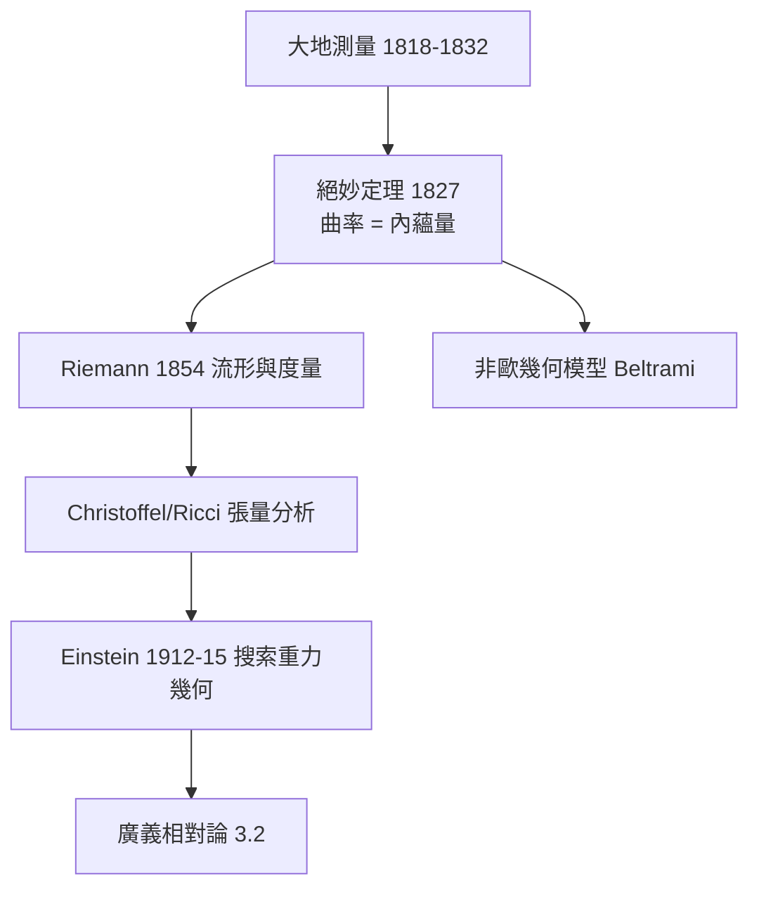

# 3.1 高斯測地測量與內蘊幾何（1827）【雙向】

## 前因：丈量地球的大師問出深刻問題

Gauss 主持 Hanover 王國的大地測量（1818–1832），在真實（彎曲）地表上做三角測量。他發現：**地表上的生物無需離開地面，就能測出地面的彎曲**——曲率可以完全由地表內的距離決定。

## 構造

**Gauss 曲率的內蘊公式**（Theorema Egregium, 1827「絕妙定理」）：

$$K = \kappa_1 \kappa_2$$

（兩主曲率之積）**是內蘊不變量**——只依賴第一基本形式 $g$（距離的平方），不依賴嵌入方式。球面 $K = 1/R^2$ 恆正，任何攤平嘗試都會撕裂（地圖必然失真）。

**測地三角形**：Gauss 實測三山三角形的內角和，嘗試探測物理空間是否彎曲——60 年後 Riemann 與 90 年後 Einstein 走上同一路。

**Riemann（1854）的推廣**：把 Gauss 的二維內蘊幾何推廣到任意維：

$$ds^2 = \sum_{i,j} g_{ij}(x)\, dx^i dx^j, \qquad K \text{ 由 } g \text{ 及其導數決定（Riemann 張量）}$$

**Christoffel、Ricci、Levi-Civita（1869–1900）**：發展張量分析——協變導數、Ricci 張量——**為「任何座標系都成立的物理定律」備好文法**。

## 後果

1. **廣義相對論**（3.2）：Einstein 1912 年向好友 Grossmann 求助，學到的正是 Ricci 與 Levi-Civita 的張量分析——**數學等了 60 年**。
2. **內蘊觀點的擴散**：流形不需要嵌入背景空間——宇宙就是自己的幾何。
3. **測地線 = 自由落體**：物理運動與幾何極值線合流（1.2 變分法的重逢）。
4. **本書觀點**：這是「雙向」的早期標本：物理實務（測量）啟發純數學（內蘊幾何），純數學反過來在 60 年後拯救物理。

## 練習與思考

1. 為什麼圓柱面可攤平（$K = 0$）而球面不能？
2. 「內蘊」與「外在」的區別，對「宇宙是否有背景空間」這一問題有何含義？
